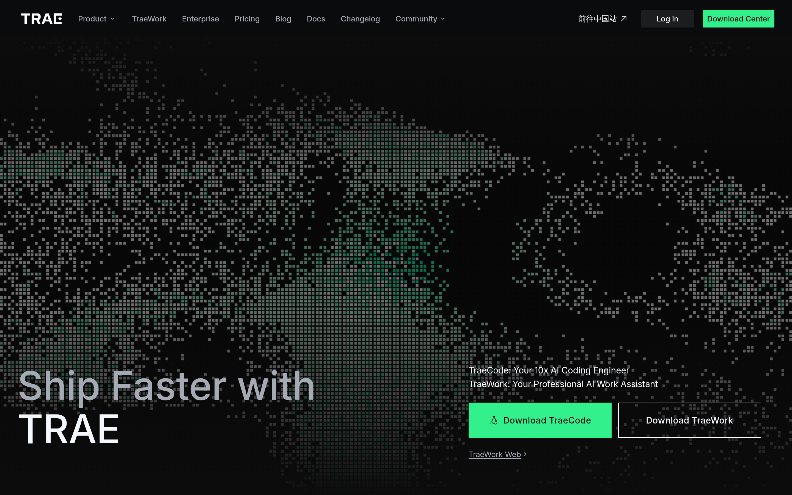
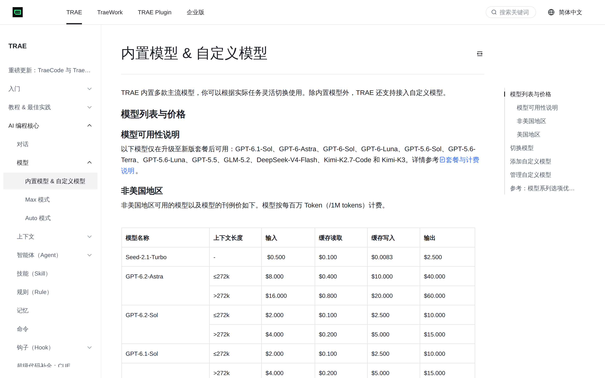

# 附录 A.2 TRAE 版（预算敏感、想看到编辑器界面）

> 学习目标：了解字节跳动基于 VS Code 打造的 AI 编程编辑器 TRAE（含国内版 `trae.cn` 与国际版 `trae.ai`、`TraeCode` IDE 与 `SOLO` 模式）的界面优势、模型与费用边界，学会把 `ai-radar` 项目无缝放进 TRAE 里用可视化文件树和红绿 Diff 做监工。
>
> 演示环境：TRAE 官网（[trae.ai](https://www.trae.ai/) / 国内版 [trae.cn](https://www.trae.cn/)）与官方中文文档（[docs.trae.ai/ide/models](https://docs.trae.ai/ide/models)，2 张实景截图均采集于 2026 年 11 月 24 日）。

---

## 1. 「我想要一个左看文件、中看代码、右看 AI 的可视化大屏，还想省预算？」

在主线课程里，我们用 DeepSeek Harness 网页版和终端帮你练熟了看目录、读 Python、看 `git diff` 的硬功力。但很多预算敏感、或者更习惯传统图形软件的学员会提一个非常实在的诉求：

- 「我不太习惯在网页和终端窗口之间来回切，能不能把**左侧文件夹树 + 中间代码/配置预览 + 底部终端 + 右侧 AI 对话和红绿 Diff 按钮**全装进同一个可视化窗口里？」
- 「最好还能国内直连安装、自带免费入门额度，而且支持接入我自己的 API Key！」

这一类「把 AI 深度嵌进代码编辑器」的工具叫 **AI IDE**（代表包括 Cursor、Windsurf 和字节跳动的 **TRAE**）。这篇全课收官附录带你 5 分钟摸清国产代表 **TRAE** 怎么无缝接住你已经搭好的 `ai-radar` 项目。

---

## 2. 系统位置：把「文件夹 + 记事本 + 终端 + AI 对话」装进同一张工作台

```
主线 DSH / Codex CLI（极简清爽）：终端 / 网页对话 + 独立编辑器看文件
                        ↕ 底层文件 100% 互通（打开同一个 ai-radar 文件夹！）
AI IDE 路线（TRAE / TraeCode）：左栏文件树 │ 中间源码与 YAML │ 右栏 AI 对话 & 红绿 Diff   ← 【本篇位置】
                                       └───── 底部内置终端（直接跑 python3 / git）─────┘
```

一句话分清适用人群：**想要一个开箱即用的可视化中文编辑器大屏、对入门预算敏感的学员，选 TRAE 国内版或国际版非常顺手；而且它底层打开的依然是你本地那份 `ai-radar` 文件夹，随时可以和 DSH / Codex 混用。**

---

## 3. 讲清楚：TRAE 国内版 vs 国际版 + 与主线课程的一一映射

### 3.1 第一步别下错：认清「中国站（`trae.cn`）」和「国际站（`trae.ai`）」

打开 TRAE 官网时，先看清右上角的 **「前往中国站 ↗」** 入口，两者面向不同网络与账号体系：

| 对比项 | TRAE 国内版（`trae.cn`） | TRAE 国际版（`trae.ai`） |
|---|---|---|
| **网络与登录** | 国内直连下载与登录，手机号/国内账号友好 | 面向海外网络环境，支持国际账号体系 |
| **内置模型生态** | 侧重国内合规可用大模型（如豆包 Seed、DeepSeek、Kimi、GLM 等） | 内置多款国际与国内主流模型（详见下图官方中文文档，按地区区分可用列表），同时支持自定义模型（BYOK） |
| **核心形态** | 基于 VS Code 打造的桌面编辑器（`TraeCode` 经典 IDE 模式 + 智能体优先的 `SOLO` 模式） | 同步提供 `TraeCode` IDE（含 `SOLO` 模式）与 `TraeWork` 办公助手 |
| **费用定位** | 对入门学习者友好（具体免费额度与付费档位以官网实时公告为准） | 提供免费入门档与按 Token 用量计费的多档付费订阅，亦可接入自有 API Key |

### 3.2 主线概念 ⇄ TRAE 编辑器一一映射

把你前 32 课练出来的监工习惯带进 TRAE，几乎是「所见即所得」：

| 主线课程学过的概念 | 在 TRAE 编辑器里的对应位置 | 监工实操好处 |
|---|---|---|
| **工作区目录（1.5 / 3.1）** | 菜单「文件 → 打开文件夹」选 `ai-radar`，左侧资源管理器直接展开 `data/`、`scripts/`、`config.yaml`、`output/` | 一眼就能看全目录结构，点一下 `config.yaml` 直接改参数保存 |
| **项目说明书 `AGENTS.md`（5.2）** | 官方文档左侧栏专设 **「规则（Rule）」**、**「技能（Skill）」**、**「记忆」** 模块（同时兼容读取项目里的规则说明文件） | 把 `practice/AGENTS.md` 里的 5 板块规则直接复用到项目规则里，持续生效 |
| **先计划后动手（5.1）** | 右侧对话框里可切换经典对话模式与智能体优先的 **`SOLO`** 模式，同样先让它列计划再批准执行 | 复杂任务交给 `SOLO` 分步拆解，小改动在经典对话里点点改完 |
| **读懂 `diff`（4.2）** | AI 改完代码后，中间编辑器直接用醒目的 **红色底纹（删除行）** 和 **绿色底纹（新增行）** 高亮展示，并提供逐块「接受 / 拒绝」按钮 | 不用敲命令也能直观审 Diff，验收完顺手在底部内置终端敲 `git diff --stat` 双重把关 |
| **隐私与密钥安全（3.4）** | 设置里检查 **「隐私模式（Privacy Mode）」**（防止对话用于模型训练），真实密钥仍只放本地 `.env` | 绝不因为换了 IDE 就把 `.env` 放进 Git 或把红灯原表直接丢进对话框 |

**最常见的误解**：以为「用了可视化 IDE，AI 帮我点『接受』改完文件，我就不需要学 Git 了」。**千万别丢掉 Git！** 编辑器自带的「撤销（Undo）」一旦关掉软件或连改五六轮就很容易失效；在 TRAE 底部打开内置终端，依然坚持「大改前先 `git commit` 存档、验收完看 `git diff`」，才是最稳的双保险。

---

## 4. 现场看：核对 TRAE 官网入口与官方中文文档能力全景

### 现场 ①：TRAE 官网首页——认准 `TraeCode` 下载入口与「前往中国站」

打开 [trae.ai](https://www.trae.ai/) 首页，右上角清晰标出 **「前往中国站 ↗」**，右下角区分了编程编辑器 **`Download TraeCode`** 与办公助手 **`Download TraeWork`**：



### 现场 ②：TRAE 官方中文文档——一眼认出全套熟面孔概念

再看一眼官方简体中文文档 `docs.trae.ai/ide/models`：



盯住左侧中文导航栏，你会发现全是你学过的老朋友：**「对话」「模型（内置 + 自定义模型）」「上下文」「智能体（Agent）」「技能（Skill）」「规则（Rule）」「记忆」「命令」「钩子（Hook）」**——连右侧的模型计价表都写着每百万 Token（`/1M tokens`）输入价和输出价，正好接上你第 0.1 课和 M2 课用 OpenRouter 数据算过的账！

### 现场 ③：在 TRAE 里打开 `ai-radar` 的 4 步上手流

1. **打开项目**：安装对应版本（国内用户直接从 `trae.cn` 下载安装），启动后点击「打开文件夹」，选中你本地的 `ai-radar`（即配套仓库的 `practice/`）；
2. **核查安全开关**：第一时间进设置确认开启隐私保护选项，核对 `.gitignore` 已忽略 `.env`、`.venv/`、`output/`；
3. **导入规矩与发任务**：让右侧 AI 先阅读项目里的 `AGENTS.md`（或把核心红线填进项目的「规则 Rule」），按四要素发出修改需求；
4. **红绿 Diff 验收 + 内置终端自检**：在中间代码区逐块核对红删绿增后点接受，在底部内置终端运行 `python3 scripts/daily_briefing.py` 和 `git diff --stat` 完成验收存档。

> `[可选补拍：作者在个人电脑安装 TRAE 国内版并打开 ai-radar 文件夹，实拍「左侧文件树 + 中间红绿 Diff 接受/拒绝按钮 + 右侧对话 + 底部终端」四合一工作台实机截图]`

---

## 5. 你来读：这 3 位学员，分别该留在主线 DSH / Codex，还是改用 TRAE？

停下来想 10 秒，用全套课程建立的选型视野做判断：

1. **学员 A**：预算很紧，想国内直连免费先练手，而且特别喜欢在同一个窗口里左边点开文件看 `config.yaml`、中间看红绿高亮改动、下面直接跑 `python3`。
2. **学员 B**：公司严禁安装任何第三方桌面软件，只允许在云端网页浏览器或公司统一采购的飞书里办公。
3. **学员 C**：想在 TRAE 里接入自己平时买好的 DeepSeek API Key，担心 TRAE 只能用自带内置模型，不能换自己的 Key。

**判断思路**：
1. **学员 A 非常适合 TRAE（国内版 `trae.cn`）**：可视化四合一编辑器的直观体验 + 国内直连与友好入门额度，完美契合需求。
2. **学员 B 不要强行装 TRAE 桌面端**：严格遵守公司 IT 规范，优先评估公司批准的飞书 / 豆包工作（附录 A.1）或合规云端方案。
3. **学员 C 可以放心接入**：正如上面官方中文文档截图所写——「除内置模型外，TRAE 还支持接入自定义模型」，按需填入自有 API Key 即可（依然记得在服务商后台设消费硬上限）。

---

## 6. 小检查（3 道判断题）

1. 在 TRAE 里打开你之前用 DeepSeek Harness 创建的 `ai-radar` 文件夹，里面的 `config.yaml`、`AGENTS.md`、`.venv` 和 Git 历史都能直接继续使用。（对 / 错）
2. 因为 TRAE 自带图形化红绿 Diff 和「撤销」按钮，所以用上 TRAE 以后就可以彻底不用 Git 做提交存档了。（对 / 错）
3. 使用任何 AI IDE 处理公司黄灯内部业务资料前，同样应该先核查设置里的隐私模式开关，且严禁把含真实隐私的红灯原表直接喂进云端模型。（对 / 错）

---

## 7. 全课结语：写给已经毕业的你

到这里，**《给 AI 当监工》全部 32 节正课 + 2 篇国产备选附录正式全剧终！**

回顾你走过的完整旅程：
- **M0–M1**：看透「Agent = 模型 + 执行框架」，不再怕黑框终端与路径，4 秒拦住危险命令；
- **M2**：不靠死记语法，照样读懂 AI 写的 Python 变量、循环、函数与报错；
- **M3–M4**：搭起标准工程骨架、守住密钥与数据三灯红线，学会用 Git 存档、看 `diff`、开分支与审 GitHub PR；
- **M5–M7 + 附录**：掌握四要素需求、`/plan` 先审后做、`AGENTS.md`、定时自动化，并且亲手证明了这套本领在 DeepSeek Harness、OpenAI Codex、豆包工作与 TRAE 之间全部通用。

AI 工具每个季度都会换新皮肤，但**看懂边界、管住风险、验收结果**的监工眼光只会越来越值钱。合上这门课后，立刻去把你工作里最烦的那一件每周重复劳动，做成你的第一件趁手工具吧！

---

## 小检查答案

1. **对**。项目文件、配置文件与 Git 仓库全部保存在本地标准目录中，任何 AI 工具都能无缝打开协同。
2. **错**。IDE 撤销只在短期编辑内有效，跨轮次、跨文件的可靠历史存档和一键回退依然要靠 Git。
3. **对**。隐私开关、最小权限、密钥隔离和「本地脚本先脱敏」是跨所有工具通用的最高红线。

---

## 参考与事实边界

- **官方资料与实景截图**（均采集于 2026-11-24）：
  - TRAE 国际站官网：[trae.ai](https://www.trae.ai/)（顶部提供国内站 [trae.cn](https://www.trae.cn/) 入口，首页区分 `TraeCode` 与 `TraeWork`）；
  - TRAE 官方简体中文文档：[内置模型 & 自定义模型 — TRAE 文档](https://docs.trae.ai/ide/models)（明确说明支持内置多模型与自定义模型接入，并列出智能体、技能、规则、记忆、命令、钩子等核心能力模块）。
- **作者说明**：TRAE 国内版与国际版的免费额度、模型清单及套餐价格会随官方策略动态更新，下载与开通前请以对应官网最新说明为准；桌面 IDE 实机编码截图按 `docs/decisions.md` 约定保留 `[可选补拍]` 标注。
