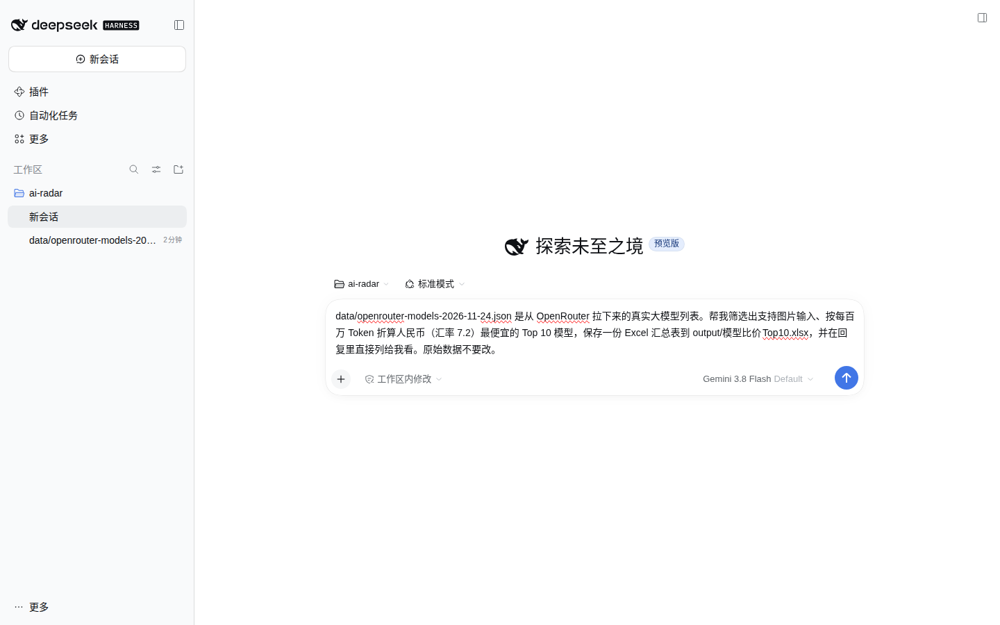
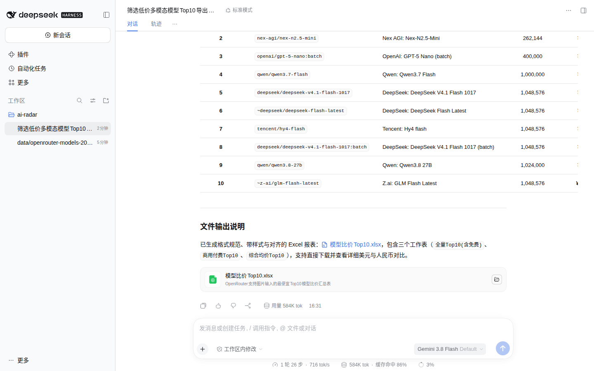

# 0.1 AI 不是在聊天，是在「干活」

> 学习目标：说清 Agent = 模型 + Harness；看懂 AI 在你电脑上「读 → 改 → 跑 → 看 → 再改」的完整循环，知道自己要在哪里盯住它。
>
> 演示环境：DeepSeek Harness 网页版 `0.2.2-rc.5`，模型 `Gemini 3.8 Flash`。演示工作区 `ai-radar`，原始数据来自 [OpenRouter 公开模型目录](https://openrouter.ai/api/v1/models) 2026 年 11 月 24 日真实快照（共 470 个模型）。**本课只看不装**——先看懂 AI 怎么干活、怎么验收，安装步骤留在第 1.4 课手把手带你完成。

---

## 1. 先看一个真实翻车现场

在开始前先放宽心：**这一课你什么软件都不用装，也不用敲任何命令，跟着看一遍就行。** 等后面把路径、终端和危险命令认清楚，到了第 **1.4 课** 再正式把工具装到你电脑上。

整套课我们围绕一个你自己日常真能用上的实战项目展开：**`ai-radar`（AI 选型与每日情报雷达）**。假设你负责给团队挑一款支持看图（多模态）且性价比高的大模型，用来批处理票据、截图或商品图。你刚从 OpenRouter 拉下来一份真实模型报价快照 `data/openrouter-models-2026-11-24.json`，里面整整躺着 **470** 个模型的参数和单价。

以前用网页聊天框，你得把大 JSON 切碎贴进去问，或者让 AI 给你写段代码，再自己去电脑上折腾环境、复制粘贴。

这次我们用 DeepSeek Harness，选中 `ai-radar` 这个工作区文件夹，把任务直接发出去：

> `data/openrouter-models-2026-11-24.json` 是从 OpenRouter 拉下来的真实大模型列表。帮我筛选出支持图片输入、按每百万 Token 折算人民币（汇率 7.2）最便宜的 Top 10 模型，保存一份 Excel 汇总表到 `output/模型比价Top10.xlsx`，并在回复里直接列给我看。原始数据不要改。



很快，AI 交出一份看起来非常工整的汇报：已经从 470 个模型里筛完并折算好人民币，生成了带格式的 `output/模型比价Top10.xlsx`，里面还贴心分了三个工作表——「全量Top10(含免费)」「商用付费Top10」「综合均价Top10」。



如果你直接把这张比价表发进团队选型群，当天下午就会出洋相。

打开 `output/模型比价Top10.xlsx` 逐行一核对，里面藏着 **3 个硬伤**：

1. **「商用付费Top10」里混进了离线批处理版和重复别名**：排第 1 的 `z-ai/glm-5.3-flash:batch`、第 3 的 `openai/gpt-5-nano:batch`、第 8 的 `deepseek/deepseek-v4.1-flash-1017:batch` 后面都带着 `:batch`——这是离线批处理接口（便宜但不能实时对话，发出去要等后台慢慢排完返回）；而第 5 名 `deepseek/deepseek-v4.1-flash-1017` 和第 6 名 `~deepseek/deepseek-flash-latest` 其实是同一个模型（`~` 开头是动态别名），白占了两个名额。
2. **「全量Top10(含免费)」里塞进了音乐生成模型**：排第 7 的 `google/lyria-3-pro-preview` 和第 8 的 `google/lyria-3-clip-preview` 标价 `¥0.00`，看着很划算，但它们是 Google 的**音乐生成模型**（输出是音频，根本不能做文字问答）。
3. **只按输入价排，掉进了「低入高出」的坑**：「商用付费Top10」第 9 名 `qwen/qwen3.8-27b` 输入价只要 `¥0.252/百万 Token`，但输出价飙到了 `¥10.80/百万 Token`，比旁边模型贵了 10 到 20 倍。

AI 全程没有中断报错，也没有停下来提醒你这些口径问题，反而自信地交了差。

这件事点出了整套课的前提：**这类 AI 工具不再只是陪你聊天的对话框，它直接进你文件夹读写文件、写脚本、跑程序；它能替你干掉大部分重复劳动，但没法替你兜底业务口径。** 你不需要自己从头写代码，你需要看得懂它在电脑上动了什么、怎么验收它的结果。

---

## 2. 系统位置：AI 干活的完整流程

在开始拆概念前，先把整条链路摆出来。你发出一条指令到拿到结果，中间经过五个固定环节：

```
你下达任务（自然语言）
      ↓
Harness 把文件夹信息、可用工具和你刚才的话打包，送给模型
      ↓
模型决定下一步动作（例如：先看 JSON 结构 / 写一段 Python 脚本 / 运行脚本）
      ↓
Harness 在你电脑上真正执行动作（需审批时弹窗问你）
      ↓
Harness 把执行结果（文件内容、程序输出、报错）送回给模型
      ↓
模型看结果：没做完或出错就继续循环；做完了才整理文字回复你
```

这套课程里的 31 节课，每一课都在帮你看懂上面这条链路里的某一环：

- **M1（电脑基本功与安装）**：先看懂路径、终端命令和危险命令识别，再装好 DeepSeek Harness、划清工作区和权限边界；
- **M2（读懂 Python）**：看懂模型写出来替你洗数据、算价格的脚本；
- **M3（项目结构与安全）**：看懂文件夹怎么组织、配置文件和 API 密钥怎么管；
- **M4（Git 与 GitHub）**：看懂怎么给文件留存档、看改动差异、挑靠谱开源项目；
- **M5–M7（协作、定时与迁移）**：把模型比价和每日 AI 情报早报接成定时自动运行的 `ai-radar`，再把同一套方法迁到 Codex 或国产工具上。

这一课先把最核心的两个零件和一个循环讲清楚：**模型**、**Harness**，以及它们配合出来的**干活循环**。

---

## 3. 讲清楚三个核心概念

### 3.1 模型（Model）和 Harness：拆开看 Agent

平时大家笼统地把能自动干活的 AI 叫做 **Agent（智能体）**。拆开来看，它由一套配合工作的组件组成，最核心的是两半：

$$\text{Agent} = \text{模型（Model）} + \text{Harness（执行框架 / 脚手架）}$$

把它翻译成普通话：

- **模型（Model）**：负责思考和做决定。这一课演示用的是 `Gemini 3.8 Flash`（你也可以换成 DeepSeek 或其他模型）。
  - **它接收什么**：对话记录、当前文件夹的基本信息、上一步工具返回的结果。
  - **它产出什么**：要么是一段回复你的文字，要么是一个「调用某个工具」的指令（例如「用 `bash` 工具跑一段 Python 检查 JSON 字段」或「写一个 `build_top10.py`」）。
  - **它不做什么**：模型本身只运行在远程服务器上，碰不到你电脑里的任何文件，也没法自己敲命令。
- **Harness（中文常译作「执行框架」「脚手架」或「运行外壳」）**：就是你装在电脑上的软件本体，例如这课用的 DeepSeek Harness（简称 DSH），后面 M7 会讲的 Codex 也是另一种 Harness。
  - **它接收什么**：你的输入，以及模型发回来的工具调用指令。
  - **它产出什么**：在本地真正读文件、改文件、运行命令、弹出权限审批框，再把结果传回模型，同时在界面上把进度、轨迹、改动差异展示给你。
  - **它不做什么**：它不替你做智能判断，怎么拆解任务、写什么筛选条件、遇到报错怎么修，还是由背后的模型决定。

**最常见的误解**：把软件和模型混成一回事。比如以为「用了 DeepSeek Harness 就只能用 DeepSeek 模型」，或者以为「模型很聪明，所以工具一定不会误删文件」。实际上，DeepSeek Harness 支持接 DeepSeek、Gemini、OpenAI、Anthropic 等多种模型；而你电脑上的文件安全边界，靠的是 Harness 的权限控制和你自己的审批，而不是指望模型「自觉」。

在 `ai-radar` 的例子里：`Gemini 3.8 Flash` 决定「先读 `data/openrouter-models-2026-11-24.json` 的数据结构，再算人民币单价、导出 Excel」；DeepSeek Harness 负责在 `ai-radar` 文件夹里真正跑命令、生成 `output/模型比价Top10.xlsx`，并在需要突破沙箱权限时弹窗问你「拒绝」还是「允许一次」。

### 3.2 「读 → 改 → 跑 → 看 → 再改」循环

网页版聊天框通常是一问一答：你发一段字，模型回一段字，流程结束。

Agent 干活是一圈一圈转的。每转一圈，Harness 记作一步（step）：

1. **读（Read）**：先看工作区里有什么文件、JSON 里有哪些字段（价格是美元字符串还是数字、输入输出模态长什么样）。
2. **改（Edit / Write）**：根据读到的情况，新建或修改脚本文件（比如 `build_top10.py`）。
3. **跑（Run）**：在终端里执行脚本（比如 `python3 build_top10.py`），让电脑真正把 470 个模型筛一遍、生成 Excel。
4. **看（Observe）**：读命令的输出或报错。如果出错了，或者发现结果异常，就把信息带进下一轮。
5. **再改（Iterate）**：针对问题改代码、重跑，直到模型认为任务达标，才停下来给你写总结。

刚才那次模型比价任务，我们只发了 1 条消息，但界面最底下显示：**`1 轮 26 步`**（消耗 `584K tok`，缓存命中 `86%`）。也就是说，在你以为 AI 只是转了一会儿圈的背后，模型和 Harness 已经来回配合了 26 步。

### 3.3 轨迹（Trajectory）和代码差异（Diff）

因为 AI 在后台走了 26 步，只看最后那句「已生成格式规范的 Excel 报表」，你根本不知道它中间有没有偷懒、漏了什么过滤条件。DSH 网页版在设置里打开「显示代码工作视图」后，会给出两个监工最常用的视图：

- **「轨迹」（Trajectory）**：按时间顺序把每一步摊开——哪一步调用了 `bash`（命令行工具），哪一步写了文件，哪一步返回了红色报错，一目了然。
- **代码差异（Diff，界面上显示为「第 N 轮改动」）**：点开 AI 新建或修改的文件，用绿色 `+` 标出新增的行，用红色 `-` 标出删掉的行。你不需要自己从头写代码，扫一眼绿字和红字，就能确认它到底把筛选口径写对没有。

---

## 4. 现场看：把 AI 刚干的 37 步摊开

### 4.1 切到「轨迹」，看第 1 轮到底发生了什么

在对话顶部点「轨迹」，就能看到第 1 轮里全部 26 步的流水账：


注意看图里的三个信号：

1. **顶部三行彩色小块（输入 / 模型 / 工具）**：灰蓝块是系统输入，浅紫块是模型思考，橙块是正常执行工具，**红块是工具执行出错**。一次最终顺利交差的任务，背后往往藏着红块报错，AI 自己消化完才继续往下走。
2. **倒数第三行的红色报错**：AI 临交差前想用 `git` 检查原始数据有没有被改动，结果触发报错 `fatal: not a git repository... [exit code: 128]`。下一步它立刻换了一条普通文件查看命令，确认 `data/openrouter-models-2026-11-24.json` 还是原样没动。这就是「跑 → 报错 → 换招再跑」的现场。
3. **为什么它把音乐模型塞进了文字对话表**：看图里第 2 行，AI 在排查价格为 `0` 的模型时，其实**亲手打印出了 `google/lyria-3-pro-preview {'prompt': '0', 'completion': '0'}`**，但因为当时只盯着「支持图片输入」和「价格便宜」、忘了查 `output_modalities`（输出模态是不是文字），照样把音乐生成模型写进了 Top 10。

这就是为什么要懂一点代码常识：AI 的排查步骤看起来很勤快，但只要它没对齐你的业务口径，就会把不合用的东西包装得漂漂亮亮交给你。

### 4.2 给一条明确反馈，看 AI 怎么修完并沉淀成脚本

发现上面 3 个硬伤后，我们在同一个会话里发了第 2 条指令，把监工口径一次说死：

> 我打开你生成的 Excel 看了一下，有 3 个口径问题需要修：
> 1. 商用付费 Top 10 里混进了 `:batch` 离线批处理版（比如第 1 名 `z-ai/glm-5.3-flash:batch`）和 `~` 开头的动态别名（比如 `~deepseek/deepseek-flash-latest`），请全部排除；
> 2. 全量榜里排第 7、8 名的 `google/lyria-3-pro-preview` 和 `google/lyria-3-clip-preview` 是音乐生成模型，不是文字对话模型，请按 `output_modalities` 必须包含 `text` 过滤掉；
> 3. 请把清洗和重算逻辑写成正式脚本 `build_top10.py` 保存在工作区根目录，只保留「商用实时付费 Top 10」：输入价和输出价都必须大于 0、排除 `:free` / `:batch` / `~` 别名，按（输入价+输出价）/2 的综合均价（人民币/百万 Token，汇率 7.2）从低到高排，覆盖生成 `output/模型比价Top10.xlsx`，并在回复里列出修正后的前 5 名。

2 分 11 秒后，AI 完成了第 2 轮（新增 11 步，累计 `2 轮 37 步`），并把规则沉淀成了正式脚本 `build_top10.py`。点开对话框里的 `已编辑 build_top10.py`，右侧直接展开「第 2 轮改动」代码差异面板：


哪怕你今天完全没学过 Python，只扫一眼右边第 38–70 行的绿字，也能立刻看懂它有没有真的照你的口径改：

```python
        # 1. 排除别名与批处理、免费版
        if m_id.startswith("~"):
            continue
        if ":free" in m_id or ":batch" in m_id:
            continue
...
        # 3. 输出模态必须包含 'text'
        if "text" not in outputs:
            continue
        if outputs != ["text"]:
            continue
...
        if p_usd_raw <= 0 or c_usd_raw <= 0:
            continue
```

翻译成白话就是 4 道筛子，凡是踩中任意一条就 `continue`（跳过）：名字 `~` 开头跳过、含 `:free` 或 `:batch` 跳过、输出不是纯文字（`outputs != ["text"]`）跳过、输入价或输出价 `<= 0` 跳过。

修正后的「商用实时付费 Top 5」（汇率 7.2，单位：人民币 / 百万 Token）立刻干净了：

1. `google/gemma-3-4b-it`：综合均价 `¥0.3240`（输入 `¥0.2880` / 输出 `¥0.3600`）
2. `nex-agi/nex-n2.5-mini`：综合均价 `¥0.4500`（输入 `¥0.1800` / 输出 `¥0.7200`）
3. `qwen/qwen3.7-flash`：综合均价 `¥0.5760`（输入 `¥0.2160` / 输出 `¥0.9360`）
4. `tencent/hy4-flash`：综合均价 `¥0.6318`（输入 `¥0.2520` / 输出 `¥1.0116`）
5. `google/gemma-3-12b-it`：综合均价 `¥0.7200`（输入 `¥0.3600` / 输出 `¥1.0800`）

而且这一次把逻辑写进了 `build_top10.py`——下周你拉回一份新的 OpenRouter 快照，不用重新跟 AI 磨一遍口舌，直接跑这个脚本就能按同一套干净口径出表。

---

## 5. 你来读：看这段轨迹，找一找哪里该留心

假设下个月你从 OpenRouter 拉了新快照 `data/openrouter-models-2026-12-01.json`，让 AI 更新一下比价表。你在「轨迹」里看到下面 3 步记录：

```text
步骤 1  工具  bash   {"command": "python3 build_top10.py"}
               → KeyError: 'pricing'
步骤 2  工具  write  {"file_path": "build_top10.py", ...}
               → Updated file build_top10.py (新增：读不到 pricing 时把输入和输出价设为 0.00000001)
步骤 3  工具  bash   {"command": "python3 build_top10.py"}
               → Finished successfully. Top 1: new-vendor/beta-preview (¥0.0720/M)
```

停下来想 10 秒：AI 在步骤 3 汇报 `Finished successfully`，并且帮你列出了「最便宜第 1 名 `new-vendor/beta-preview`」，你应该直接采纳吗？

**判断思路**：绝对不能。步骤 1 报了 `KeyError: 'pricing'`，说明新快照里有模型缺少价格字段（可能是未公布价格的内测模型）。AI 在步骤 2 没有把缺少价格的模型排除掉，反而给它填了一个极小的假数字 `0.00000001`——既盖住了报错，又生造出一个「全场最便宜第 1 名」。正确做法是让它把缺少 `pricing` 字段的模型直接跳过，并单独打印出来给你确认。

---

## 6. 小检查（3 道判断题）

1. DeepSeek Harness 是模型，所以装了它就只能调用 DeepSeek 自家模型。（对 / 错）
2. AI 汇报「已完成」且没有红色报错，说明生成出来的模型比价表口径一定准确。（对 / 错）
3. 「轨迹」视图能看到 AI 后台实际调用了哪些命令和文件，以及中间有没有遇到报错。（对 / 错）

---

## 7. 下一课

这一课你亲眼看到：AI 会自己跑完 26 步交出一张漂亮的 Excel，也会把 `:batch` 离线版和音乐模型混进商用对话榜。下一课 **0.2《你的新角色：AI 的监工》**，我们把「哪些活可以全交给 AI、哪些节点必须人来拍板」列成一张可直接照着用的清单。

---

## 小检查答案

1. **错**。DeepSeek Harness 是 Harness（执行框架），负责在你电脑上读写文件、执行命令和展示界面；背后接哪个模型可以自己配（本课演示就接了 Gemini）。
2. **错**。程序「跑通不报错」只说明语法和执行没中断，不代表业务口径对了——就像本课第 1 轮把 `:batch` 批处理版、音乐生成模型和 `~` 动态别名全混进了 Top 10。
3. **对**。打开「显示代码工作视图」后，在会话顶部的「轨迹」标签页可以看到完整步骤与报错记录。

---

## 参考与事实边界

- **实际操作结果**：本课全部截图、步骤数与统计（第 1 轮 26 步 / `584K tok` / 缓存命中 `86%`；第 2 轮新增 11 步 / `2 分 11 秒` / `442K tok`，累计 `2 轮 37 步` / `1M tok` / 缓存命中 `89%`）、第 1 轮混入 `:batch` / `lyria-3` / `~` 别名及第 2 轮通过 `build_top10.py` 修正后的 Top 5 榜单，均在 DeepSeek Harness `0.2.2-rc.5` + `Gemini 3.8 Flash` 上实际运行获得。
- **公开数据与官方资料**：
  - OpenRouter 公开模型列表接口：[https://openrouter.ai/api/v1/models](https://openrouter.ai/api/v1/models)（本课使用 2026-11-24 离线快照，保存于仓库 `practice/data/openrouter-models-2026-11-24.json`）；
  - DeepSeek Harness 仓库与配置文档：[deepseek-ai/deepseek-harness](https://github.com/deepseek-ai/deepseek-harness)。
- **作者说明**：第 5 节「你来读」里的 12 月快照轨迹片段是为练习设计的模拟案例。
