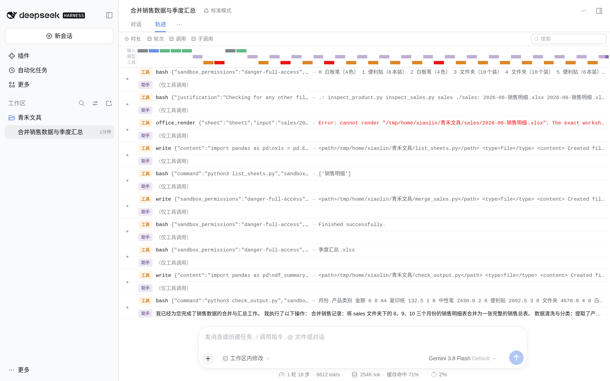
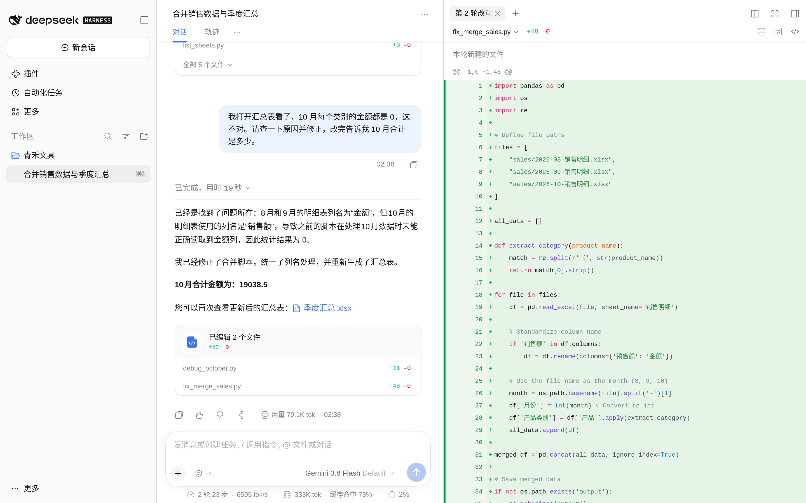

# 0.1 AI 不是在聊天，是在「干活」

> 学习目标：说清 Agent = 模型 + Harness；看懂 AI 在你电脑上「读 → 改 → 跑 → 看 → 再改」的完整循环，知道自己要在哪里盯住它。
>
> 演示环境：DeepSeek Harness 网页版 `0.2.2-rc.5`，模型 `Gemini 3.8 Flash`。演示数据来自虚构公司「青禾文具」。

---

## 1. 先看一个真实翻车现场

「青禾文具」是一家 12 人的文具贸易公司，运营专员小林每个季度都要把 8、9、10 三个月的销售明细表合并成一张总表，再按月份和产品类别算出销售额，交给周老板看。

以前小林用网页聊天框问 AI：把文件拖进去，让 AI 给个思路或者写段 Excel 公式，最后还得自己一张张复制粘贴。

这次小林换了 DeepSeek Harness，选好「青禾文具」这个文件夹，把任务直接发出去：

> `sales` 文件夹里有 8、9、10 三个月的销售明细表。帮我合并成一张总表，再按月份和产品类别统计销售金额，结果保存到 `output/季度汇总.xlsx`。原始文件不要改。


1 分 51 秒后，AI 回复了一段非常工整的汇报：已经合并了 8、9、10 三个月的明细表，提取了产品类别，把总表和汇总表保存到了 `output/季度汇总.xlsx`。底下还列着它刚写完的 5 个 `.py` 文件。


如果小林直接把这张表发给周老板，当天下午就会出事。

打开 `output/季度汇总.xlsx` 里的「产品类别汇总」一看：8 月的 6 个品类合计 `10,842.0` 元，9 月合计 `11,431.5` 元，**10 月 6 个品类的金额全都是 `0.0`**。而 10 月其实有 31 笔订单，真实销售额是 `19,038.5` 元。

AI 既没有报错，也没有停下来提醒，反而自信地交了差。原因很普通：8 月和 9 月的表头写的是「金额」，10 月的表头换成了「销售额」。AI 写脚本时只按「金额」这一列求和，把 10 月整月漏掉了。

这件事点出了整套课的前提：**这类 AI 工具不再只是陪你聊天的对话框，它是直接进你文件夹读写文件、跑程序的干活助手；它能替你干掉大部分重复劳动，但没法替你兜底。** 你不需要自己写代码，你需要看得懂它在电脑上动了什么、怎么验收它的结果。

---

## 2. 系统位置：AI 干活的完整流程

在开始拆概念前，先把整条链路摆出来。你发出一条指令到拿到结果，中间经过五个固定环节：

```
你下达任务（自然语言）
      ↓
Harness 把文件夹信息、可用工具和你刚才的话打包，送给模型
      ↓
模型决定下一步动作（例如：先看目录 / 写一段 Python 脚本 / 运行脚本）
      ↓
Harness 在你电脑上真正执行动作（需审批时弹窗问你）
      ↓
Harness 把执行结果（文件内容、程序输出、报错）送回给模型
      ↓
模型看结果：没做完或出错就继续循环；做完了才整理文字回复你
```

这套课程里的 30 节课，每一课都在帮你看懂上面这条链路里的某一环：

- **M1（电脑基本功）**：看懂 Harness 在你电脑上动路径、跑命令、要权限的那一环；
- **M2（读懂 Python）**：看懂模型写出来替你处理数据的脚本；
- **M3（项目结构与安全）**：看懂文件夹怎么组织、密钥和数据边界怎么守；
- **M4（Git 与 GitHub）**：看懂怎么给文件留存档、看差异、用好开源工具；
- **M5–M7（协作与迁移）**：学会给 AI 写规则、派定时任务，再把同一套方法迁到 Codex 或国产工具上。

这一课先把最核心的两个零件和一个循环讲清楚：**模型**、**Harness**，以及它们配合出来的**干活循环**。

---

## 3. 讲清楚三个核心概念

### 3.1 模型（Model）和 Harness：拆开看 Agent

平时大家笼统地把能自动干活的 AI 叫做 **Agent（智能体）**。拆开来看，它由一套配合工作的组件组成，最核心的是两半：

$$\text{Agent} = \text{模型（Model）} + \text{Harness（执行框架 / 脚手架）}$$

把它翻译成普通话：

- **模型（Model）**：负责思考和做决定。这一课演示用的是 `Gemini 3.8 Flash`（你也可以换成 DeepSeek 或其他模型）。
  - **它接收什么**：对话记录、当前文件夹的基本信息、上一步工具返回的结果。
  - **它产出什么**：要么是一段回复你的文字，要么是一个「调用某个工具」的指令（例如「用 `write` 工具写一个叫 `merge_sales.py` 的文件」）。
  - **它不做什么**：模型本身只运行在远程服务器上，碰不到你电脑里的任何文件，也没法自己敲命令。
- **Harness（中文常译作「执行框架」「脚手架」或「运行外壳」）**：就是你装在电脑上的软件本体，例如这课用的 DeepSeek Harness（简称 DSH），后面 M7 会讲的 Codex 也是另一种 Harness。
  - **它接收什么**：你的输入，以及模型发回来的工具调用指令。
  - **它产出什么**：在本地真正读文件、改文件、运行命令、弹出权限审批框，再把结果传回模型，同时在界面上把进度、轨迹、改动差异展示给你。
  - **它不做什么**：它不替你做智能判断，怎么拆解任务、写什么脚本、遇到报错怎么修，还是由背后的模型决定。

**最常见的误解**：把软件和模型混成一回事。比如以为「用了 DeepSeek Harness 就只能用 DeepSeek 模型」，或者以为「模型很聪明，所以工具一定不会误删文件」。实际上，DeepSeek Harness 支持接 DeepSeek、Gemini、OpenAI、Anthropic 等多种模型；而你电脑上的文件安全边界，靠的是 Harness 的权限控制和你自己的审批，而不是指望模型「自觉」。

在青禾文具的例子里：`Gemini 3.8 Flash` 决定「先写 `inspect_sales.py` 看一眼表头，再写 `merge_sales.py` 合并表格」；DeepSeek Harness 负责把这两个脚本写进 `青禾文具` 文件夹、替你运行 `python3 merge_sales.py`、并在需要突破沙箱权限时弹窗问你「拒绝」还是「允许一次」。

### 3.2 「读 → 改 → 跑 → 看 → 再改」循环

网页版聊天框通常是一问一答：你发一段字，模型回一段字，流程结束。

Agent 干活是一圈一圈转的。每转一圈，Harness 记作一步（step）：

1. **读（Read）**：先看工作区里有什么文件、表格里有哪些工作表和列名。
2. **改（Edit / Write）**：根据读到的情况，新建或修改脚本文件（比如 `merge_sales.py`）。
3. **跑（Run）**：在终端里执行脚本（比如 `python3 merge_sales.py`），让电脑真正把数据算出来。
4. **看（Observe）**：读命令的输出或报错。如果出错了，或者发现输出不对，就把错误信息带进下一轮。
5. **再改（Iterate）**：针对问题改代码、重跑，直到模型认为任务达标，才停下来给你写总结。

刚才那次合并表格任务，小林只发了 1 条消息，但界面最底下显示：**`1 轮 18 步`**。也就是说，在你以为 AI 只是「思考了 1 分 51 秒」的背后，模型和 Harness 已经来回配合了 18 步。

### 3.3 轨迹（Trajectory）和代码差异（Diff）

因为 AI 在后台走了 18 步，只看最后那句「我已经为您完成了」，你根本不知道它中间有没有偷懒、有没有出错。DSH 网页版在设置里打开「显示代码工作视图」后，会给出两个监工最常用的视图：

- **「轨迹」（Trajectory）**：按时间顺序把每一步摊开——哪一步调用了 `bash`（命令行工具），哪一步调用了 `write`（写文件工具），哪一步返回了红色报错，一目了然。
- **代码差异（Diff，界面上显示为「第 N 轮改动」）**：点开 AI 新建或修改的文件，用绿色 `+` 标出新增的行，用红色 `-` 标出删掉的行。你不需要自己从头写代码，扫一眼绿字和红字，就能确认它到底动了哪一行逻辑。

---

## 4. 现场看：把 AI 刚干的 23 步摊开

### 4.1 切到「轨迹」，看第 1 轮到底发生了什么

在对话顶部点「轨迹」，就能看到第 1 轮里全部 18 步的流水账：



注意看图里的三个信号：

1. **顶部三行彩色小块（输入 / 模型 / 工具）**：灰蓝块是系统输入，浅紫块是模型思考，橙块是正常执行工具，**红块是工具执行出错**。一次顺利交差的任务，背后往往藏着好几次红块报错，AI 自己消化完才继续往下走。
2. **中间那一行红字 `office_render`**：AI 一开始想直接按默认工作表名 `Sheet1` 去渲染 Excel，结果报错找不到 `Sheet1`。于是它在下一步立刻改写了一个 `list_sheets.py` 去查真实的工作表名，查出叫 `['销售明细']`。这就是「读 → 跑 → 报错 → 再改」的现场。
3. **为什么它没发现 10 月是 0**：看倒数第二步 `check_output.py`，AI 跑完汇总后其实做了自检，但它只打印了汇总表的前面几行（图里能看到 `8月 A4 复印纸 132.5`、`中性笔 2430.0`……），**没打印到 10 月那几行**，于是以为一切正常，直接收工汇报。

这就是为什么要懂一点代码常识：AI 的自检脚本也会只看开头、漏掉尾巴。

### 4.2 给一条明确反馈，看 AI 怎么在 19 秒内修完

小林发现 10 月全是 0 后，在输入框里补了一句：

> 我打开汇总表看了，10 月每个类别的金额都是 0，这不对。请查一下原因并修正，改完告诉我 10 月合计是多少。

19 秒后，AI 完成了第 2 轮（共 5 步）。点开右下角的 `fix_merge_sales.py`，右侧直接展开代码差异面板：



哪怕你今天完全没学过 Python，只看右边第 21–23 行，也能一眼读懂它干了什么：

```python
# Standardize column name
if '销售额' in df.columns:
    df = df.rename(columns={'销售额': '金额'})
```

翻译成白话就是：如果这张表的表头里有「销售额」，就把它改名叫「金额」，再统一合并计算。改完之后，10 月合计从 `0.0` 变成了准确的 `19038.5`。

---

## 5. 你来读：看这段轨迹，找一找哪里该留心

假设小林明天让 AI 帮她把 11 月的新表也并进去，你在「轨迹」里看到下面 5 步记录：

```text
步骤 1  工具  bash   {"command": "ls sales"}
               → 2026-08-销售明细.xlsx  2026-09-销售明细.xlsx  2026-10-销售明细.xlsx  2026-11-销售明细.xlsx
步骤 2  工具  write  {"file_path": "merge_sales.py", ...}
               → Created file merge_sales.py
步骤 3  工具  bash   {"command": "python3 merge_sales.py"}
               → KeyError: '金额'
步骤 4  工具  write  {"file_path": "merge_sales.py", ...}
               → Updated file merge_sales.py (新增：把空白或缺失列填为 0)
步骤 5  工具  bash   {"command": "python3 merge_sales.py"}
               → Finished successfully.
```

停下来想 10 秒：AI 在步骤 5 汇报「Finished successfully」，你应该直接把结果发给老板吗？

**判断思路**：绝对不能。步骤 3 已经报了 `KeyError: '金额'`（意思是某张表里找不到「金额」列），AI 在步骤 4 没有去查 11 月的表头到底叫什么，而是直接把缺失列填成了 0——它把报错「盖住了」，并没有把数据算对。你应该让它先打印 4 张表各自的表头，确认列名映射，再重算一遍。

---

## 6. 小检查（3 道判断题）

1. DeepSeek Harness 是模型，所以装了它就只能调用 DeepSeek 自家模型。（对 / 错）
2. AI 汇报「已完成」且没有红色报错，说明生成出来的 Excel 数据一定准确。（对 / 错）
3. 「轨迹」视图能看到 AI 后台实际调用了哪些命令和文件，以及中间有没有遇到报错。（对 / 错）

---

## 7. 下一课

这一课你亲眼看到：AI 会自己跑完 18 步、也会把 10 月算成 0 还自信汇报。下一课 **0.2《你的新角色：AI 的监工》**，我们把「哪些活可以全交给 AI、哪些节点必须人来拍板」列成一张可直接照着用的清单。

---

## 小检查答案

1. **错**。DeepSeek Harness 是 Harness（执行框架），负责在你电脑上读写文件、执行命令和展示界面；背后接哪个模型可以自己配（本课演示就接了 Gemini）。
2. **错**。程序「跑通不报错」只说明语法和执行没中断，不代表业务逻辑和数据口径对了——就像本课第 1 轮把 10 月金额全算成 `0.0`。
3. **对**。打开「显示代码工作视图」后，在会话顶部的「轨迹」标签页可以看到完整步骤与报错记录。

---

## 参考与事实边界

- **实际操作结果**：本课全部截图、步骤数（第 1 轮 18 步 / 1 分 51 秒 / 254K tok，第 2 轮 5 步 / 19 秒 / 79.1K tok）、10 月金额从 `0.0` 修正为 `19038.5` 的过程，均在 DeepSeek Harness `0.2.2-rc.5` + `Gemini 3.8 Flash` 上实际运行获得。
- **官方资料**：DeepSeek Harness 仓库与配置文档：[deepseek-ai/deepseek-harness](https://github.com/deepseek-ai/deepseek-harness)。
- **作者说明**：第 5 节「你来读」里的 11 月轨迹片段是为练习设计的模拟案例。
