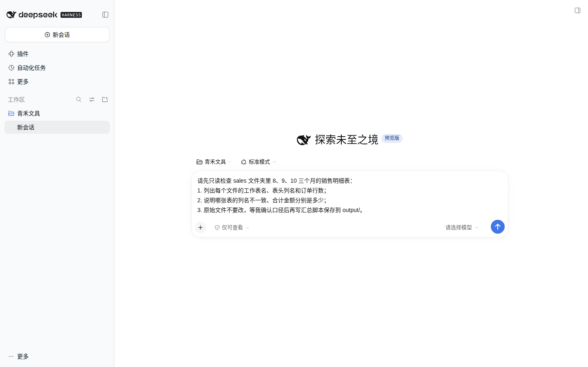

# 0.2 你的新角色：AI 的监工

> 学习目标：分清哪些活放心交给 AI、哪些节点必须自己拍板；掌握发任务前、执行中、收货后 3 个固定检查动作。
>
> 演示环境：DeepSeek Harness 网页版 `0.2.2-rc.5`，延续实战项目 `ai-radar`（OpenRouter 470 个真实大模型快照 + Hacker News 首页讨论）。**本课同样只看不装**，装软件留在第 1.4 课。

---

## 1. 两个都不划算的极端

上一课亲眼看到 AI 把 `:batch` 离线批处理模型排进商用实时 Top 1、还把音乐生成模型 `lyria-3` 混进文本对话榜之后，很多人会掉进两个极端。

第一个极端，是彻底不信它：「连筛选个模型价格表都能混进写歌模型，我还是自己一个个开网页抄价格、手工做 Excel 吧。」结果省时间的工具白装了，人回到原来的手工苦力。

第二个极端，是换个更贵的模型继续当甩手掌柜。比如团队准备搭 `ai-radar`，你想省事直接发一句：「帮我挑出最划算的商用模型，再把今天 Hacker News 的热门 AI 动态做成简报，直接发到公司大群。」

把这两句直接丢给 AI，大概率会连踩两个雷：
- **第一个雷（口径错）**：团队到底要的是「实时对话」还是「离线批处理」？「最便宜」是只看输入价（容易踩进输入 ¥0.25、输出 ¥10.80 的坑）还是看输入+输出综合价？要支持图片还是纯文本？你不说清楚，AI 会按自己理解的默认规则算出一张极其工整的错表，全程不报任何错。
- **第二个雷（不可逆外发）**：一旦给它接了推送飞书/企微大群或发邮件的能力又没人拦着，简报里只要把一条谣言或过时新闻当成今天的大新闻发进全员群，撤回都来不及。

你既不需要去学怎么自己写代码，也不能把拍板权整个交出去。和能干活的 AI 搭档，你的新角色很明确：**做 AI 的监工**——把重复的体力活全交给它，把 4 个决定成败的节点死死攥在自己手里。

---

## 2. 系统位置：监工在整条链路里站哪 3 个岗？

回到 0.1 课画过的 5 步链路。监工不需要盯着模型写的每一行代码，只需要站住开头、中间、结尾这 3 个岗：

```
【岗 1：发任务前】你定清楚边界、业务口径和验收标准（陌生活先开「仅可查看」）
        ↓
你下达任务 → Harness 打包发给模型 → 模型写脚本、调工具
        ↓
【岗 2：执行中】Harness 弹审批框时扫 4 秒再点「允许一次」或「拒绝」
        ↓
模型跑完脚本、自检并汇报「已完成」
        ↓
【岗 3：收货后】你看「轨迹」和代码差异，30 秒核对关键口径，决定能不能对外发
```

这套课程后面的所有技能，本质上都在帮你把这 3 个岗站稳：
- **岗 1（发任务前）**：靠的是划清工作区、管住权限、把需求说清楚（M1 的 1.5、M5 的 5.1–5.2）；
- **岗 2（执行中）**：靠的是看懂路径、终端命令和危险命令识别表（M1 的 1.1–1.3）；
- **岗 3（收货后）**：靠的是读懂 Python 关键逻辑、看懂报错和代码差异（M2、M4）。

---

## 3. 讲清楚：分工清单和监工必须拍板的 4 件事

先解释三个后面会天天用到的词：

- **业务口径（Business Logic / Metric Definition）**：你或团队怎么定义「合格」「最便宜」「重要」的具体规矩。比如在 `ai-radar` 里，「商用实时聊天模型」必须同时满足：价格大于 `0`、排除 `:free` 和 `:batch`、输出模态包含 `text`、去掉 `~` 别名重复项。
  - **它和代码的关系**：代码只忠实执行写进去的条件；口径没给全，代码写得再漂亮，结果也会跑偏。
- **验收标准（Acceptance Criteria）**：你收货时用来判断「这活算不算过关」的硬指标。比如「总扫描条目必须等于 470」「Top 10 里绝不能出现 `:batch`、`:free` 或 `¥0.00`」「随机挑 1 个模型手算美元 × 1,000,000 × 7.2 和表格一致」。
  - **为什么重要**：有了验收标准，你就不用盲信 AI 那句「我已经为您完成了」。
- **只读先行（Read-Only First）**：拿到陌生数据或复杂需求时，先把软件左下角切到「仅可查看」，让 AI 先摸清文件夹里有什么、字段长什么样、有哪些异常条目，**你拍板口径后再切到「工作区内修改」让它真正写脚本**。

### 3.1 一张表分清：哪些活给 AI，哪些事人来拍板

| 分类 | 具体事项 | 原因 |
|---|---|---|
| **放心交给 AI 干** | 解析 470 个模型的 JSON 快照、换算汇率、排序并生成带样式的 Excel | 重复计算密集，AI 写脚本几秒钟干完人一小时的活 |
| **放心交给 AI 干** | 从 Hacker News / GitHub 批量抓取公开动态、按关键词筛选、去重整理成 Markdown 草稿 | 信息搬运与归类重，输出到 `output/` 后极易人工扫读 |
| **放心交给 AI 干** | 写一次性清洗脚本、查报错原因、对比两周模型价格变动生成差异表 | 只要不改原始数据、不直接外发，试错成本几乎为零 |
| **必须人拍板 ①** | **业务口径和目标**（排除哪些变体、按什么排序、哪些话题算重要情报） | AI 不知道你的真实业务场景，没说的规矩它只能靠猜 |
| **必须人拍板 ②** | **数据边界和隐私**（哪些文件能放进工作区、API Key 和公司内部数据能不能碰） | 一旦放进不该给的目录或传到外部服务，追悔莫及 |
| **必须人拍板 ③** | **不可逆动作**（删文件夹、覆盖原始快照、群发飞书/邮件通知、提交线上变更） | 这些动作没有 Ctrl+Z，必须由人最后点头 |
| **必须人拍板 ④** | **最终验收和对外签字**（确认选型表和早报无误后再发给老板或团队） | AI 交差不担责，发错选型方案或错报背锅的是你 |

### 3.2 监工 3 步检查单（每次发活照着走）

把上面四条红线压成 3 个动作，以后每次打开工具直接照着做：

1. **发任务前（15 秒）**：交代清楚 3 句话——**筛选和计算口径**、**原始文件不要改**、**结果存到 `output/`**；对数据结构心里没底，先开「仅可查看」让它盘点。
2. **执行中（4 秒）**：弹窗出来不盲点，扫一眼动词、参数、路径（1.3 课详讲）；跑完顺手点开顶部「轨迹」扫一眼有没有红块。
3. **收货后（30 秒）**：核对 3 个硬指标——**总数有没有漏扫（470 个）**、**榜单里有没有混进明显违规项（`-1` / `0` / `:batch`）**、**随机抽 1 条手算一遍（单价 × 100 万 × 7.2）**。全对再发出去。

**最常见的误解**：以为「等以后模型再升级两代，人就彻底不用当监工了」。实际刚好相反——模型越聪明，生成的报表格式越工整、汇报语气越笃定，一个因为你没说清口径导致的隐蔽错误（比如把半价的 `:batch` 离线接口算进实时榜第 1 名），越容易混在漂亮的表格里蒙混过关。

---

## 4. 现场看：把「甩手指令」改成「监工指令」

先看 `ai-radar/data/openrouter-models-2026-11-24.json` 这份真实公开快照的盘点底数（2026 年 11 月 24 日实测解析）：

| 盘点维度 | 真实数量 | 监工为什么要先看这个数 |
|---|---|---|
| 快照总模型数 | **470** | 验收时确认 AI 扫描了全量，没有截断 |
| 价格为 `-1` 的动态路由 | **8** | 例如 `openrouter/auto`，必须排除 |
| 价格为 `0` 的免费限流版 | **14** | 例如 `:free` 变体，不能用于正式商用 |
| 带 `:batch` 的离线批处理变体 | **92** | 占了近五分之一，价格打折但不能实时对话 |
| 真正收费的实时聊天模型（排除 `:batch` / `:free` / `<=0`） | **354**（其中支持图片输入的 **235** 个） | 这才是真正该进商用比价池的候选集 |

现在对比两种下达方式：

- **甩手版指令**（容易翻车）：
  > 帮我从 OpenRouter 数据里挑 10 个最便宜的大模型，顺便整理一份今日 AI 简报发到群里。
- **监工版指令**（先开「仅可查看」摸底，摸清暗坑再定口径）：



注意这张真实界面截图里的 4 个监工细节：

1. **左下角先切在「仅可查看」**：这一步先让 AI 只读摸底，哪怕它理解错了也改不了硬盘上任何一个字节。
2. **明确先盘点异常条目再动手**：要求它先报出总数、前 5 厂商、价格 `<= 0` 和 `:batch` 的数量，把现实世界数据里的暗坑在写脚本前全部摊到桌面上。
3. **写死数据边界**：明确写着「原始数据不要改，等我确认筛选口径后再写脚本输出到 `output/`」。
4. **自带收货锚点**：等它交出最终比价表时，你扫一眼榜单里有没有 `:batch` / `:free` / `lyria`，再随手抽一条（比如 `deepseek/deepseek-v4.1-flash-1017` 输入 `0.00000003 × 1,000,000 × 7.2 = ¥0.216/M`）手算核对，30 秒完成验收。

---

## 5. 你来读：4 个真实工作场景，哪一步必须人拦下来？

假设你在团队里用 `ai-radar` 推进下面 4 件活，停下来想 10 秒：每件活里，**哪部分可以放心让 AI 跑，哪一步必须自己拍板或拦住？**

1. **每天早上抓取 Hacker News 热门讨论，翻译成中文简报后直接自动发到 50 人的公司大群。**
2. **清洗 `data/openrouter-models-2026-11-24.json` 里的 `:batch` 和免费条目，直接覆盖写回原 JSON 文件省空间。**
3. **在「仅可查看」模式下，对比上周和本周两份 OpenRouter 快照，列出刚上线的新模型和降价超过 20% 的模型清单。**
4. **帮团队测算「每月处理 5 亿 Token 客服对话」该选哪家模型，并直接把预算报告发给老板审批。**

**参考判断**：
1. **抓取、筛选、翻译并生成本地 Markdown 简报放进 `output/` 放心交给 AI**；**扫一眼内容真实性、按下发送到全员群的按钮必须人来拍板**（或者先推到仅自己可见的私聊/草稿频道，确认后再转发大群）。
2. **把清洗后的结果另存到 `output/` 放心交给 AI**；**绝不能让它覆盖 `data/` 里的原始快照**。一旦以后发现某个筛选条件误杀了正常模型，原始数据没留底就只能重抓。
3. **整件事都可以直接交给 AI**。只读模式不改任何文件，且输出是可核对的清单，你回原快照一眼就能复核。
4. **写脚本按不同模型单价测算月度成本放心交给 AI**；**动手前必须由人先拍板口径**（输入和输出 Token 比例是 3:1 还是 1:1？需不需要缓存折扣？能否用海外节点？），**算完后人核对 1–2 个主力模型数字再发给老板**。

---

## 6. 小检查（3 道判断题）

1. 只要把最新最贵的大模型接进 DeepSeek Harness，就不再需要核对筛选口径和单价换算，直接把结果发给老板就行。（对 / 错）
2. 碰到结构陌生的数据快照，先切到「仅可查看」让 AI 盘点字段和异常条目，确认口径后再让它写脚本，能挡住大多数返工和翻车。（对 / 错）
3. 让 AI 每天自动把公开热点整理成本地草稿放进 `output/` 可以放心交给它，但对外群发到公司大群或客户群必须由人把关。（对 / 错）

---

## 7. 下一课

M0 两节心智课到此结束：你已经明白 AI 怎么干活、自己该守住哪三个岗。从下一课正式进入 **M1 电脑基本功与安装**，我们先看 **1.1《文件、文件夹和「路径」》**——拿 `ai-radar` 的目录结构，把 Windows 和 Mac 两种路径写法、文件扩展名以及 `.env`、`.git` 这些隐藏文件一次认清。

---

## 小检查答案

1. **错**。模型再聪明也不知道你真实的商用筛选口径（比如排不排除 `:batch` 离线版、按输入价还是综合价排），而且排版越工整，隐蔽错误越难一眼察觉。
2. **对**。「只读先行」先把 `-1` 动态路由、免费版、离线批处理、音乐模型这些暗坑暴露出来，零风险且省去大量返工。
3. **对**。生成本地草稿是可逆的重复劳动，放心外包；对外群发是不可逆动作且需人担责，必须由人核对后发出。

---

## 参考与事实边界

- **实际操作结果**：本课盘点底数（总模型 470、`-1` 动态路由 8、`0` 免费版 14、`:batch` 变体 92、付费实时模型 354、多模态付费实时模型 235）均直接解析自本仓库 `practice/data/openrouter-models-2026-11-24.json`（2026-11-24 采集自 OpenRouter 官方公开接口 `https://openrouter.ai/api/v1/models`）；截图来自 DeepSeek Harness 网页版 `0.2.2-rc.5` 实机界面。
- **作者说明**：第 5 节的 4 个练习场景为围绕 `ai-radar` 设计的职场实操判断题。
