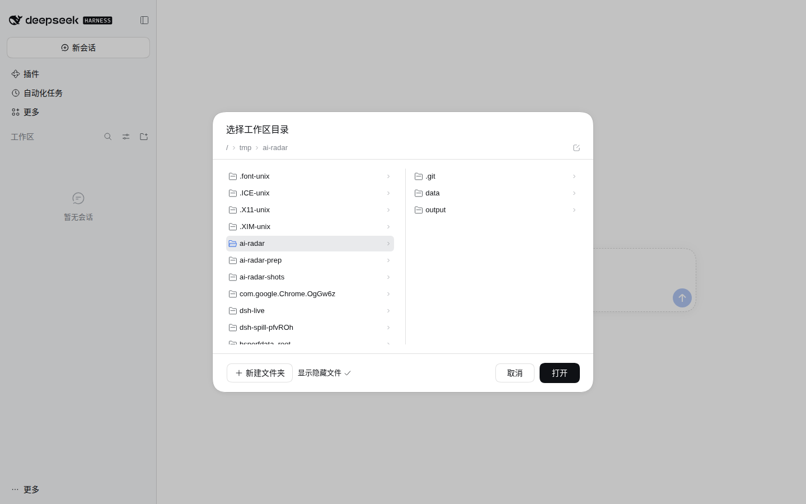

# 1.1 文件、文件夹和「路径」

> 学习目标：看懂 Windows 和 Mac 两种路径写法；认出常见文件扩展名和 3 个必认的隐藏文件（`.env`、`.git`、`.gitignore`），在 AI 说「找不到文件」或「要动某个路径」时一眼定位。
>
> 演示环境：DeepSeek Harness 网页版 `0.2.2-rc.5` 及 `ai-radar` 项目目录（Windows / Mac 双系统对照）。**本课仍无需安装软件**，装工具在第 1.4 课。

---

## 1. 一句最常见报错，背后全是斜杠

你刚从 OpenRouter 下载了一份模型价格快照 `openrouter-models-2026-11-24.json` 丢在桌面上，然后打开 AI 工具发了一句：「帮我按 `data` 里的快照算一份模型比价表。」

几秒后，AI 停下来吐出一行红字：

```text
FileNotFoundError: [Errno 2] No such file or directory: 'data/openrouter-models-2026-11-24.json'
```

第二天，你又在一次权限弹窗里看到 AI 想去读 `../.env`。你盯着这两个地址犯了难：
- `openrouter-models-2026-11-24.json` 明明就在桌面上躺着，它为什么说找不到？
- `../.env` 前面的两个点是什么意思？我打开文件夹根本没看到一个叫 `.env` 的文件，它是从哪冒出来的？

平时你在电脑上找文件，靠的是眼睛看图标、鼠标双击一层层点进去。但 AI 没有鼠标，也没法「肉眼扫桌面」——它找文件、写文件、改文件，全靠一行文字地址，也就是**路径（Path）**。看不懂路径，你就不知道 AI 正在动你电脑的哪个角落。

---

## 2. 系统位置：路径是 AI 找文件的唯一门牌号

回到 0.1 课的链路，把 Harness 动手操作硬盘的那一环放大：

```
你下达任务（例如「分析 data 里的模型价格快照」）
        ↓
模型写出工具指令，必须附带精确的文件路径  ← 【本课位置】
        ↓
Harness 严格按这个路径去电脑硬盘上找文件：
  ├── 路径拼错 / 文件不在那 → 立刻报 FileNotFoundError（找不到文件）
  ├── 路径带 .. 或 ~ 或 C:\  → 跑出当前工作区（1.3 课重点拦住）
  └── 路径落到 .env / .git   → 碰到敏感密钥或 Git 存档库
```

不管是 1.2 课的终端命令、1.3 课的危险命令识别，还是 1.5 课划定工作区边界，前提都是你一眼能看懂路径指向哪里。

---

## 3. 讲清楚：路径、符号、扩展名和隐藏文件

### 3.1 文件树和路径（Path）：电脑里的省市区门牌号

电脑硬盘里的文件夹一层套一层，像一棵倒着长的树。以整套课贯穿始终的项目 `ai-radar` 为例：

```text
ai-radar/
├── .env                                    ← 隐藏文件（存 API Key，默认看不见）
├── .git/                                   ← 隐藏文件夹（Git 存档库，默认看不见）
├── .gitignore                              ← 隐藏文件（Git 不上传清单）
├── data/
│   ├── hn-frontpage-2026-11-24.json        ← Hacker News 首页讨论快照
│   └── openrouter-models-2026-11-24.json   ← OpenRouter 470 个模型价格快照
└── output/
    └── 模型比价Top10.xlsx
```

把从最外层一路点到目标文件经过的文件夹名字，用斜杠串成一行，就是**路径（Path）**。

同一份 OpenRouter 模型快照，在 Windows 和 Mac 两种电脑上的完整路径长得略有不同，对照看一眼就会：

| 对比项 | Windows 写法 | Mac / Linux 写法 |
|---|---|---|
| **起点** | 从盘符开始，如 `C:\`、`D:\` | 从最顶层根目录 `/` 开始 |
| **层级分隔符** | 传统用反斜杠 `\`（新版 PowerShell 和 Python 通常也认 `/`） | 统一用正斜杠 `/` |
| **用户主目录** | `C:\Users\alex` | `/Users/alex`（Linux 上常见 `/home/alex`） |
| **模型快照完整路径** | `C:\Users\alex\ai-radar\data\openrouter-models-2026-11-24.json` | `/Users/alex/ai-radar/data/openrouter-models-2026-11-24.json` |

### 3.2 绝对路径 vs 相对路径，以及 3 个必认符号

写快递地址时，你在外地寄信要写「江苏省南京市……」，但你在同一栋楼里递东西，只要说「3 楼 302 室」。路径也是两种写法：

- **绝对路径（Absolute Path）**：从最源头（Windows 的 `C:\`，Mac 的 `/`）一路写全，不管当前站在哪，永远指向同一个文件。例如 `/Users/alex/ai-radar/data/openrouter-models-2026-11-24.json`。
- **相对路径（Relative Path）**：以「当前所在的文件夹」为起点接着往下写。如果你已经在 `ai-radar` 工作区里，只要写 `data/openrouter-models-2026-11-24.json`。前面开头的报错，正是因为那份快照还落在桌面（`Desktop`），压根没放进 `ai-radar/data/` 里。

另外有 **3 个出现频率极高的简写符号**，看到必须立刻反应过来：

| 符号 | 含义 | 举例（假设当前站在 `ai-radar/`） | 监工为什么要认它 |
|---|---|---|---|
| `.`（一个点） | 当前所在文件夹 | `./output/模型比价Top10.xlsx` 等同于 `output/模型比价Top10.xlsx` | 看到它说明还在原地，没跑偏 |
| `..`（两个点） | **往外退一层（上一级文件夹）** | `../报价底表.xlsx` 指向 `ai-radar` 外面的同级文件 | **高危信号**：命令里带 `..` 说明 AI 正在伸手碰工作区外面的东西 |
| `~`（波浪号） | 当前登录用户的主目录 | `~/ai-radar/data` 等同于 `/Users/alex/ai-radar/data`（Windows PowerShell 对应 `C:\Users\alex\ai-radar\data`） | 常见于配置文件路径，比如 DeepSeek Harness 存配置和密钥的 `~/.dsh` |

顺手记一个小习惯：**给项目文件夹和文件起名尽量用英文短名加连字符，别加空格**（用 `ai-radar`、`openrouter-models-2026-11-24.json` 代替 `AI 雷达 2026`）。因为在终端里空格默认用来隔开两个词，路径一旦带空格，就必须用英文双引号包起来（例如 `"AI 雷达/模型 比价.xlsx"`），漏打引号经常直接报错。

### 3.3 扩展名（File Extension）：文件末尾的「身份证」

文件名里**最后一个点 `.` 后面的那串字母**叫扩展名（俗称后缀），操作系统和程序靠它知道该怎么打开这份文件。当监工先认全这 6 种：

| 扩展名 | 是什么文件 | 什么时候会见到 |
|---|---|---|
| `.json` | 结构化数据文件（花括号和方括号套起来的键值对） | OpenRouter 模型价格表、Hacker News 热点快照、工具配置 |
| `.xlsx` / `.csv` | Excel 表格 / 纯文本逗号分隔表格 | AI 导出的《模型比价 Top 10》、日常财务和运营数据表 |
| `.py` | Python 脚本文件 | AI 写出来替你清洗价格、抓取热点的程序 |
| `.md` | Markdown 纯文本文档 | `README.md` 说明书、`AGENTS.md` 规则书、每日 AI 简报 |
| `.yaml`（`.yml`） | 配置文件（缩进式清单） | `config.yaml`（设置关注厂商和汇率）、DSH 配置文件 `cordis.patch.yml` |
| `.zip` | 压缩包 | 从 GitHub 下载的打包文件，必须先解压才能用 |

**强烈建议现在就做的一件事**：Windows 电脑默认隐藏已知文件的扩展名，容易把 `模型比价.xlsx` 和伪装程序 `模型比价.xlsx.exe` 看混。打开任意文件夹，在顶部点「查看 → 显示」，把 **「文件扩展名」** 和 **「隐藏的项目」** 勾选上。

> `[可选补拍：Windows 11 文件资源管理器顶部「查看 → 显示」勾选「文件扩展名」和「隐藏的项目」截图]`

**最常见的误解**：以为「把 `.json` 改名改成 `.xlsx`，就能直接用 Excel 打开」。绝对不行。扩展名只是贴在纸箱外面的标签，强行把标签撕了贴上别的名，里面的数据结构根本没变——用 Excel 去开只会直接报错或乱码。真要转格式，必须让 AI 写脚本解析转换。

### 3.4 必须认识的 3 个隐藏文件（Dotfiles）

在 Mac 和 Linux 里，**文件名以英文句点 `.` 开头的文件或文件夹默认会藏起来**（Mac 的访达里按快捷键 `Cmd + Shift + .` 可以一键显示/隐藏；Windows 勾选「隐藏的项目」即可看到）。

以后用 AI 干活，下面 3 个带点开头的隐藏项最常出现，一定要分清能不能碰：

1. **`.env`（Environment，环境变量文件）**：用来存放 API Key、推送 Webhook 等私密配置的小文本。**铁律：绝不把 `.env` 发到微信群，绝不上传到公开 GitHub。**
2. **`.git`（隐藏文件夹）**：Git 用来保存每一次历史存档的「黑匣子」。**铁律：千万别觉得它占地方就手痒删掉**，删掉它，项目的所有历史版本瞬间清零。
3. **`.gitignore`（Git 忽略清单）**：告诉 Git 哪些文件不要上传的纯文本清单，里面通常头几行就写着 `.env`，专门用来防止把密钥误传上网。

（如果你用 Mac，有时还会冒出一个 `.DS_Store` 文件，那是 macOS 记录文件夹图标排列位置的系统杂项，不用管它。）

---

## 4. 现场看：在真实界面和终端里看隐藏文件现身

先看 DeepSeek Harness 网页版里选择工作区时的真实目录浏览器。下面这张图里，我们打开了 `ai-radar` 目录，并点亮了底部的 **「显示隐藏文件」** 开关：



盯住图里的三个细节：
1. **顶部的路径面包屑 `/ > tmp > ai-radar`**：它就是把路径 `/tmp/ai-radar` 拆成了一节节可点击的按钮。
2. **底部勾选了「显示隐藏文件 ✓」**：勾上之前，右侧只能看到 `data` 和 `output` 两个普通文件夹；勾上之后，点开头的 **`.git`** 立刻现身。
3. **为什么这里没列出 `.env` 和 `.gitignore`**：因为这个弹窗是「选择工作区**目录**」，只展示文件夹不展示单个文件。

再切到真实终端里，站在同一目录 `/tmp/ai-radar` 下对比两次列表命令的输出（下一课 1.2 会细讲 `ls`）：

```text
# 只看普通文件（隐藏项看不见）
$ ls
data  output

# 加上 -a 显示全部（含以 . 开头的隐藏项）
$ ls -la
drwxr-xr-x 5 user user 4096 Nov 24 16:22 .
drwxrwxrwt 1 root root 4096 Nov 24 16:28 ..
drwxr-xr-x 2 user user 4096 Nov 24 16:22 data
-rw-r--r-- 1 user user   33 Nov 24 16:22 .env
drwxr-xr-x 2 user user 4096 Nov 24 16:22 .git
-rw-r--r-- 1 user user   18 Nov 24 16:22 .gitignore
drwxr-xr-x 2 user user 4096 Nov 24 16:22 output
```

看输出最上面那两行：`.` 和 `..` 真真实实地挂在每个文件夹里；紧跟着就是平时看不见的 `.env`、`.git` 和 `.gitignore`。以后 AI 提示读写这些文件时，你就再也不会一头雾水了。

---

## 5. 你来读：5 条真实路径，一眼解码

假设你现在的工作区是 `ai-radar`（Windows：`C:\Users\alex\ai-radar`；Mac：`/Users/alex/ai-radar`）。下面 5 条路径出现在 AI 的日志或弹窗里，停下来想 10 秒，分别判断它指向哪、需不需要警惕：

1. `data/openrouter-models-2026-11-24.json`
2. `C:\Users\alex\Desktop\公司年度预算.xlsx`
3. `../财务报销/11月发票.xlsx`
4. `~/.dsh/.credentials.yaml`
5. `.env`

**参考判断**：
1. **工作区内的相对路径，安全**。指向当前 `ai-radar` 下 `data` 子文件夹里的 OpenRouter 模型快照。
2. **Windows 绝对路径，已跑出工作区**。它指向桌面（`Desktop`）上的公司预算表，不在 `ai-radar` 里，要立刻确认是不是你要给 AI 看的。
3. **越界相对路径，高度警惕**。开头的 `..` 已经退出了 `ai-radar`，钻进了隔壁的 `财务报销` 文件夹——审批框里看到这类路径直接拒绝。
4. **用户主目录下的隐藏路径**。`~` 是你的用户主目录，`.dsh` 是 DeepSeek Harness 自己存放配置和凭据的隐藏文件夹（`.credentials.yaml` 存着你保存的 API 密钥）——绝不能把里面的内容发给别人。
5. **当前工作区里的隐藏环境变量文件**。里面通常放着 API Key 或通知机器人密钥，打包发给同事或上传 GitHub 前必须确认排除它。

---

## 6. 小检查（3 道判断题）

1. 在电脑里把 `openrouter-models-2026-11-24.json` 直接重命名成 `openrouter-models-2026-11-24.xlsx`，它就自动转换成了 Excel 表格。（对 / 错）
2. 如果你当前在 `ai-radar` 文件夹里，路径 `../客户名单.xlsx` 指的是 `ai-radar` 文件夹**外面**上一级目录里的文件。（对 / 错）
3. 项目文件夹里看到一个以点开头的隐藏文件夹 `.git`，平时用不到，为了省空间可以直接删掉。（对 / 错）

---

## 7. 下一课

路径看懂了，门牌号不再迷路。下一课 **1.2《终端与常用命令》**，我们正式推开那个黑色窗口，把 AI 后台天天敲的 `cd`、`ls`、`python`、`pip`、`npm`、`npx` 等 12 个高频命令一次认全。

---

## 小检查答案

1. **错**。改扩展名只换了文件名后缀，不会改变文件内部数据结构，强行改名只会导致 Excel 打不开。
2. **对**。`..` 表示往外退一层（上一级目录），说明已经超出了当前的 `ai-radar` 工作区。
3. **错**。`.git` 保存着项目完整的 Git 历史存档记录，删掉它就等于把所有历史版本抹平。

---

## 参考与事实边界

- **实际操作结果**：本课截图采集自 DeepSeek Harness 网页版 `0.2.2-rc.5` 真实目录选择器界面；终端 `ls` 与 `ls -la` 输出实测于本地 `ai-radar` 演示目录（演示输出已对用户名作脱敏）。
- **官方资料**：DeepSeek Harness 凭据存储路径 `$DSH_HOME/.credentials.yaml`（默认 `~/.dsh/.credentials.yaml`）见官方配置文档 [docs/user/guide/providers.zh.md](https://github.com/deepseek-ai/deepseek-harness/blob/master/docs/user/guide/providers.zh.md)。
