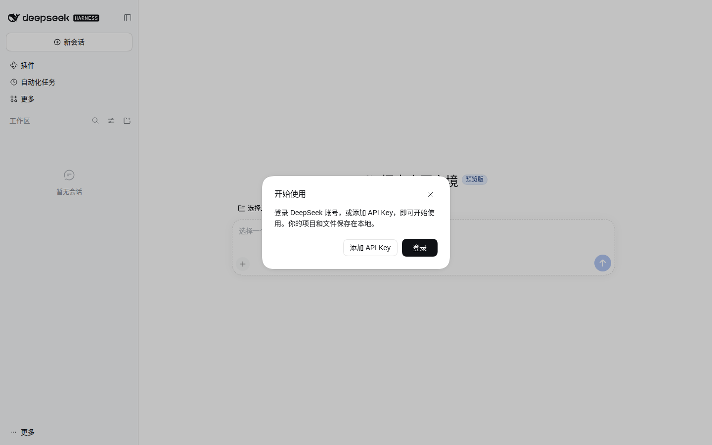
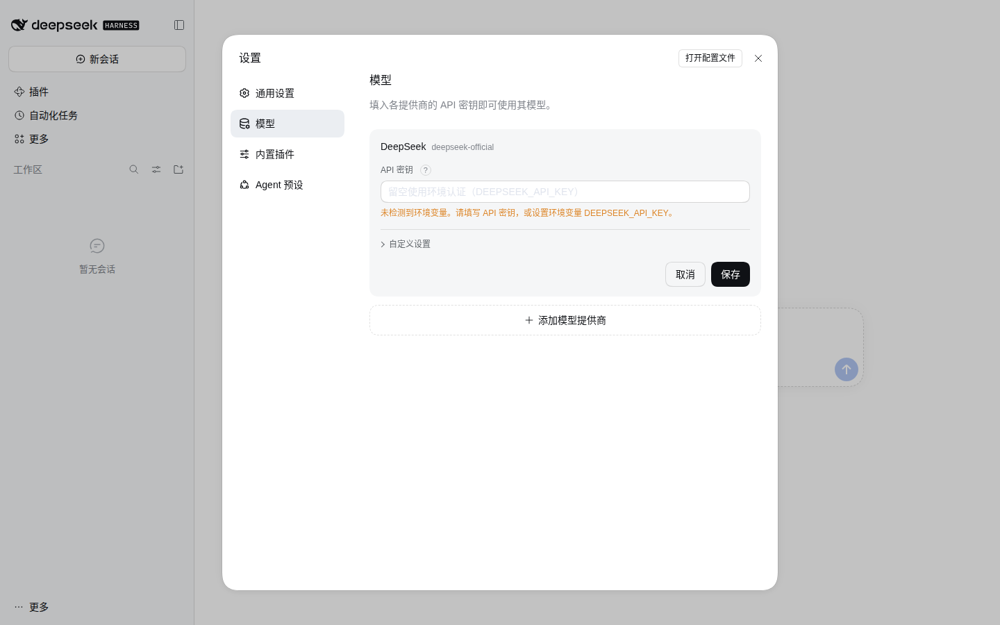
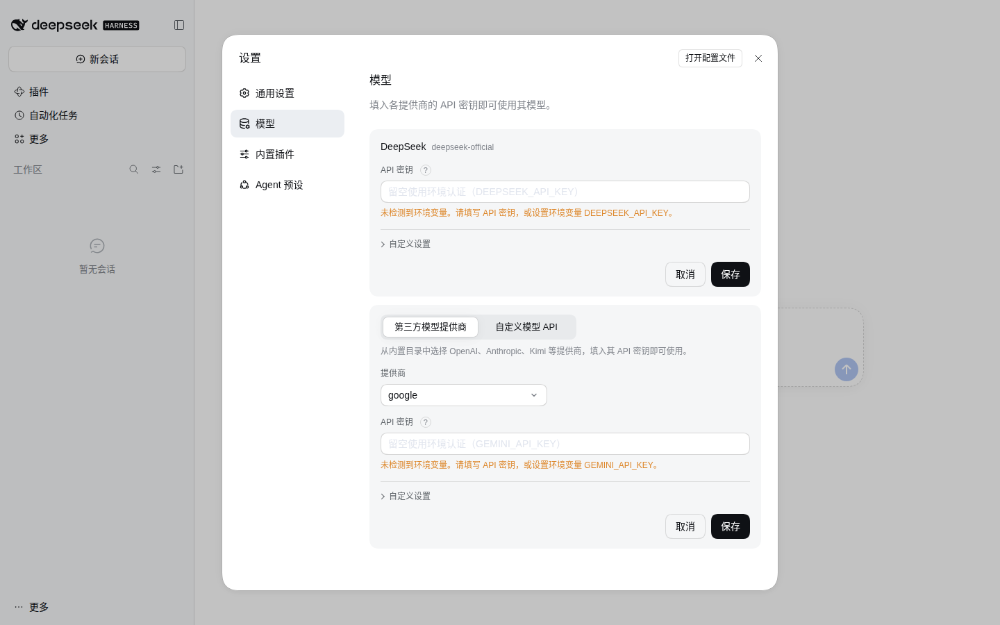
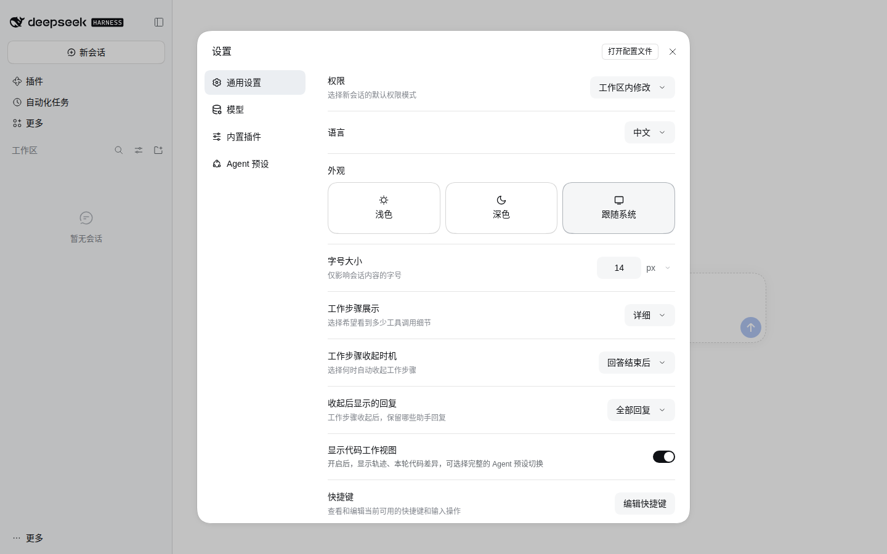

# 1.4 装好 DeepSeek Harness

> 学习目标：在自己电脑上启动 DeepSeek Harness 网页版（`0.2.2-rc.5`），配好 Gemini API Key（附国内学员改用 DeepSeek 官方 API Key 的完整替代步骤），打开监工必开视图，并选好「青禾文具」工作区跑通第一个只读任务。
>
> 演示环境：DeepSeek Harness 网页版 `0.2.2-rc.5`；主线模型 Gemini（Google AI Studio），国内替代方案 DeepSeek 官方 API。Windows 和 Mac 步骤全程通用。

---

## 1. 终于动手：5 分钟把工具装到自己电脑上

前 3 课你已经把路径、12 个常用命令和 8 类危险命令摸透了。现在真正开始动手——你会发现，装好 DeepSeek Harness 并不需要敲一堆复杂配置，核心动作只有三步：

1. 装好底层运行环境 **Node.js**（点安装包一路「下一步」）；
2. 在终端敲 **1 行 `npx` 命令**拉起网页版；
3. 在中文设置页填进 **1 串 API Key**，打开「显示代码工作视图」，选好工作区。

先交代一条路线选择：**本课主线教你用终端启动网页版**，原因是 Mac 和 Windows 的每一步界面、按钮和排错信息几乎完全一致，出了问题终端里直接看得到日志。如果你更习惯双击桌面图标，DeepSeek Harness 官网（[deepseek.com/harness](https://deepseek.com/harness)）也提供桌面端安装包，它和网页版共用同一份 `~/.dsh` 配置、密钥和会话记录，装完后的操作逻辑完全一样。

> `[可选补拍：DeepSeek Harness 官网（deepseek.com/harness）桌面端下载入口截图]`

---

## 2. 系统位置：这一课把「外壳」和「大脑」真正接上线

回到 0.1 课的公式 `Agent = 模型 + Harness`，看看今天每一步分别在接哪一节：

```
你装好 Node.js
      ↓
敲 npx @deepseek-ai/dsh@0.2.2-rc.5 web  → 把 Harness（本地执行外壳）启动在你电脑上
      ↓
在「设置 → 模型」填入 API Key            → 把本地外壳接通远程模型（Gemini 或 DeepSeek） ← 【本课位置】
      ↓
在「通用设置」打开「显示代码工作视图」   → 打开监工专用的「轨迹」和「代码差异」面板
      ↓
点击「选择工作区」并跑通第一个只读任务   → 整条链路验收通关
```

这里顺手解释两个首次正式用到的词：

- **API Key（接口密钥）**：大模型厂商发给你的个人通行证，长得像一串很长的乱码（例如 `AIza...` 或 `sk-...`）。Harness 每次替你向云端模型提问时，都要带上它来验证身份和按用量扣费。**它等同于带余额的门禁卡，绝不能截图发群，也绝不能传到公开 GitHub。**
- **本地地址 `127.0.0.1:3080`**：等会儿网页打开后，你会在浏览器地址栏看到这串数字。它代表**你自己的这台电脑**，意思是这个网页界面只是借浏览器来显示，你的业务文件夹并没有被上传成一个公开网站。

---

## 3. 讲清楚：从零装好并配通模型的 5 个步骤

### 第 1 步：安装 Node.js 并验证（3 分钟）

1. 打开浏览器访问 Node.js 官网：[https://nodejs.org](https://nodejs.org)，下载对应你电脑系统（Windows 或 macOS）的安装包，像装微信一样一路默认点「下一步」装完。
   - **版本提醒**：DeepSeek Harness `0.2.2-rc.5` 在配置中声明要求 `Node >= 24.9.0`。新装用户直接下载官网较新版本即可；如果你电脑里本来装的是 Node 22，启动时终端会吐出黄色 `npm warn EBADENGINE` 提醒，但实测仍可正常启动，不必急着重装。
2. 装完后，**关掉之前开着的终端窗口，重新打开一个新的终端**（Mac 搜「终端」，Windows 搜「PowerShell」），依次输入两条命令确认：

```bash
node -v
npx --version
```

只要两行都吐出了版本号（例如 `v24.x.x` 或 `v22.23.5`，以及 `12.x.x`），底层环境就过关了。

> `[可选补拍：nodejs.org 官网下载页及本机 PowerShell / Mac 终端执行 node -v 的截图]`

### 第 2 步：一行命令启动 DeepSeek Harness 网页版

在终端里敲下面这行命令并按回车（指定 `@0.2.2-rc.5` 可以保证按钮位置和课程截图完全一致；不写版本号敲 `npx @deepseek-ai/dsh web` 则会拉取最新版）：

```bash
npx @deepseek-ai/dsh@0.2.2-rc.5 web
```

首次运行会联网下载并缓存程序包，等待几十秒后，终端里会打印一行类似下面的本地链接，并自动用默认浏览器打开页面：

```text
dsh web: http://127.0.0.1:3080/?token=xxxxxxxxxxxx
```

注意网址末尾带有一串 `?token=...`，这是本次启动自动生成的本地访问口令。如果浏览器没自动弹开，按住 `Cmd`（Mac）或 `Ctrl`（Windows）直接点击终端里的整行链接，或整行复制粘贴进浏览器地址栏。

首次打开网页，会先弹出一个 **「预览版说明」** 卡片，点右下角 **「继续」**，接着会看到 **「开始使用」** 引导框：



> **最常见的误解**：很多人看到浏览器里网页打开了，顺手把背后那个黑色终端窗口叉掉，结果网页立刻报连接断开。记住：**那个跑着 `npx` 命令的终端是本地后台发动机，用的时候最小化放着就行，不要关掉；真正用完想退出时，切回终端按 `Ctrl + C`。**

### 第 3 步：接上模型 API Key（两条路线任选其一）

#### 路线 A（课程主线）：配置 Gemini API Key

1. 先去 Google AI Studio（[https://aistudio.google.com/apikey](https://aistudio.google.com/apikey)）登录 Google 账号，点击创建 API Key，把生成的那串密钥先复制下来（建议顺手在云端账单页设一个预算提醒，比如 \$10 或 \$20，学完课程随时可以删掉这个 Key）。
2. 回到 DeepSeek Harness 网页：在「开始使用」弹窗直接点右上角 `×` 关掉（如果点了「添加 API Key」，它默认先弹 DeepSeek 快捷框，点「稍后配置」即可回到主界面）。
3. 点界面左下角的 **「更多」** → 点 **「设置」** → 左侧点 **「模型」**，进入模型配置页：



4. 点击下方的 **「+ 添加模型提供商」**，保持顶部选在默认的 **「第三方模型提供商」**。
5. **关键避坑**：在「提供商」下拉框里，往下翻选 **`google`**（注意名字是 `google`，不是 `gemini`）。选中后，输入框下方会立刻出现提示：`未检测到环境变量。请填写 API 密钥，或设置环境变量 GEMINI_API_KEY。`



6. 把你的 Gemini API Key 粘贴进「API 密钥」输入框，点右下角黑色 **「保存」** 按钮即可。**不需要重启终端或刷新网页，模型配置立刻生效。**

---

#### 路线 B（国内学员替代步骤）：直接配置 DeepSeek 官方 API Key

如果你当前网络不方便访问 Google AI Studio，**完全不用折腾代理**，直接用 DeepSeek 官方 API 就能顺畅学完全套课程（后面的路径、命令、Python、Git、工作流概念 100% 通用）：

1. 浏览器打开 DeepSeek 开放平台：[https://platform.deepseek.com/](https://platform.deepseek.com/)，注册并登录账号。
2. 在左侧「充值」页充一笔小额测试费（10 元人民币就够练完整个零基础课程，按实际消耗计费）。
3. 在左侧「API keys」页点「创建 API key」，起个名字比如 `ai-supervisor-101`，把生成的那串 `sk-...` 密钥立刻复制下来（离开页面后平台不会再次显示完整明文）。
4. 回到 DeepSeek Harness 网页：
   - 如果还停在刚打开时的「开始使用」弹窗，点 **「添加 API Key」**，把 `sk-...` 粘贴进去点 **「保存并继续」**，一步到位；
   - 如果已经进到主界面，点左下角 **「更多 → 设置 → 模型」**，直接粘进顶部第一张 **`DeepSeek`（`deepseek-official`）** 卡片的「API 密钥」栏（见上面的图 2），点 **「保存」** 即可。

> **关于密钥存储安全（来自官方文档）**：无论你填的是 Gemini 还是 DeepSeek，点「保存」后，DSH 会把密钥单独存进你电脑本地的 `$DSH_HOME/.credentials.yaml`（默认路径 `~/.dsh/.credentials.yaml`），页面输入框只显示脱敏后的局部字符，永远不会再把完整明文回显到网页上。

### 第 4 步：顺手打开监工必开的开关——「显示代码工作视图」

趁着还在「设置」弹窗里，点一下左侧最上面的 **「通用设置」**，往下找到 **「显示代码工作视图」**，把右侧开关点成开启状态：



注意开关下方那行官方小字：**`开启后，显示轨迹、本轮代码差异，可选择完整的 Agent 预设切换`**。0.1 课里我们用来抓 10 月翻车的「轨迹」和右侧「代码差异」视图，就是靠这个开关放出来的。

点右上角 `×` 关掉设置窗口，准备试跑第一个任务。

### 第 5 步：准备好「青禾文具」文件夹并跑通第一个只读任务

1. 在电脑里新建一个干净的练习文件夹（例如 Windows 建 `C:\Users\你的用户名\青禾文具`，Mac 建 `~/青禾文具`），在里面建一个 `sales` 子文件夹，把本课程配套仓库 `practice/data/sales/` 里的 3 份销售 Excel 表放进去（仓库下载方式在 M4 也会教，现在可以直接放这 3 张表或随便放 2 张你自己的脱敏测试表）。
2. 回到 DeepSeek Harness 主界面，点击输入框上方的 **「选择工作区」**，找到并打开 `青禾文具` 文件夹。
3. 确认输入框左下角选在 **「仅可查看」**（只读试跑，零风险），右下角模型选择器选好你刚配通的模型（Gemini Flash 档或 DeepSeek 模型）。
4. 发送你的第一条监工指令：

> 请只读检查 `sales` 文件夹里的全部 Excel 文件，列出每个文件的文件名、工作表名、表头列名和订单行数，汇总成一张表格回复我。不要修改任何文件。

---

## 4. 现场看：怎么确认你已经彻底装通？

发完上面那条指令，盯着下面 4 个验收信号——全部对上，说明你的 Node.js、DSH 网页版、API Key、工作区权限和监工视图整条链路全部打通：

1. **界面底部右下角出现具体模型名**（不再显示灰色的「请选择模型」），且输入框不再灰掉提示「选择一个工作区开始」。
2. **对话顶部能看到「轨迹」标签页**（说明「显示代码工作视图」已生效）。
3. **AI 报出的表格结构和数字与原表完全一致**：
   - `2026-08-销售明细.xlsx`：工作表「销售明细」，24 行，金额列叫「金额」；
   - `2026-09-销售明细.xlsx`：工作表「销售明细」，27 行，金额列叫「金额」；
   - `2026-10-销售明细.xlsx`：工作表「销售明细」，31 行，金额列叫 **「销售额」**。
4. **打开 `sales` 文件夹检查修改时间**：3 张原表分毫未动。

---

## 5. 你来读：装工具最容易卡住的 4 条提示，怎么排？

新手第一次装环境，90% 的卡顿都逃不出下面 4 条提示。停下来想 10 秒：每条提示分别说明哪一步漏了，你第一步该做什么？

1. 终端报错：`zsh: command not found: npx`（或 Windows 提示「无法将 `npx` 项识别为 cmdlet」）
2. 终端刷出：`npm warn EBADENGINE Unsupported engine { required: { node: '>=24.9.0' }, current: { node: 'v22.23.5' } }`
3. 网页打开了，但输入框是灰的，里面写着：`选择一个工作区开始`
4. 发完消息报错：`MISSING_CREDENTIAL`

**参考判断**：
1. **Node.js 没装好，或者装完没有重开终端窗口**。先彻底关掉旧终端、新开一个终端敲 `node -v`；如果还是找不到，去 `nodejs.org` 重新运行安装包。
2. **不是报错，只是版本提醒**。耐心等它继续往下跑；只要后面能打印出 `dsh web: http://127.0.0.1:3080/?token=...`，直接进浏览器用就行。
3. **还没选定工作区文件夹**。点击输入框上方的「选择工作区」，选中你的 `青禾文具` 文件夹并点「打开」，输入框立刻解锁。
4. **当前所选模型没有保存有效的 API Key**。点左下角「更多 → 设置 → 模型」，检查对应提供商（`google` 或 `DeepSeek`）是否填进了 Key 并点下了黑色「保存」按钮。

---

## 6. 小检查（3 道判断题）

1. 用 `npx @deepseek-ai/dsh@0.2.2-rc.5 web` 打开浏览器网页后，为了桌面整洁，应该立刻把背后的黑色终端窗口直接关掉。（对 / 错）
2. 在 DeepSeek Harness 的「设置 → 模型」里保存好 Gemini 或 DeepSeek 的 API Key 后，不需要重启终端服务，下一次发消息就会生效。（对 / 错）
3. 如果想配置课程主线的 Gemini 模型，在「添加模型提供商 → 第三方模型提供商」的下拉框里，应该选择 **`google`**。（对 / 错）

---

## 7. 下一课

工具装好了，第一个只读任务也跑通了。但在你把真正的工作资料放进文件夹之前，还有最后一节防踩坑必修课——下一课 **1.5《工作区与权限：给 AI 划好边界》**，我们把工作区怎么选、三档访问模式怎么切、以及沙箱防不住的 2 个真实边界彻底讲清楚。

---

## 小检查答案

1. **错**。终端窗口是本地运行的后台服务进程，关掉它网页就会断线；平时最小化放在后台，用完按 `Ctrl + C` 停止即可。
2. **对**。DeepSeek Harness 的凭据按请求实时解析，保存后无需重启即可在模型选择器中选用。
3. **对**。在内置第三方提供商列表中，Gemini 对应的提供商 ID 为 `google`（选中后下方会明确提示 `GEMINI_API_KEY`）。

---

## 参考与事实边界

- **实际操作结果**：本课 4 张界面截图（「开始使用」引导框、「设置 → 模型」、第三方提供商选中 `google`、「设置 → 通用设置」开启「显示代码工作视图」）以及启动链接格式 `dsh web: http://127.0.0.1:3080/?token=...`、`npm warn EBADENGINE` 输出，均于 2026-11-24 在 DeepSeek Harness `0.2.2-rc.5` 上实机运行获得。
- **官方资料**：
  - Web UI 启动方式与端口说明：[deepseek-ai/deepseek-harness README.zh.md](https://github.com/deepseek-ai/deepseek-harness/blob/master/README.zh.md) 与 [docs/user/guide/index.zh.md](https://github.com/deepseek-ai/deepseek-harness/blob/master/docs/user/guide/index.zh.md)；
  - 模型提供商配置、凭据脱敏与 `$DSH_HOME/.credentials.yaml` 存储机制：[docs/user/guide/providers.zh.md](https://github.com/deepseek-ai/deepseek-harness/blob/master/docs/user/guide/providers.zh.md)；
  - 桌面端与 CLI 共用 `$DSH_HOME` 数据说明：[apps/desktop/README.zh.md](https://github.com/deepseek-ai/deepseek-harness/blob/master/apps/desktop/README.zh.md)。
