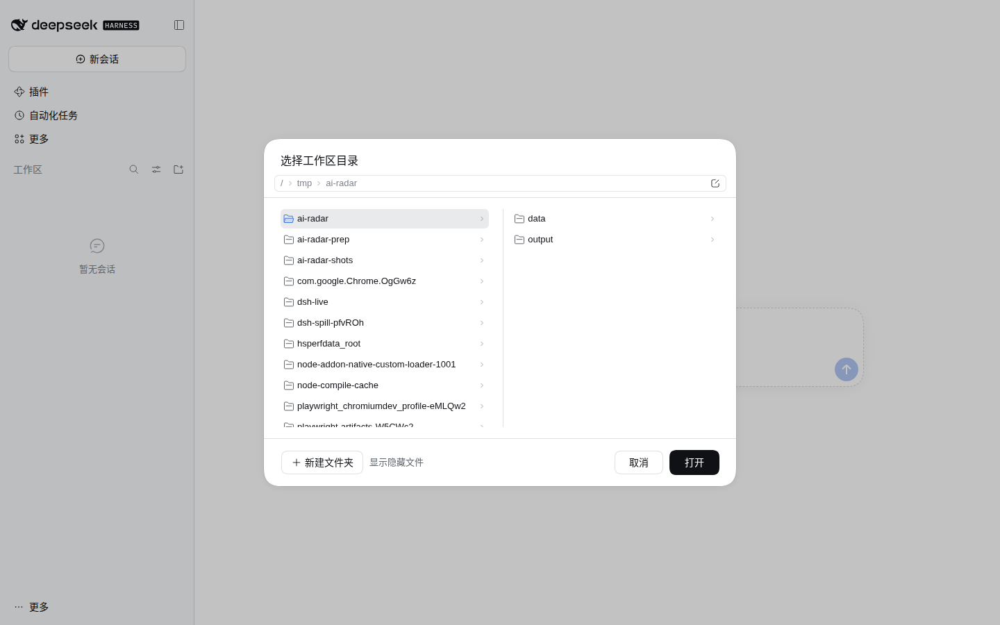
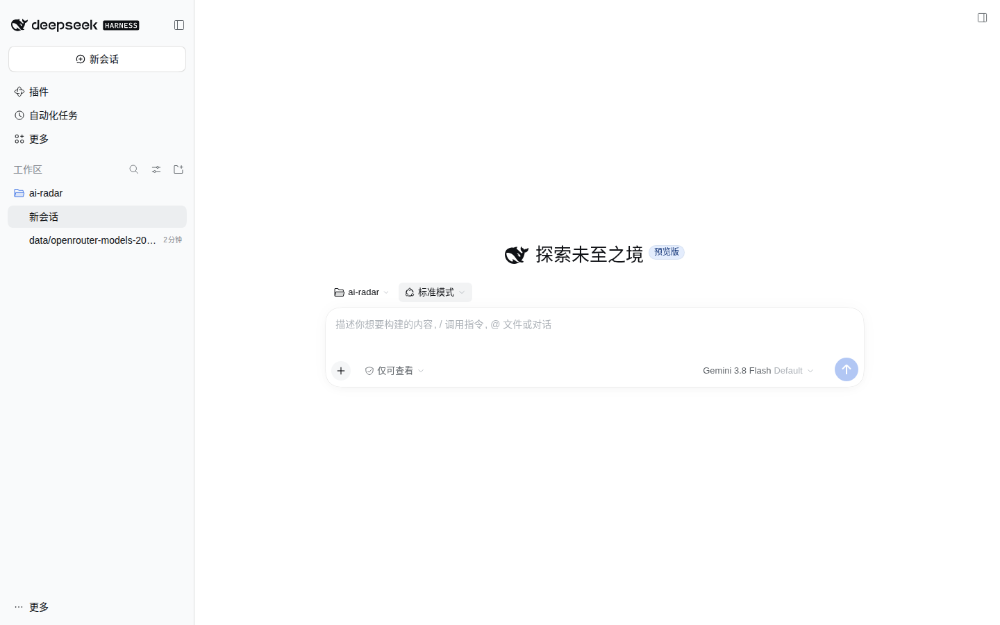
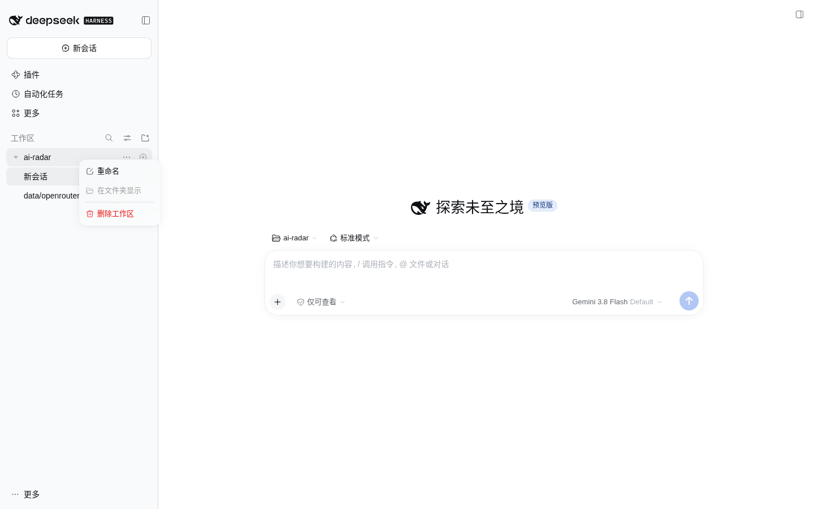
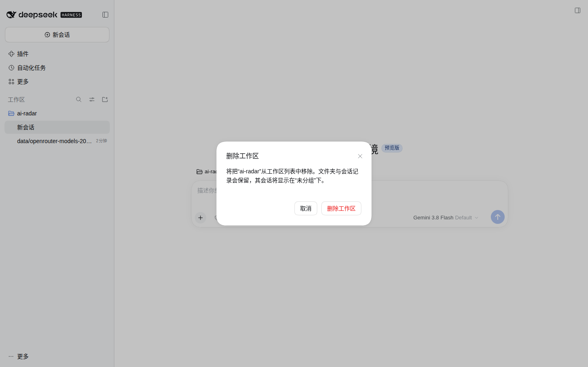

# 1.5 工作区与权限：给 AI 划好边界

> 学习目标：会用「独立工作区文件夹 + 三档访问模式」给 AI 划好操作边界，并且清楚本地沙箱能防什么、防不住什么。
>
> 演示环境：DeepSeek Harness 网页版 `0.2.2-rc.5`，延续 `ai-radar` 工作区。安全边界核对自 DeepSeek Harness 官方安全与沙箱文档。

---

## 1. 图省事把「桌面」选成工作区，会发生什么？

装好 DeepSeek Harness 后，不少人第一次选工作区时图省事：心想「我平时下载的表格、JSON 快照、PDF 报告全扔桌面上，干脆直接把整个『桌面』选进去，省得来回切」；跑了两次觉得弹审批框烦，又顺手把左下角切成了 **「完全权限」**。

半小时后，两件糟心事同时发生：
1. AI 写完比价脚本后，直接把 5 个临时 `.py` 文件和中间缓存铺在了桌面上，和你桌上的合同、财务报销表混成一团；
2. 你让它「把刚才生成的临时文件清理一下」，因为开着「完全权限」没有审批拦截，它差点连桌面上另一个旧项目目录一起扫进去。

1.3 课讲的是「AI 已经要敲高危命令了，你在弹窗那一秒怎么拦」。这一课把防线再往前推一层：**还没发第一句话之前，怎么用「工作区」和「访问模式」两道围栏，提前把 AI 圈在安全区里。**

---

## 2. 系统位置：开工前的两道固定围栏

把整个安全防线排成四层，你一眼就能看清 1.3 课和 1.5 课的分工：

```
第 1 层（空间围栏）：选一个干净独立的「工作区」文件夹      ← 【本课位置】
        ↓
第 2 层（动作围栏）：选好「仅可查看 / 工作区内修改」权限    ← 【本课位置】
        ↓
第 3 层（单次闸门）：越界或敏感命令触发「等待审批」弹窗    ← 1.3 课已学
        ↓
第 4 层（事后复核）：看「轨迹」、扫 Diff、核对关键口径     ← 0.1 / 0.2 课已学
```

前两层站好了，后面两层的工作量直接减掉一大半。

---

## 3. 讲清楚：工作区铁律、三档权限和沙箱的 2 个真实边界

### 3.1 工作区（Workspace）的 3 条铁律

在 DeepSeek Harness 里添加工作区，**并不是把你的文件夹上传到云端服务器**，只是告诉 Harness：「接下来的会话，把电脑里这一个文件夹当成当前施工现场。」

当监工建工作区，死守下面 3 条：

1. **绝不选大范围根目录**：永远不要把 `桌面`（`Desktop`）、`下载`（`Downloads`）、`C:\`、`D:\` 或用户主目录 `~` 选成工作区。范围越大，误改误删的爆炸半径越大。
2. **一个项目建一个独立文件夹，原料和产出分开放**：像 `ai-radar` 这样单独建一个目录，里面至少拆两块——原始快照放 `data/`，AI 生成的报表和每日简报放 `output/`：

```text
ai-radar/
├── data/     ← 原始公开快照（发任务前留备份，要求 AI 只读不改）
└── output/   ← AI 输出的比价 Excel、每日 AI 简报、导出网页
```

3. **别被红字的「删除工作区」吓到**：在 DSH 左侧的工作区列表里右键点击 `ai-radar`，菜单里有一个红字选项叫 **「删除工作区」**。很多人怕点了它会把硬盘里整个项目文件夹删掉，其实完全不会——**它只把快捷入口从软件左侧列表里移除，电脑硬盘上的真实文件夹和历史会话记录都会完整保留**（原有会话会移到「未分组」下继续可查）。

### 3.2 三档访问模式：平时怎么选、在哪设默认值？

DeepSeek Harness 的底层进程沙箱（Sandbox，操作系统给子进程套上的文件写入隔离笼子）把访问权限分成三档，既可以在每次会话的输入框左下角随时切换，也可以在 **「更多 → 设置 → 通用设置 → 权限」** 里设定所有新会话的默认档位：

| 中文界面标签 | 底层策略名 | 允许做什么 | 监工推荐用法 |
|---|---|---|---|
| **「仅可查看」** | `read-only` | 只读分析、列目录、看字段、出方案；**禁止写入修改文件** | **拿到陌生数据先摸底、让 AI 先写计划时，永远先选这一档** |
| **「工作区内修改」** | `workspace-write` | 允许在当前工作区目录和系统临时目录内读写、跑脚本；越界或需提权时弹审批框 | **日常干活的默认首选**（在「通用设置 → 权限」保持这一档） |
| **「完全权限」** | `danger-full-access` | **绕过本地文件隔离，直接放行命令** | **存有业务数据的办公电脑默认别开** |

### 3.3 必须说透的 2 个真实边界（破除「沙箱万能论」）

很多教程把「工作区内修改」吹成「绝对安全的防弹玻璃」，这是不对的。照着 DeepSeek Harness 官方安全文档（`SAFETY.zh.md`）和进程沙箱子系统说明（`docs/subsystems/sandbox.zh.md`），有 **两个真实边界** 你必须心里有底：

1. **边界一：文件沙箱主要锁的是「写入」，不一定锁死「读取」和「联网」**
   - DeepSeek Harness 在三大系统上调用不同的底层隔离机制：Linux 用 `bwrap` / `Landlock`，macOS 用 `Seatbelt`，Windows 用 ACL 受限令牌。
   - 官方文档明确写着：**沙箱模式只管控文件系统写入效果，网络访问和进程可见性不在其封锁范围内；且 Windows ACL 受限令牌下，对工作区外文件的读取并不受绝对限制。**
   - **给监工的动作**：绝不要以为开了「工作区内修改」就可以高枕无忧。公司核心底表、私人证件照、存密钥的 `.env` 不要随便和实验任务混在一台不受控的电脑环境里；看到弹窗里出现 `curl -X POST` 外发数据或读取工作区外路径（`..`、`~`、`C:\`），照样立刻点「拒绝」。
2. **边界二：沙箱保护不了你已经放进当前工作区里的原始文件**
   - 道理很简单：既然你给了它「工作区内修改」权限，那么只要 `data/openrouter-models-2026-11-24.json` 或你自己的业务表格就在这个工作区里面，AI 跑脚本直接改写原文件，在沙箱眼里完全属于「合法的工作区内写入」，**沙箱不会拦它**。
   - **给监工的动作**：重要原始数据永远在工作区外面留一份备份；发任务时顺手写一句「原始文件不要改，结果写到 `output/`」（到 M4 学完 Git 以后，还能靠 Git 存档一键回退）。

顺带提一个容易被忽略的隐私开关：在 **「设置 → 通用设置」** 最下方，有一项 **「在使用官方模型 API 时上传 Session Log（帮助改进 DeepSeek 模型与产品）」**。如果工作区里放的是公司内部业务数据，建议装好后进去核对并关闭这项开关。

---

## 4. 现场看：把 `ai-radar` 圈进工作区、切只读、验证删除不删盘

### 4.1 选干净的独立工作区

点击「选择工作区」，在「选择工作区目录」弹窗里精准定位到独立的 `ai-radar` 文件夹——右边只看得到 `data` 和 `output` 两个干净的子目录，没有任何私人杂项，再点「打开」：



### 4.2 陌生任务先切「仅可查看」

选中 `ai-radar` 后，左下角先点开切到 **「仅可查看」**。此时左边栏清晰挂着 `ai-radar`，输入框上方显示当前工作区，左下角稳稳锁在只读：



### 4.3 亲眼验证：红字「删除工作区」到底删不删硬盘文件？

在左侧工作区栏里右键点击 `ai-radar`（或悬停点 `...` 图标），会弹出三个操作项：**「重命名」**、**「在文件夹显示」**、红字 **「删除工作区」**：



点一下 **「删除工作区」**，先别慌，看它弹出来的真实确认框：



弹窗正文白纸黑字写着：**「将把“ai-radar”从工作区列表中移除。文件夹与会话记录会保留，其会话将显示在“未分组”下。」** 以后你想整理左侧栏，把旧项目从列表里清掉，完全不用担心会误删硬盘里的资料。

---

## 5. 你来读：4 套工作区与权限方案，哪套踩了雷？

开工前花 10 秒做一次安全体检。下面 4 种做法，停下来逐条判断「稳不稳，如果不稳该怎么改」：

1. **做法 A**：直接把 `C:\Users\alex\Desktop` 选成工作区，并把默认权限改成「完全权限」，省得干活老弹审批框。
2. **做法 B**：新建独立目录 `~/ai-radar`（里面分 `data/` 和 `output/`），在外部留了一份原始数据备份；先切「仅可查看」盘点字段，确认口径后再切「工作区内修改」生成比价表。
3. **做法 C**：新建了独立目录 `~/q4-budget`，权限选在「工作区内修改」，但把唯一一份季度预算原表直接剪贴进了这个目录里，也没交代不要改原件。
4. **做法 D**：项目做完后想把旧工作区从 DeepSeek Harness 侧边栏清掉，但看到菜单里写着红字「删除工作区」，怕把本地文件夹删了，一直不敢点。

**参考判断**：
1. **双重大雷，立刻重改**。选整个桌面会把私人文件全暴露给工作区，开「完全权限」直接拆掉了隔离围栏和审批闸门。应该单独建项目文件夹，权限保持在「工作区内修改」。
2. **教科书级标准做法**。独立工作区 + 原文件备份 + 只读先行 + 确认后改写，四层防线齐全。
3. **存在原表被覆盖风险**。「工作区内修改」不会阻止 AI 改写工作区内部文件。应该立刻把原始预算表另存一份备份到工作区外，再在指令里写明「原始文件不要改，输出保存到 `output/`」。
4. **虚惊一场，可以放心点**。「删除工作区」只移除软件侧边栏里的登记记录，不会删硬盘文件夹和会话历史。

---

## 6. 小检查（3 道判断题）

1. 在 DeepSeek Harness 左侧工作区菜单点击红字「删除工作区」并确认后，电脑硬盘里对应的文件夹和数据会被一并永久删除。（对 / 错）
2. 只要把权限设在「工作区内修改」，放进当前工作区里的原始数据文件就绝对不可能被 AI 误改或覆盖。（对 / 错）
3. 根据 DeepSeek Harness 官方安全说明，进程沙箱主要限制文件写入范围，并不绝对封锁联网；因此涉及公司敏感数据时，仍要做好工作区隔离、关闭不必要的日志上传并认真看审批框。（对 / 错）

---

## 7. 下一课

到这里，**M1 电脑基本功与安装** 5 节课全部通关：路径、常用命令、危险命令、工具安装、工作区与权限边界全部落袋。下一课正式进入 **M2 读懂 Python**，从 **2.1《为什么 AI 爱用 Python》** 开始，拿 `ai-radar` 的真实脚本带你一眼看懂 AI 写出来的 `.py` 代码。

---

## 小检查答案

1. **错**。确认弹窗和官方文档均明确说明，该操作仅将工作区从列表移除，硬盘文件夹与会话历史均会完整保留。
2. **错**。「工作区内修改」允许 AI 修改当前工作区内的文件，无法阻止它覆盖同目录里的原文件；必须靠外部备份 + 明确指令（原件不改、写入 `output/`）来防。
3. **对**。沙箱降低风险但不是绝对防弹罩，尤其网络访问和部分平台上的读取不在文件写入沙箱的封锁范围内，监工把关不可省。

---

## 参考与事实边界

- **实际操作结果**：本课 4 张界面截图（目录选择器、仅可查看模式、工作区右键菜单、删除工作区确认弹窗）均于 2026-11-24 采集自 DeepSeek Harness 网页版 `0.2.2-rc.5` 实机界面。
- **官方资料**：
  - 沙箱限制与负责任使用声明：[deepseek-ai/deepseek-harness SAFETY.zh.md](https://github.com/deepseek-ai/deepseek-harness/blob/master/SAFETY.zh.md)；
  - 三档进程沙箱模式（`read-only` / `workspace-write` / `danger-full-access`）及各平台隔离深度说明：[docs/subsystems/sandbox.zh.md](https://github.com/deepseek-ai/deepseek-harness/blob/master/docs/subsystems/sandbox.zh.md) 与 [packages/sandbox/README.zh.md](https://github.com/deepseek-ai/deepseek-harness/blob/master/packages/sandbox/README.zh.md)；
  - 工作区移除不删除本地文件夹和会话历史说明：[packages/workspace/README.zh.md](https://github.com/deepseek-ai/deepseek-harness/blob/master/packages/workspace/README.zh.md)。
