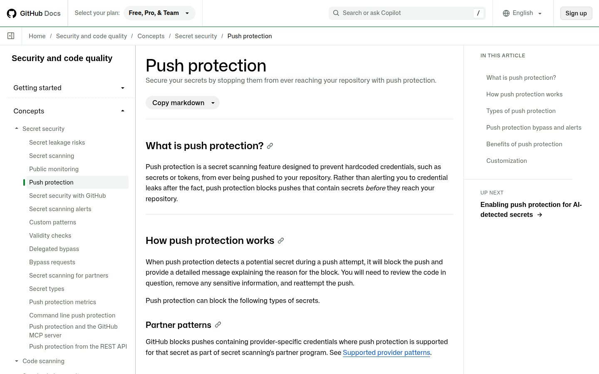
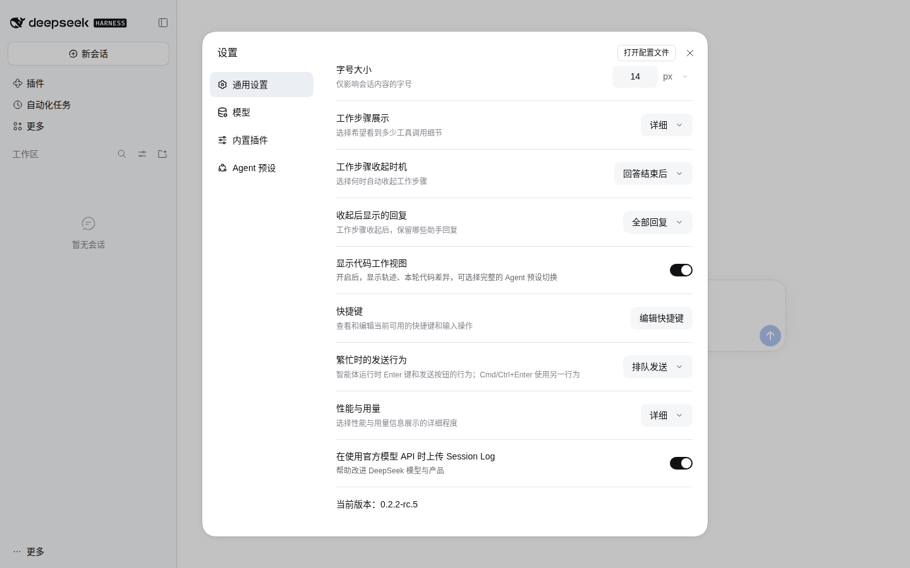

# 3.4 密钥与数据安全

> 学习目标：掌握 API Key 等密钥的保管、预算限额与泄露应急流程；能用「红黄绿三灯清单」判断什么工作数据可以交给 AI，并学会用「本地脚本先脱敏」避开敏感数据上传风险。
>
> 演示环境：DeepSeek Harness 网页版 `0.2.2-rc.5`（实机设置页截图）、GitHub 官方 Push Protection 安全文档页（均采集于 2026 年 11 月 24 日），对照仓库 `practice/.env.example` 与 `.gitignore`。

---

## 1. 两起真实踩坑：一分钟刷爆信用卡，和把客户表喂进云端

在职场里用 AI 工具，真正在一瞬间让人出冷汗的事故，往往不是脚本算错了一行，而是下面两件事：

- **事故一（密钥泄露）**：有人让 AI 帮写调用大模型的脚本，图省事把 `GEMINI_API_KEY` 直接硬写进 `.py` 文件，后来一顺手推到了公开 GitHub 仓库——**不到 3 分钟**，全网自动扫仓的爬虫机器人就会抓走这把 Key 疯狂刷调用，如果账号没设消费上限，账单能直接飙出几百上千美元。
- **事故二（敏感数据裸奔）**：有人把带客户真实姓名、手机号、身份证号或公司未公开工资条的 Excel 直接拖进公有云 AI 对话框，甚至没注意工具默认开着会话日志上传开关。

这一课是 **M3 的压轴课**，把「**管住密钥（防盗刷）**」和「**管住数据（防泄密）**」两条底线一次立清楚，做到既敢大胆用 AI 提效，又绝不踩红线。

---

## 2. 系统位置：在数据离开你电脑前，架起三道安检门

只要调用云端大模型（Gemini、DeepSeek、OpenAI 等），或者把代码传上 GitHub，数据就会离开你自己的硬盘。监工要守住的是「出境前」这三道门：

```
你电脑里的文件与密钥
      │
      ├── 门 1：密钥隔离（.env 留本地 + .gitignore 拦截 + 设平台消费上限）  ← 【本课前半】
      │       ↓（推 GitHub 前还有 GitHub Push Protection 最后兜底）
      │
      ├── 门 2：数据分级（红黄绿三灯清单：红灯绝不进云端，黄灯先本地脱敏）  ← 【本课后半】
      │
      └── 门 3：工具隐私开关（关闭不必要的 Session Log 上传，独立工作区隔离）
              ↓
      安全离开本机 → 发往模型 API / 私有 GitHub 仓库
```

---

## 3. 讲清楚：密钥防泄四铁律 + 职场数据红黄绿三灯清单

### 3.1 密钥（API Key / Token）防泄四铁律

把 API Key 想成「**不记名、免输密码就能直接扣钱的银行副卡**」——谁拿到这串字符，就能替你花钱或动你的仓库。记住 4 条铁律：

1. **绝不硬编码，统一走 `.env` + `.env.example` + `.gitignore`**
   - **`.env`**：放你真实的 Key，**只留在你自己电脑本地**，并且第一天就写进 `.gitignore`（绝不提交进 Git、绝不发微信群、绝不留在录屏和截图里；`.gitignore` 里同时加一行 `!.env.example` 放行模板文件）。
   - **`.env.example`**：放进 Git 仓库给同事或未来自己看的「空占位模板」，长这样（摘自仓库 `practice/.env.example`）：

```text
# 复制本文件为 .env 后再填入你自己的真实密钥
# 注意：.env 已列入 .gitignore，绝对不要把含真实密钥的 .env 提交到 GitHub 或发给别人

# 用于 DeepSeek Harness / 模型调用（按你实际选用的模型填写其一即可）
GEMINI_API_KEY=your_gemini_api_key_here
DEEPSEEK_API_KEY=your_deepseek_api_key_here

# 可选：用于 M4/M5 拉取 GitHub Releases 提高接口限额（公开只读权限即可）
GITHUB_TOKEN=your_github_token_here
```

2. **每一把新申请的 Key，第一时间设「硬消费上限」**
   - 无论在 Google AI Studio、DeepSeek 开放平台还是 OpenRouter，拿到 Key 先去账单/限额页设一个你能接受的硬上限（比如先设 `20 美元` 或 `50 元人民币` 充值额度，不绑无限额自动续费）。就算哪天脚本写进死循环或意外泄露，损失也被死死锁在上限以内。
3. **万一不小心泄露了，千万别只「删文件再提交」——立刻吊销重签！**
   - **最常见的误解**：以为不小心把 Key 推上 GitHub 后，只要本地删掉那一行再 `git push` 一次就安全了。**错！** Git 的本质就是保留所有历史版本，别人点开上一条 Commit 记录依然能清清楚楚看到那串 Key，而且扫描爬虫往往在几十秒内就已经抄走了。
   - **正确应急 3 步**：① **第一步（最高优先级）**：立刻登录模型商或 GitHub 后台，把泄露的那把 Key **吊销 / 删除（Revoke / Delete）**，生成一把新 Key 换上；② 再清理代码里的硬编码；③ 去账单页核对有没有异常消耗。
4. **认识 GitHub 的最后一道防线：`Push protection`（推送保护）**
   - 如果你不小心在代码里夹带了常见平台的 API Key 或 Token 往 GitHub 推送，GitHub 的 **Secret Scanning（密钥扫描）** 里的 **`Push protection`** 会在推送落盘前直接把这次推送拦下来报错提醒。



   - 记住：它是安全气囊，不是你可以不系安全带的理由——它并不保证识别所有小众平台的密钥格式，也不能拦住你发进微信群或截图里的 Key。

---

### 3.2 职场数据「红黄绿三灯清单」：什么能喂给 AI，什么绝不能？

很多白领和小老板最拿不准的问题是：「公司里的表到底能不能丢给 AI 处理？」不用凭感觉猜，照下面这张三灯表一秒归类：

| 级别 | 典型数据举例 | 能不能交给公有云 AI？ | 监工怎么操作 |
|---|---|---|---|
| **🟢 绿灯（放心用）** | 公开网页数据（如 OpenRouter 模型目录、Hacker News 热点）、官方公开财报、自己编的脱敏测试表 | **可以直接用** | 正常放进 `ai-radar/data/` 练习或自动化处理 |
| **🟡 黄灯（隔离 + 脱敏后用）** | 内部运营汇总表、商品 SKU 销量、不含个人隐私的匿名工单/调研问卷、内部流程草案 | **先脱敏 + 关日志上传后再用** | ① 单独建干净工作区；② 删掉客户姓名/联系方式列；③ 关闭工具的会话日志上传开关；④ 优先用企业合规版 API（承诺不拿数据训练） |
| **🔴 红灯（严禁裸奔上传）** | 客户身份证号/手机号/家庭住址、员工工资条/绩效、银行卡号/对公账户、未公开融资与财务底稿、带保密协议（NDA）的合同、任何密码和 `.env` | **绝对不要直接拖进公有云 AI 对话框！** | 真要批处理这类表，用下面 3.3 节的「本地脚本先脱敏」办法，或者仅使用公司 IT 批准的内网/本地部署模型 |

### 3.3 必学实战技巧：「本地脚本先脱敏，敏感原表不进大模型」

假如你手里有一张包含 3,000 行客户真实姓名、手机号和订单金额的表格，想让 AI 帮你做复购分析，**怎么做到既借 AI 的脑子写分析代码，又不让任何一条客户真实手机号离开你的电脑？**

照这 3 步做（核心是 0.1 课讲过的「模型在云端，Python 在本地跑」）：

1. **只给 AI 看「表头 + 2 行假数据」**：新建一个只有 3 行的假样例文件（比如 `张三 / 13800000001 / 299元`），或者直接打字告诉 AI 表头长什么样，**绝对不把真实客户表放进工作区**。
2. **让 AI 写两份本地脚本**：一份叫 `anonymize.py`（把真实姓名替换成编号 `CUST_0001`、删除手机号列，另存为 `output/脱敏订单.xlsx`），一份叫 `analyze.py`（统计复购率和客单价）。
3. **你自己在终端本地跑脚本**：运行 `python3 anonymize.py` 和 `python3 analyze.py`——全程纯本机 Python 运算，**3,000 行真实客户隐私一个字节都不会发给云端模型**！

---

## 4. 现场看：检查你工具里那个容易被忽略的隐私开关

打开 DeepSeek Harness 网页版左下角「更多」→「设置」→「通用设置」，往下滚到底部，你会看到这一项：



盯住倒数第二行：**「在使用官方模型 API 时上传 Session Log（帮助改进 DeepSeek 模型与产品）」**——注意看图里，它在全新默认状态下是**开启的（黑色滑块在右边）**！

监工养成一个固定习惯：
- 如果只是用公开数据（如 `ai-radar` 的 OpenRouter / HN 快照）练习，开不开无所谓；
- **只要开始处理任何公司黄灯内部业务资料，第一时间进来把这个开关拨到左边关掉！** 换到 Codex、Claude Code 或国产工具（如豆包、TRAE）时，也同样第一件事进设置找「数据改进 / 隐私 / 会话日志上传」开关核查一遍。

> `[可选补拍：作者在自己常用的模型后台（Google AI Studio / DeepSeek 开放平台）补拍「设置消费上限」和「一键吊销 Key」的界面截图，拍摄时务必打码隐藏全部真实 Key]`

---

## 5. 你来读：3 个真实职场险情，你第一时间怎么做？

遇到下面 3 种突发情况，先停 10 秒想出你的第一动作，再核对参考判断：

1. 你刚把新写的脚本推送到公开 GitHub 仓库，突然发现代码第 8 行忘删了测试时粘贴进去的 `GEMINI_API_KEY="AIza..."`。你第一步该干什么？
2. 财务同事发你一份包含全公司 45 名员工姓名、身份证号和实发工资的 `11月薪资.xlsx`，让你用 AI 写个脚本按部门核对社保比例。你应该把这张表直接丢进 DeepSeek Harness 工作区让 AI 读吗？
3. 你准备把做好的 `ai-radar` 打包成 ZIP 发给另一个部门的同事试用，文件夹里有 `README.md`、`config.yaml`、`requirements.txt`、`.env`、`.env.example`、`data/`、`scripts/`、`.venv/`。发之前哪 **2 样** 必须先剔除？

**判断思路**：
1. **第一步不是改代码，而是立刻登录 Google AI Studio 后台吊销（删除）这把泄露的 Key！** 吊销完之后，再把本地代码里的硬编码改成读 `.env`、生成一把新 Key 放进本地 `.env`（并检查账单消耗）。
2. **绝对不能直接放进工作区给云端 AI 读！** 身份证号和员工薪资属于典型红灯数据。正确做法是只把列名和 2 行编造的假数据（例如「测试员工A / 研发部 / 10000」）发给 AI，让它写好 `check_social.py`，然后你在自己电脑的终端里本地运行该脚本核对真实表格。
3. **必须剔除 `.env`（含你自己的真实密钥）和 `.venv/`（体积大且换电脑不能用）**；留着 `.env.example` 和 `requirements.txt` 让同事照着填自己的 Key 和重建环境即可。

---

## 6. 小检查（3 道判断题）

1. 如果不小心把 API Key 写进代码并推送到了公开 GitHub 仓库，只要马上把那一行删掉再重新 `git push` 一次，这把 Key 就彻底安全了，不需要吊销。（对 / 错）
2. 仓库里提供一份不含真实密钥的 `.env.example` 是规范做法，方便协作者知道需要配置哪些环境变量，而真正填了密钥的 `.env` 必须加入 `.gitignore`。（对 / 错）
3. 处理含客户真实手机号和姓名的表格时，可以只把表头和 2 行虚构样例交给 AI 写脱敏脚本，再在自己电脑本地运行脚本处理真实表格，避免真实隐私上传云端。（对 / 错）

---

## 7. 下一课

恭喜你！到这里，**M3 一个项目长什么样** 全部 4 节课正式通关：目录分区（3.1）、虚拟环境与依赖（3.2）、纯文本三件套（3.3）、密钥与数据安全（3.4）全部落袋。

现在你的 `ai-radar` 已经是一座干干净净、有规矩有防线的真实工程项目了。接下来进入 **M4 Git 与 GitHub**，从 **4.1《Git = 游戏存档》** 开始，学会给 AI 的每一次改动打存档、看差异、出错一键回退。

---

## 小检查答案

1. **错**。Git 历史会保留之前的提交记录，且公网爬虫可能在几分钟内就扫走了密钥；泄露后的第一反应永远是**立刻去服务商后台吊销并更换新 Key**。
2. **对**。`.env.example` 留模板进仓库，`.env` 留真钥匙在本地并由 `.gitignore` 拦住。
3. **对**。这是兼顾「借 AI 写代码提效」和「守住敏感数据不出本地」最实用的职场安全工作流。

---

## 参考与事实边界

- **实际操作结果**：本课两张截图均于 2026-11-24 实机采集——图 1 采自 DeepSeek Harness 网页版 `0.2.2-rc.5`「设置 → 通用设置」底部（实测「在使用官方模型 API 时上传 Session Log」默认开启）；图 2 采自 GitHub 官方 `Push protection` 文档页；`.env.example` 摘自配套仓库 `practice/.env.example`。
- **官方资料**：
  - GitHub 密钥扫描与推送保护：[Push protection — GitHub Docs](https://docs.github.com/en/code-security/concepts/secret-security/push-protection)；
  - DeepSeek Harness 安全边界与隐私说明：[deepseek-ai/deepseek-harness SAFETY.zh.md](https://github.com/deepseek-ai/deepseek-harness/blob/master/SAFETY.zh.md)。
- **作者说明**：第 3.2 节「红黄绿三灯清单」与第 3.3 节「本地脚本先脱敏」为面向职场白领和小团队的通用安全实践建议；涉及金融、医疗、政务或公司强合规场景时，以所在企业的正式信息安全制度为准。
