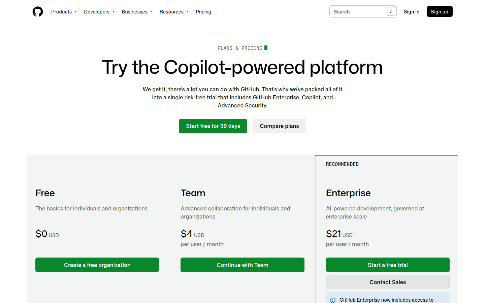
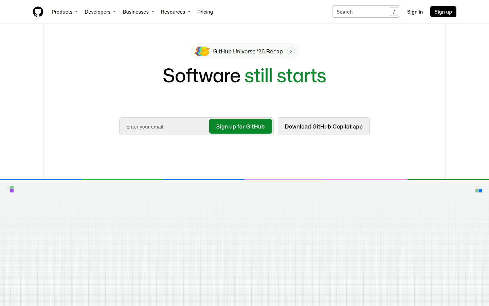
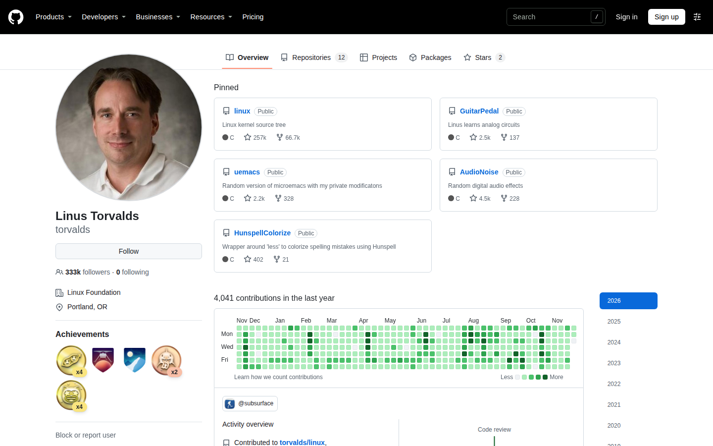
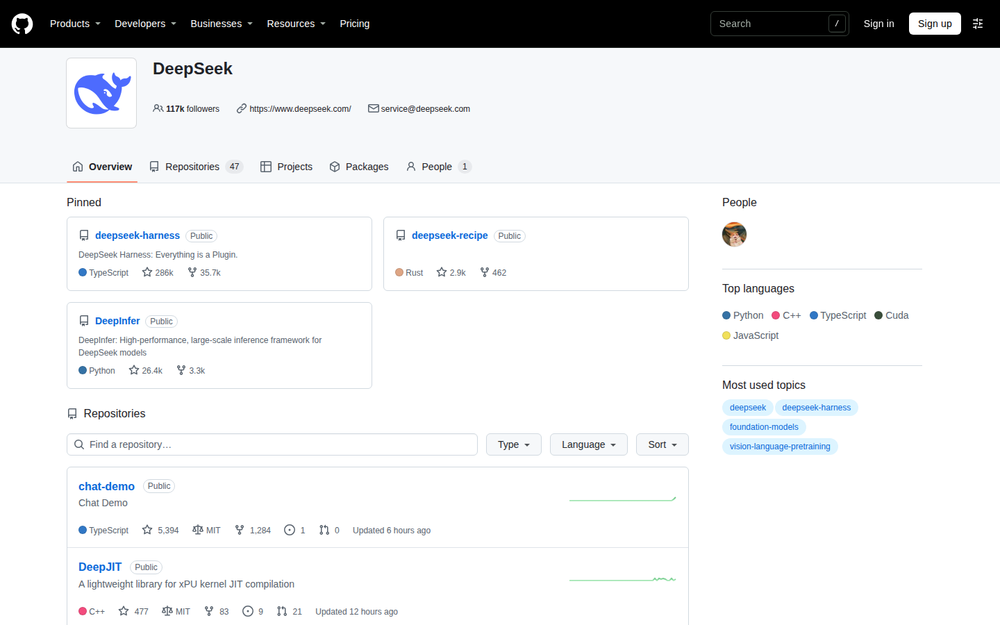
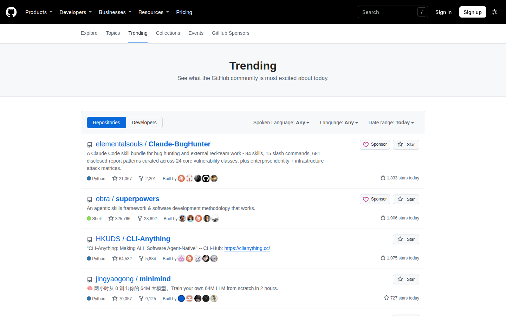
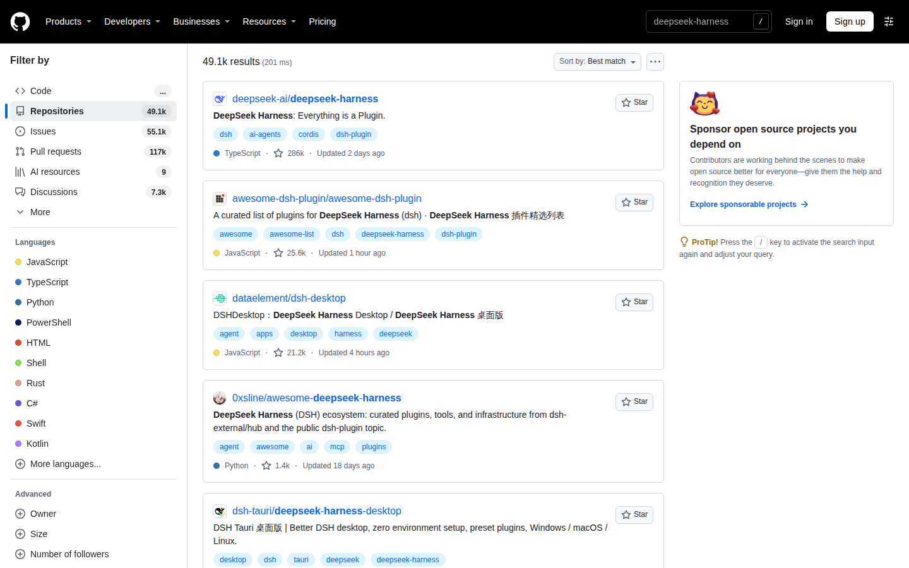
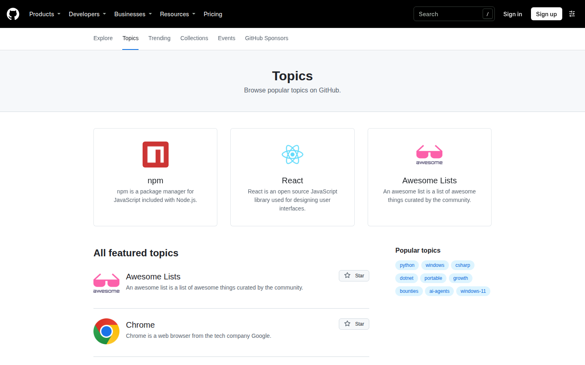
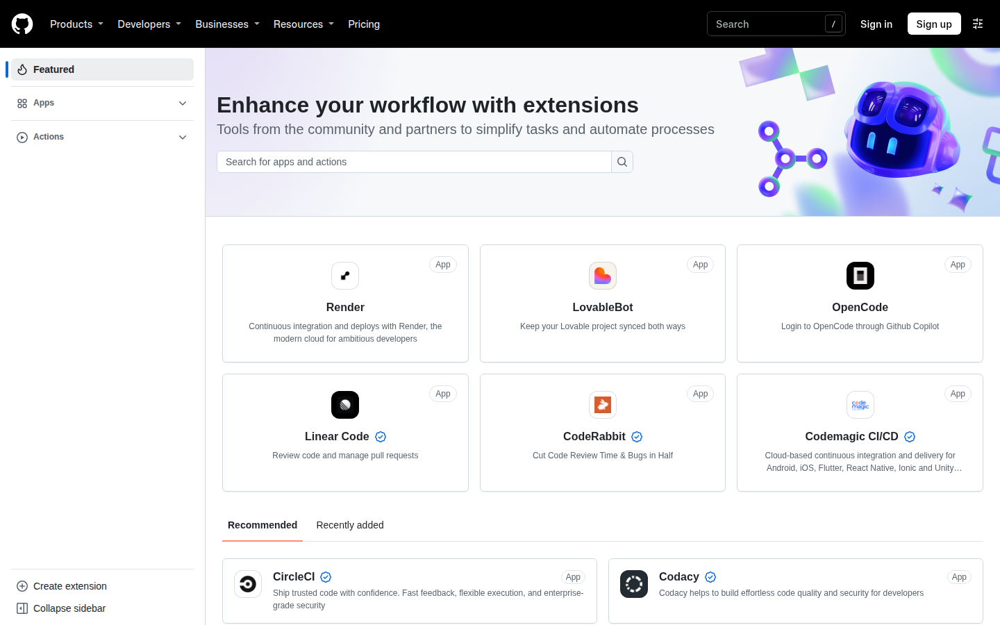

# 4.4 从 0 认识 GitHub：注册与全平台板块导览

> 学习目标：从零完成 GitHub 账号注册与双因素认证（2FA），认全 GitHub 平台的每一个核心功能板块（工作台、个人/组织主页、全局搜索、Explore 与趋势榜、新建仓库、Stars 收藏清单、Marketplace、Settings 授权安全），并亲手建出自己的第一个私有仓库。
>
> 演示环境：[github.com](https://github.com/) 网页版，全部 8 张平台实景截图均采集于 2026 年 11 月 24 日；面向**从未注册过 GitHub 的零基础学员**。

---

## 1. 还没注册过 GitHub，打开首页第一眼就犯怵？

刷 AI 资讯或听人聊提效工具时，你十有八九听过这几句话：

- 「这个工具开源了，去 GitHub 搜一下就能下。」
- 「把你搭好的 `ai-radar` 传到 GitHub 上存一份，换电脑也不丢。」
- 「今天 GitHub Trending 趋势榜第一是个新出的 AI Agent！」

可是当你第一次敲开 `https://github.com/`，迎面是一整屏英文：`Sign in`、`Sign up`、`Search`、`Products`、`Pricing`……心里难免冒出三个顾虑：

1. **我是职场白领/小老板，不是程序员，也能注册吗？会不会收费？**
2. **注册以后要不要折腾一堆复杂设置？安不安全？**
3. **登进去之后，工作台、Repositories、Stars、Explore、Trending、Topics、Marketplace、Gists、Settings……这么多板块各自管什么、平时该怎么用？**

先吃一颗定心丸：**GitHub 个人和组织基础版完全免费（`$0 USD`），支持创建无限个公开（Public）和私有（Private）仓库，完全不要求你会写代码。** 这一课面向从来没碰过 GitHub 的你，从注册按钮一路带到建出第一个私有仓库，把整个平台的所有核心板块一次讲透。

---

## 2. 系统位置：先分清「Git」「GitHub 平台」和「单个仓库」三层关系

在 4.1–4.3 课里，你已经用熟了 **Git**（装在你自己电脑里的「游戏存档机」）。现在把视野拉高，看清从本地电脑到云端网站的三层地图：

```
第 1 层：你的电脑（本地 Git，4.1–4.3 课）
  └── 存着 ai-radar 文件夹和本地提交历史，断网也能用
                ↕（联网同步：clone / push / pull）
第 2 层：GitHub 平台大厅（账号、工作台、搜索、趋势榜、新建仓库、设置） ← 【本课位置】
  ├── 逛广场：Search / Explore / Trending / Topics / Marketplace
  ├── 管自己：Home 工作台 / Your Profile 个人主页 / Stars 收藏分组 / Settings 安全
  └── 建库房：点右上角 + → New repository（创建自己的云端项目库）
                ↓（点进任意一个具体项目）
第 3 层：单个仓库内部（4.5 课详细导览）
  └── Code / Issues / Pull requests / Releases / README / LICENSE
```

把这三层分开，逛 GitHub 就绝不会迷路：**这一课先把第 2 层「整个平台大厅」摸得门儿清，下一课 4.5 再推开具体某一个仓库的大门往里细看。**

---

## 3. 讲清楚：从 0 注册 + 全平台功能板块全景拆解

### 3.1 费用、账号注册与必开的 2FA 安全锁

先打消收费顾虑。打开 `https://github.com/pricing`，官方把套餐明明白白分成三档：



- **`Free`（`$0 USD`）**：个人和小团队起步完全够用——无限个公开仓库、无限个私有仓库、基础协作和每月赠送的自动化额度，**不需要绑信用卡**。
- **`Team`（`$4 USD` / 人 / 月）** 和 **`Enterprise`（`$21 USD` / 人 / 月）**：中大型研发团队管复杂权限和合规审计才需要，普通学员和小老板直接用 `Free` 即可。

确认免费后，回到 `https://github.com/` 首页准备注册：



点右上角黑色按钮 **`Sign up`**（或直接在中间框填邮箱点绿色 **`Sign up for GitHub`**），按这 4 步走完：

1. **填邮箱（Email）**：强烈建议用你的**长期私人常用邮箱**（如 Gmail、Outlook、QQ/163 邮箱），不要用随时可能离职停用的公司邮箱——以后你收藏的项目和个人作品都跟着这个账号走。
2. **设密码（Password）**：用独立强密码（字母 + 数字 + 符号），不要和微信/银行卡密码重复。
3. **起用户名（Username）**：**这一步想清楚再填！** 你的用户名会直接出现在今后所有仓库网址里（`https://github.com/<你的用户名>/ai-radar`），并且对外公开可见。建议用简洁易读的英文或拼音短名（如 `alex-ops`、`chen-studio`），**绝不要用真实手机号或身份证号**。
4. **选国家/地区 + 完成人机拼图验证 + 填邮箱 8 位验证码**：验证完就正式拥有 GitHub 账号了。（如果系统弹出问卷问你身份和兴趣，直接点底部 `Skip personalization` 跳过即可，不影响任何功能。）

> **注册完第一件必做的事：开启 2FA（双因素认证）**
>
> 为了防止账号被盗、代码和密钥遭殃，GitHub 官方已要求活跃贡献者逐步启用 **2FA（Two-Factor Authentication）**。登录后点右上角头像 → **`Settings`** → 左侧 **`Password and authentication`** → **`Enable two-factor authentication`**，用手机验证器 App（如 Microsoft Authenticator、Google Authenticator、Apple 密码 App）扫一下二维码即可开启。系统同时会给一份 **`Recovery codes`（恢复码）**，务必下载保存好，万一换手机可以靠它救回账号。

---

### 3.2 先分清两种账号页面：个人主页 vs 官方组织主页

在 GitHub 上，几乎所有项目网址都长成 `github.com/斜杠前/斜杠后`。斜杠前面只有两种可能：**个人账号（User）** 或 **组织账号（Organization）**。认清这两张页面，以后一眼就能分辨一个工具是「个人业余写的」还是「官方团队维护的」。

先看一张最经典的**个人主页**——Git 发明人 Linus Torvalds 的主页（`https://github.com/torvalds`）：



个人主页从上到下固定有 4 块：
1. **顶部 5 个标签**：`Overview`（总览）、`Repositories`（名下所有仓库）、`Projects`（任务看板）、`Packages`（发布的软件制品）、`Stars`（他收藏过的开源项目——**逛大佬的 `Stars` 列表，是发现宝藏工具的捷径！**）。
2. **左侧名片**：头像、姓名、用户名、`Follow` 关注按钮、粉丝数、所属公司和城市。
3. **右侧上方 `Pinned`**：作者亲自置顶的代表作（最多 6 个）。
4. **右侧下方绿色格子（Contribution graph，俗称「小绿点」）**：过去一年里每一天在 GitHub 上提交代码、提 Issue、审 PR 的活跃热力图，颜色越深代表那天干活越多（图里 Linus 一年贡献了 `4,041` 次）。

再对照看一张**官方组织主页**——DeepSeek 官方主页（`https://github.com/deepseek-ai`）：



对比个人主页，组织主页有 3 个明显特征：
- 顶部多了 **`People`**（组织成员列表），少了个人才有的 `Stars`；
- 顶部挂着官方认证的域名（`https://www.deepseek.com/`）和官方邮箱（`service@deepseek.com`）；
- 中间直接陈列该机构全部公开仓库（图里共 `47` 个）并带搜索与语言筛选框。

---

### 3.3 登录后全平台 8 大功能板块（每个板块是什么意思、怎么用）

登录进 GitHub 后，不管你在哪个页面，最顶上永远有一条**全局导航栏**：
- **最左侧 `☰` 三条杠**：打开全站抽屉菜单（`Home` / `Issues` / `Pull requests` / `Projects` / `Discussions` / `Explore` / `Marketplace`）；
- **中间偏右 `Search` 搜索框**：按键盘 **`/`** 键随时一键激活；
- **右侧 `+` 加号**：新建入口（`New repository` 新建仓库、`Import repository`、`New gist`）；
- **右侧小框与小铃铛**：直达跨仓库待办（`Issues` / `PR`）和 **`Notifications`（消息通知）**；
- **最右侧圆形头像**：打开个人菜单（`Your profile`、`Your repositories`、`Your stars`、`Settings`）。

把整个 GitHub 平台的 **8 大功能板块** 放进一张表里，每一个的意思和用法一目了然：

| 平台板块 | 入口位置 | 它到底是什么 | 零基础白领 / 小老板怎么用它 |
|---|---|---|---|
| **1. Home（工作台首页）** | 登录后默认页 / 左上角 `☰` → `Home` | 你的个人主控台：左侧 `Top repositories`（常用仓库列表），中间 `Feed`（关注项目动态流），右侧 `Latest changes`（平台更新） | 每次登录直接从左侧点进自己的 `ai-radar` 仓库，不用每次重新搜 |
| **2. Search（全局搜索）** | 顶栏搜索框，或按键盘 **`/`** 键 | 全网代码、仓库、报错讨论的超级搜索引擎 | 找工具直接搜名字；电脑报错直接搜英文报错关键词并切左侧 `Issues` / `Discussions` |
| **3. Explore & Trending（发现与趋势榜）** | 左上角 `☰` → `Explore`，或直接访问 `github.com/trending` | 全球开源圈的「热搜榜」和专题广场（含 `Explore` / `Topics` / `Trending` / `Collections`） | 每周花 2 分钟刷一次 `Trending`，看全球最新爆火的 AI 工具和效率脚本 |
| **4. Topics（主题标签）** | `Explore` 顶栏 → `Topics`，或 `github.com/topics` | 按主题归类的开源项目大合集（如 `python`、`ai-agents`、`awesome`） | 想找某一领域的精选清单，直接搜 `awesome` + 主题（比如 `awesome-deepseek-harness`） |
| **5. `+ New repository`（新建仓库）** | 右上角 **`+`** → **`New repository`** | 在云端为自己的项目建一个新库房 | 把你本地的 `ai-radar` 或办公脚本传上云端备份；**工作文件务必选 `Private` 私有！** |
| **6. Your Stars & Lists（收藏与分组）** | 右上角头像 → **`Your stars`** | 你的专属开源工具书签夹，支持自己建分类清单（`Lists`） | 看到好项目点 `Star`，再归进「AI 工具」「Excel 脚本」分组，不再收藏即吃灰 |
| **7. Marketplace & Gists（插件商店 & 便签）** | `☰` → `Marketplace` / `+` → `New gist` | `Marketplace` 是给仓库装自动化插件（`Apps` 和 `Actions`）的应用商店；`Gist` 是快速分享单段代码或文本的云端便签 | 平时先眼熟即可；看到仓库接入了 `CodeRabbit`、`Linear` 等审稿机器人，知道它们来自这里 |
| **8. Settings（账号与安全设置）** | 右上角头像 → **`Settings`** | 管理密码、2FA、邮箱、第三方授权应用和开发者电子钥匙（Token / SSH Key） | **监工必查 3 处**：开 2FA、查 `Applications` 解绑不用的授权工具、妥善保管 `Personal access tokens` |

> `[可选补拍：作者用测试账号登录后补拍 Home 工作台首页、+ New repository 创建表单及 Settings → Applications 页面]`

下面看 4 张核心广场板块的真实界面，提前混个眼熟：

#### ① 今日趋势榜（`github.com/trending`）



实用小技巧：盯住表格右上角的 3 个筛选下拉框——`Spoken Language`（自然语言，可筛中文说明项目）、`Language`（编程语言，比如只看 `Python`）、`Date range`（`Today` 今日 / `This week` 本周 / `This month` 本月）。图里 2026-11-24 当天榜首就躺着 `obra/superpowers`、`HKUDS/CLI-Anything`、`jingyaogong/minimind` 等热门 AI 项目。

#### ② 全站搜索（按 `/` 呼出，实测搜 `deepseek-harness`）



看左侧 **`Filter by`** 侧边栏：搜同一个词，不只能找仓库（`Repositories`），还能一键切到 **`Issues`**（`55.1k`）、**`Discussions`**（`7.3k`）直接搜全网别人遇到过的报错和解决方案，或者按 **`Languages`** 筛选只要 `Python` 项目。右上角 `Sort by` 可以从 `Best match`（综合匹配）切成 **`Most stars`**（按收藏数从高到低排），最快找到最主流的项目。

#### ③ 主题标签广场（`github.com/topics`）



零基础特别值得记住右下角和中间的 **`Awesome Lists`**——开源社区有个传统，凡是名字叫 `awesome-xxx` 的仓库，往往是热心人整理好的「某个领域最好用的工具大全清单」。

#### ④ 插件应用商店（`github.com/marketplace`）



以后你在别人的开源项目里看到机器人自动帮人审核 PR（比如图里的 `CodeRabbit`）或自动部署网页（`Render`），就知道这些能力都是从 `Marketplace` 的 `Apps` / `Actions` 装上去的。

---

### 3.4 新手必学核心实操：点 `+ New repository` 建你的第一个私有仓库

登进账号后，点右上角 **`+`** → **`New repository`**，页面里只需要盯住 5 个选项，其他全保持默认：

1. **`Repository name`（仓库名）**：填简洁英文短名加连字符，例如 `ai-radar`（不要放空格）。
2. **`Description`（可选简介）**：写一句中文说明，例如「个人 AI 模型比价与每日情报雷达」。
3. **可见性开关（最关键！）**：
   - **`Public`（公开）**：全世界任何人都能看见你的文件——**只有确认完全不含公司数据、个人隐私和密钥的开源项目才选它**；
   - **`Private`（私有）**：只有你自己（以及你手动邀请的协作者）能看——**职场白领建第一个练习或工作仓库，默认永远先选 `Private`！**
4. **初始化选项（按需勾选）**：
   - `Add a README file`：帮你自动建一份空白说明书；
   - `Add .gitignore`：下拉选 **`Python`**，GitHub 会自动塞进一份专业的不上传清单（帮挡掉 `__pycache__`、`.venv` 等临时垃圾）；
   - `Choose a license`：私有仓库不用选，公开开源项目常用 **`MIT License`**。
5. 点底部绿色按钮 **`Create repository`**，不到 1 秒，你就拥有了自己的第一个云端私有仓库！

**最常见的误解**：以为在 GitHub 建仓库就会把代码自动公开给全世界看，或者把免费版当成「只能建公开仓库」。其实 GitHub 早在多年前就把免费版的**无限私有仓库**全部放开了，只要建库时盯住选 **`Private`**，就可以安心当成带完整版本历史的私人云端保险柜来用。

---

## 4. 现场看：零基础注册后的「5 分钟上手闭环」

拿到新账号后，照着下面 4 个动作顺序点一遍，5 分钟就能彻底告别陌生感：

1. **先逛榜收藏**：打开 `https://github.com/trending`，把 `Date range` 切到 `This week`，找一个你感兴趣的 AI 工具（比如 `deepseek-ai/deepseek-harness`）点右上角 **`Star`**；接着进右上角头像 → **`Your stars`** → **`Create list`**，建一个叫 `AI-Tools` 的清单把它装进去。
2. **练一次全局搜**：在任意页面直接按键盘 **`/`** 键，输入 `deepseek-harness` 回车，试着把左侧 `Filter by` 从 `Repositories` 切到 `Discussions`，再把右上角 `Sort by` 切到 `Most stars`，感受全网搜项目和搜报错的效率。
3. **辨一次官方号**：在搜索结果里点开 `deepseek-ai`（斜杠前面的名字），核对它是不是带有 `People` 栏和官方网址 `deepseek.com` 的组织主页。
4. **建第一个私有库**：点右上角 **`+`** → **`New repository`**，名字填 `ai-radar`，可见性选 **`Private`**，勾选 `Add a README file` 和 `.gitignore: Python`，点 **`Create repository`**。

做完这 4 步，你已经把 GitHub 平台上 90% 的日常高频动作亲手跑通了一遍。

---

## 5. 你来读：4 个真实新手场景，该去平台哪个板块？

下面 4 个问题都是刚注册完 GitHub 最常遇到的，先停 10 秒自己选入口，再核对判断：

1. 你想把本地写好的 `ai-radar` 模型比价脚本备份到云端，只给自己看、绝不能让同事或外人搜到——应该点哪里，关键选项选什么？
2. 你去年收藏过 30 多个好用的 AI 项目，现在想把其中 5 个专门做 Excel 处理的归类整理出来——应该去哪个板块？
3. 以前给某个第三方 AI 网页工具授权登录过你的 GitHub，现在那个工具不用了，担心它还留着你仓库的读取权限——应该去哪一键取消授权？
4. 老板问你「这周全球开源圈最火的 Python AI 项目有哪些」，你想 30 秒拉一份真实榜单出来——应该打开哪个页面，调哪两个筛选框？

**判断思路**：
1. 点右上角 **`+`** → **`New repository`**，可见性务必选择 **`Private`（私有）**；同时在仓库里配好 `.gitignore` 拦住 `.env` 密钥文件。
2. 点右上角头像 → **`Your stars`**，使用右侧的 **`Create list`** 建一个专属清单（例如「Excel 自动化」），把对应项目勾选归类。
3. 点右上角头像 → **`Settings`** → 左侧 **`Applications`**（分别检查 `Authorized GitHub Apps` 和 `Authorized OAuth Apps`），找到不再使用的工具直接点 **`Revoke`** 一键撤销授权。
4. 打开 **`Explore` → `Trending`**（`github.com/trending`），右上角把 **`Language`** 选为 `Python`，把 **`Date range`** 选为 `This week`，前几名一目了然。

---

## 6. 小检查（3 道判断题）

1. GitHub 免费账号（`Free $0 USD`）只能建公开（`Public`）仓库；想建只有自己能看的私有（`Private`）仓库，必须先花钱买每月 4 美元的 Team 套餐。（对 / 错）
2. 个人主页（User）顶部通常有 `Stars` 标签和绿色贡献热力图，而官方组织主页（Organization，如 `deepseek-ai`）顶部带有 `People` 成员栏和官方认证信息。（对 / 错）
3. 注册完 GitHub 后，可以在 `Settings → Applications` 里随时查看并撤销已授权的第三方应用权限；开启 2FA 时务必离线保存好恢复码（`Recovery codes`）。（对 / 错）

---

## 7. 下一课

现在你已经拥有了自己的 GitHub 账号、摸透了全平台 8 大功能板块，还亲手建好了第一个私有仓库。下一课 **4.5《GitHub 仓库页导览（以 DeepSeek Harness 仓库为例）》**，我们推开具体某一个开源仓库的大门，带你在 1 分钟内认清仓库里面的所有按钮、标签页、`Releases` 和 `LICENSE` 商用条款。

---

## 小检查答案

1. **错**。GitHub 免费版（`$0 USD`）就支持无限个公开仓库和无限个私有仓库，日常学习和工作备份完全免费够用。
2. **对**。区分个人账号和官方组织账号，是确认开源工具来源是否正规的第一步。
3. **对**。定期检查 `Applications` 撤销闲置授权、开启 2FA 并保存恢复码，是守住账号和私有仓库安全的必备习惯。

---

## 参考与事实边界

- **页面实测截图与数据**（采集于 2026-11-24）：
  - GitHub 首页与官方定价页：[https://github.com/](https://github.com/)、[https://github.com/pricing](https://github.com/pricing)（`Free $0 USD` / `Team $4 USD` / `Enterprise $21 USD`）；
  - 个人主页示例（Linus Torvalds）：[https://github.com/torvalds](https://github.com/torvalds)；组织主页示例（DeepSeek）：[https://github.com/deepseek-ai](https://github.com/deepseek-ai)；
  - 平台广场与搜索实景：[https://github.com/trending](https://github.com/trending)、[https://github.com/search?q=deepseek-harness&type=repositories](https://github.com/search?q=deepseek-harness&type=repositories)、[https://github.com/topics](https://github.com/topics)、[https://github.com/marketplace](https://github.com/marketplace)。
- **官方资料**：
  - 注册与快速上手：[Creating an account on GitHub](https://docs.github.com/en/get-started/start-your-journey/creating-an-account-on-github)；
  - 双因素认证（2FA）与恢复码：[Configuring two-factor authentication](https://docs.github.com/en/authentication/securing-your-account-with-two-factor-authentication-2fa/configuring-two-factor-authentication)；
  - 创建新仓库与可见性设置：[Creating a new repository](https://docs.github.com/en/repositories/creating-and-managing-repositories/creating-a-new-repository)；
  - 审查与撤销第三方授权应用：[Reviewing your authorized integrations](https://docs.github.com/en/authentication/keeping-your-account-and-data-secure/reviewing-your-authorized-integrations)。
- **作者说明**：登录后专属页面（Dashboard、`+ New repository` 表单、`Settings`）界面文字均核对自 GitHub 官方文档，并在文中保留 `[可选补拍]` 提示，供作者录播或审稿阶段按需用测试账号补拍真实画面。
