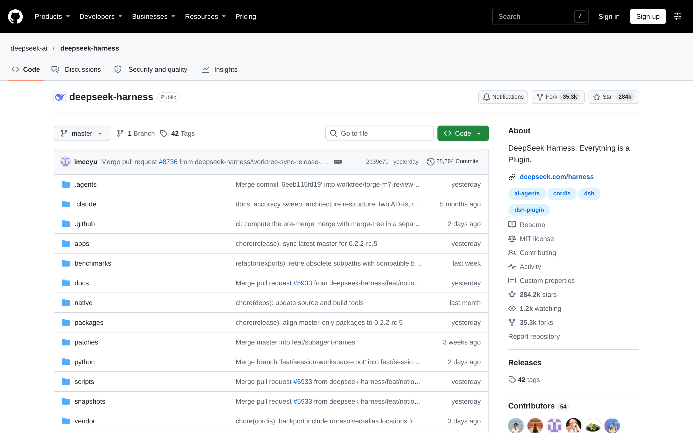
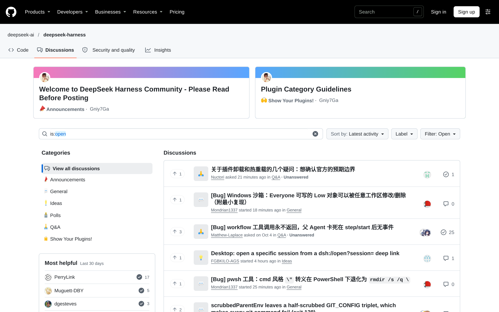
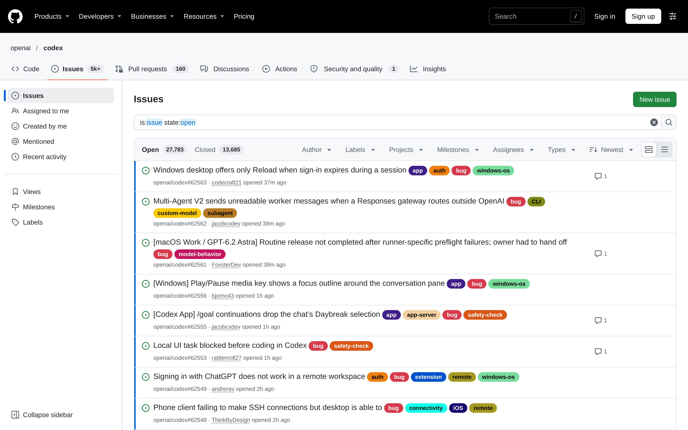
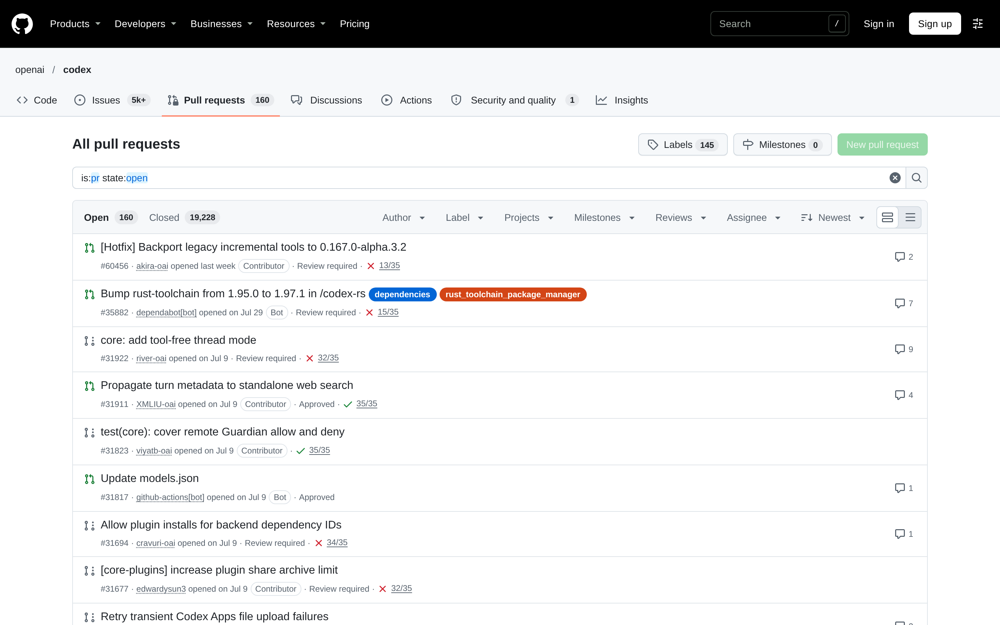
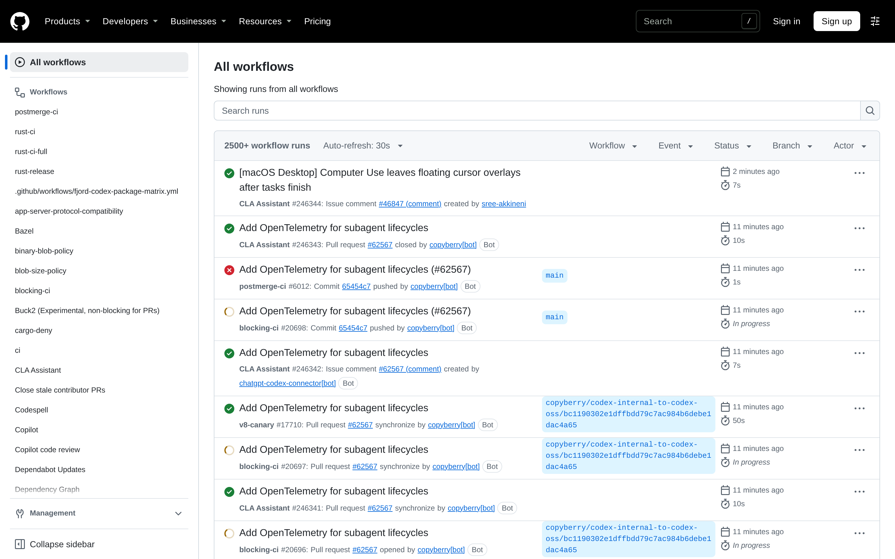
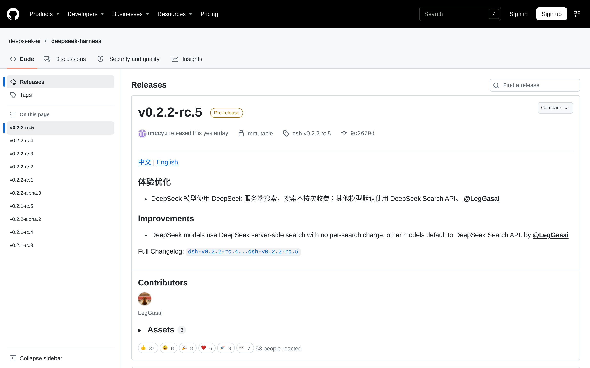
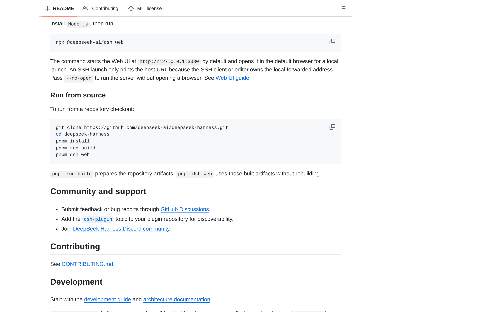
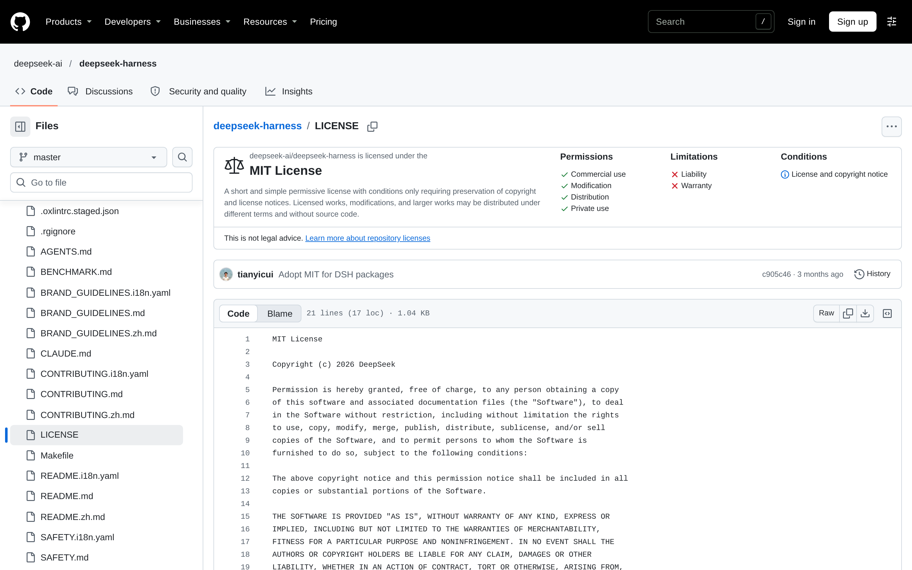
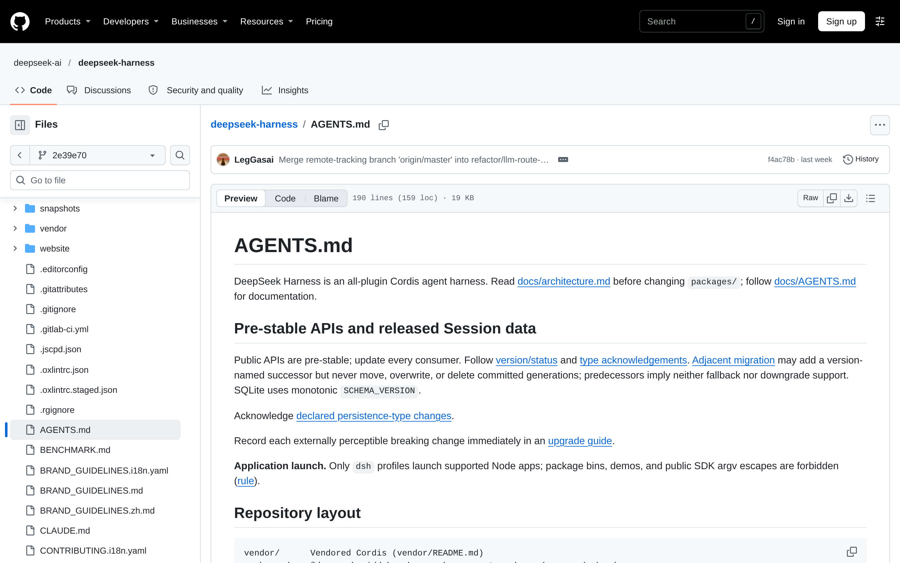

# 4.4 GitHub 页面导览（以 DeepSeek Harness 仓库为例）

> 学习目标：打开任意一个 GitHub 开源仓库，能认出每个标签页、按钮和根目录文件的作用，在 1 分钟内找到说明书、最新版本号、能否商用、报错去哪查。
>
> 演示仓库：主看 [deepseek-ai/deepseek-harness](https://github.com/deepseek-ai/deepseek-harness)，并对照 [openai/codex](https://github.com/openai/codex) 补齐 `Issues`、`Pull requests`、`Actions` 三个标签页。页面数据截自 2026 年 11 月 19 日。

---

## 1. 老板甩来一个 GitHub 链接，你该先看哪？

周老板听说可以用 DeepSeek Harness 帮运营自动整理报表，把链接 `https://github.com/deepseek-ai/deepseek-harness` 转发给小林，顺口问了四个问题：

1. 这是官方发的吗？用的人多不多？
2. 公司免费拿来用行不行，有没有商用版权风险？
3. 最新是哪个版本，电脑上怎么装？
4. 如果用着报错，去哪看别人有没有遇到过同样的问题？

小林点开页面，迎面全是英文：`Code`、`Discussions`、`Fork 35.3k`、`Star 284k`、`master`、`42 Tags`、`28,264 Commits`、`Releases`……

其实不用懂代码，这四个问题在页面上都有固定位置，就像逛超市知道「生鲜在里面、收银在出口」一样。这一课把 GitHub 仓库的每一块区域按顺序指给你看。

---

## 2. 系统位置：Git 和 GitHub 不是一回事

在 4.1–4.3 课里，我们学了 **Git**——装在你自己电脑里的版本管理工具，负责存档（commit）、看差异（diff）、切分支（branch）。

**GitHub** 是架在网上的代码托管与协作网站：

```
你的电脑（本地）                          GitHub（云端网站）
┌─────────────────────────┐             ┌────────────────────────────────────┐
│ 文件夹 + Git 本地存档    │  ← clone/   │ 公开或私有仓库（Repository）         │
│ （commit / diff / 分支） │    push →   │ • Code：文件与历史存档                │
└─────────────────────────┘             │ • Releases：打包好的正式版本与说明     │
                                        │ • Issues / Discussions：报 Bug 与问答│
                                        │ • Pull requests：审核改动再合并      │
                                        │ • Actions：自动跑测试               │
                                        └────────────────────────────────────┘
```

- **Git 负责什么**：在你电脑上记录每一次改动，断网也能用。
- **GitHub 负责什么**：把 Git 仓库放到网上，提供网页浏览、云端备份、版本发布、问题讨论和多人审核。
- **最常见的误解**：把 GitHub 当成软件下载站，或者以为「放在 GitHub 上的东西都公开免费随便商用」。实际上，GitHub 既能建 **Public（公开）** 仓库，也能建 **Private（私有，仅自己或授权成员可见）** 仓库；而公开仓库能不能商用，必须看它的 `LICENSE` 文件。

---

## 3. 讲清楚：按区域认识整个 GitHub 仓库页

打开 [deepseek-ai/deepseek-harness](https://github.com/deepseek-ai/deepseek-harness)，先看首页全貌：



把这张页面拆成四个区，从上到下、从左到右逐个认清楚。

### 3.1 最上方：身份牌和三个动作按钮

- **仓库地址栏 `deepseek-ai / deepseek-harness`**：斜杠前面是**拥有者（个人或组织账号）**，这里是 DeepSeek 官方组织 `deepseek-ai`；斜杠后面是**仓库名**。旁边灰底小标签写着 `Public`，表示这是一个公开仓库。
- **右上角三个按钮**：
  - **`Star`（284k）**：收藏 / 点赞。数字越高，通常代表关注的人越多。
  - **`Fork`（35.3k）**：**复制一份完整仓库到你自己的 GitHub 账号下**，方便你独立修改。新手最容易点错这里——如果你只是想把软件装到自己电脑上，不用点 `Fork`。
  - **`Notifications` / `Watch`（右侧 About 显示 `1.2k watching`）**：订阅仓库动态，有新发布或讨论时接收通知。

### 3.2 顶部功能标签栏：为什么不同仓库的标签数量不一样？

仔细看上面那张图的第二行导航栏，`deepseek-ai/deepseek-harness` 只显示了 4 个标签：`Code`、`Discussions`、`Security and quality`、`Insights`。

很多教程里提到的 `Issues`、`Pull requests`、`Actions` 去哪了？**GitHub 允许仓库管理员按自己的协作方式开关标签页。** DeepSeek Harness 关掉了公开的 `Issues` 和 `Pull requests`，并在说明书里明确写着：反馈和报 Bug 请走 `Discussions`（社区讨论区）。



再看我们后面 M7 要用到的第二个工具 [openai/codex](https://github.com/openai/codex)，它就把最经典的 **7 个标签页**全开着。对比看一次，以后去任何开源仓库都不会迷路：

| 标签页 | 中文意思 | 里面有什么 | 白领/小老板什么时候点它 |
|---|---|---|---|
| `Code` | 代码主页 | 文件夹、代码、底部渲染好的 `README` 说明书 | **每次必看**，找文档和下载入口 |
| `Issues` | 问题单 | 用户报的 Bug、提的需求，带 `Open`/`Closed` 状态和彩色标签 | **遇到报错时先来这里搜关键词**，大概率别人已经问过 |
| `Pull requests` | 合并请求（简称 PR） | 开发者提交的代码改动申请，含审核状态和自动检查结果 | 看项目最近正在修什么功能，或审核 AI/外包交来的改动 |
| `Discussions` | 讨论区 | 像论坛一样分「公告」「问答」「插件分享」等板块 | 仓库关掉 `Issues` 时（如 DSH），报 Bug 和提问就在这里 |
| `Actions` | 自动化流水线 | 每次代码变动后，GitHub 自动跑测试和打包的记录（绿勾通过、红叉失败） | 判断项目有没有自动化质检，不用自己动手改 |
| `Security and quality` | 安全与质量 | 官方披露的安全公告、漏洞反馈政策 | 公司上线前检查有没有未修的高危漏洞 |
| `Insights` | 数据洞察 | 贡献者列表、最近提交活跃度、代码频率图表 | 判断项目是不是还在持续维护（下一课 4.5 细讲） |

下面三张图来自 `openai/codex`，让你先眼熟 `Issues`、`Pull requests`、`Actions` 实际长什么样：







### 3.3 `Code` 主页的核心按钮和右侧栏

回到第一张图（DSH 的 `Code` 主页），中间和右侧有五个高频入口：

1. **分支选择器（`master` / `1 Branch`）**：切换不同分支（详见 4.3 课）。
2. **`42 Tags` 和右侧 `Releases`**：`Tag` 是打在某次存档上的版本号标签；`Releases` 是把对应版本整理成正式发布页，附带**更新日志**和**安装包（`Assets`）**。
3. **`28,264 Commits`**：历史存档总数，旁边显示最近一次改动的摘要和时间（图里写着 `yesterday`，说明项目昨天刚更新过）。
4. **绿色 `<> Code` 按钮**：真正把仓库弄到自己电脑上的入口——里面有复制克隆地址（给 `git clone` 用）和 `Download ZIP`（直接打包下载压缩包）。
5. **右侧 `About` 栏**：一句话介绍、官网地址（`deepseek.com/harness`）、许可证（`MIT license`）、Star/Watching/Fork 统计。

点开 `Releases`，就能看到 DSH 的最新版本记录：



注意版本号旁边的黄色小标 **`Pre-release`**，以及版本号里的 **`rc.5`**（Release Candidate，发布候选版）。它直接告诉你一件事：这个版本还在预览迭代期，功能更新很快，也可能出现不兼容调整——这比到处问别人「稳不稳定」准确得多。

### 3.4 根目录里最值得先认出的 4 个文件

仓库首页的文件列表里往往有几十个文件夹，你不需要点开源码目录（如 `packages/`、`native/`），只要先认出这 4 个文件：

1. **`README.md`（中文项目常附带 `README.zh.md`）**：项目总说明书。在 `Code` 首页往下滚就能直接看到排版好的内容，里面写着项目干什么用、怎么安装（图里直接给了 `npx @deepseek-ai/dsh web`）以及社区入口。



2. **`LICENSE`**：开源许可证。很多人怕英文法律条款不敢点，其实 GitHub 顶部已经用绿勾和红叉帮你翻译成三栏摘要了：



看顶栏三列：
- **Permissions（允许）**：`Commercial use ✓`（可商用）、`Modification ✓`（可修改）、`Distribution ✓`（可分发）、`Private use ✓`（可私用）；
- **Limitations（限制）**：`Liability ✗`（作者不担责）、`Warranty ✗`（不提供担保）；
- **Conditions（条件）**：`License and copyright notice`（二次分发时保留这份许可证和版权声明）。

3. **`.gitignore`**：Git 的「不上传清单」。文件名开头带个点 `.` 表示隐藏配置文件，里面列着哪些本地文件绝不能传到 GitHub（例如存 API Key 的 `.env`、临时缓存文件夹）。
4. **`AGENTS.md`（旁边常见 `CLAUDE.md`）**：**给 AI 看的仓库说明书**。以前开源仓库只放给人看的 `README.md`；现在像 DeepSeek Harness 这类项目，根目录里会专门放一份 `AGENTS.md`，明确规定 AI 改代码前要先看哪份文档、哪些底线不能破。



---

## 4. 现场看：1 分钟答完周老板的 4 个问题

现在回到第 1 节周老板抛给小林的 4 个问题，用刚才认出的位置逐个交差：

1. **是不是官方发的、用的人多吗？**
   看顶栏和 `About`：属于官方组织 `deepseek-ai`，公开仓库，`284k` Star、`35.3k` Fork、`54` 位贡献者、昨天刚有新提交，活跃度很高。
2. **公司免费用有没有商用风险？**
   点 `LICENSE` 看顶栏：采用 **MIT License**，明确允许商用、修改和私用，但属于无担保开源软件（出问题作者不担责，所以公司内部用必须自己做验收和备份）。
3. **最新是哪个版本、怎么装？**
   点右侧 `Releases` 看最新版：`v0.2.2-rc.5`，标了 `Pre-release`（预览版）；首页往下滚看 `README`，一行命令 `npx @deepseek-ai/dsh web` 就能启动网页版。
4. **遇到报错去哪查？**
   DSH 关掉了 `Issues`，README 指明走 `Discussions`——点顶部 `Discussions`，在搜索框输入报错关键词，就能看到像图里那样带 `[Bug]` 标题的真实讨论。

整套核查不到 2 分钟，没有读一行底层源码。

---

## 5. 你来读：3 个真实动作，该点页面哪里？

假设你现在打开一个开源工具的 GitHub 仓库页，碰到下面 3 种需求，先自己想 10 秒应该点哪里，再对照答案：

1. 你想把这个项目下载到自己电脑上试用，但你暂时不打算修改它的源码也不准备给官方提改动——应该点右上角的 **`Fork`**，还是文件列表上方的绿色 **`<> Code`**？
2. 你看到某个新版本更新了「搜索收费方式」，想核对具体是从哪个版本号开始改的——应该去 **`Releases`**，还是去 **`Insights`**？
3. 你在自己电脑上用 Codex 时碰到 Windows 登录过期弹窗只给刷新按钮的问题，想看看别人有没有遇到同样 Bug——在 `openai/codex` 仓库里，应该点顶部哪个标签页，怎么搜？

**参考判断**：
1. 点绿色 **`<> Code`**（复制地址用 `git clone`，或直接选 `Download ZIP`）。`Fork` 是在 GitHub 云端给你自己账号复制一份远程仓库，不会把文件下到你电脑里。
2. 点右侧 **`Releases`**，查看每个版本的更新日志（Changelog）。`Insights` 看的是活跃度和贡献统计，不是版本更新说明。
3. 点顶部的 **`Issues`**，在搜索框里把默认保留的 `is:issue` 留着，后面补上关键词（例如 `Windows sign-in`），还可以把 `state:open` 删掉同时搜已关闭（`Closed`）的问题，往往能直接找到官方给出的解决办法。

---

## 6. 小检查（3 道判断题）

1. 在 GitHub 上看到一个开源工具想下载到自己电脑，点右上角的 `Fork` 就能开始下载安装包。（对 / 错）
2. 不是所有 GitHub 仓库顶部都显示完全一样的标签页；比如 DeepSeek Harness 关掉了 `Issues`，改用 `Discussions` 处理反馈和 Bug。（对 / 错）
3. 看到 `LICENSE` 页面写着 `MIT License` 且勾选了 `Commercial use ✓`，意味着公司可以直接拿来商用，不需要再付授权费，但作者也不对使用后果承担赔偿责任。（对 / 错）

---

## 7. 下一课

认清了 GitHub 上每个按钮和页面的位置之后，下一课 **4.5《怎么判断一个开源项目靠不靠谱》**，我们把 Star、提交时间、Issue/Discussions 响应速度和 License 串成一套 3 分钟体检清单，帮你避开「空壳项目」和「已经停更的坑」。

---

## 小检查答案

1. **错**。`Fork` 是把别人的仓库复制一份到你的 GitHub 账号下；下载安装包去 `Releases` 的 `Assets`，下载源码点绿色 `<> Code`。
2. **对**。仓库维护者可以按需启用或隐藏 `Issues`、`Pull requests`、`Discussions`、`Actions` 等标签页。
3. **对**。MIT 是非常宽松的开源协议，允许商用、修改和私有使用，只需保留版权和许可声明，同时附带免责与无担保条款。

---

## 参考与事实边界

- **页面实测截图与数据**（采集于 2026-11-19）：
  - DeepSeek Harness 仓库：[https://github.com/deepseek-ai/deepseek-harness](https://github.com/deepseek-ai/deepseek-harness)（Star `284k`、Fork `35.3k`、Tags `42`、Commits `28,264`、最新版本 `v0.2.2-rc.5 Pre-release`、许可证 `MIT`；未开放公开 `Issues`/`Pull requests`，通过 `Discussions` 收集社区反馈）。
  - OpenAI Codex 仓库：[https://github.com/openai/codex](https://github.com/openai/codex)（用于展示完整的 `Issues`、`Pull requests`、`Actions` 标签页）。
- **官方说明**：GitHub 仓库许可证摘要页顶部明确标注「This is not legal advice」，涉及商业产品二次分发或合规审查时以正式法务意见为准。
