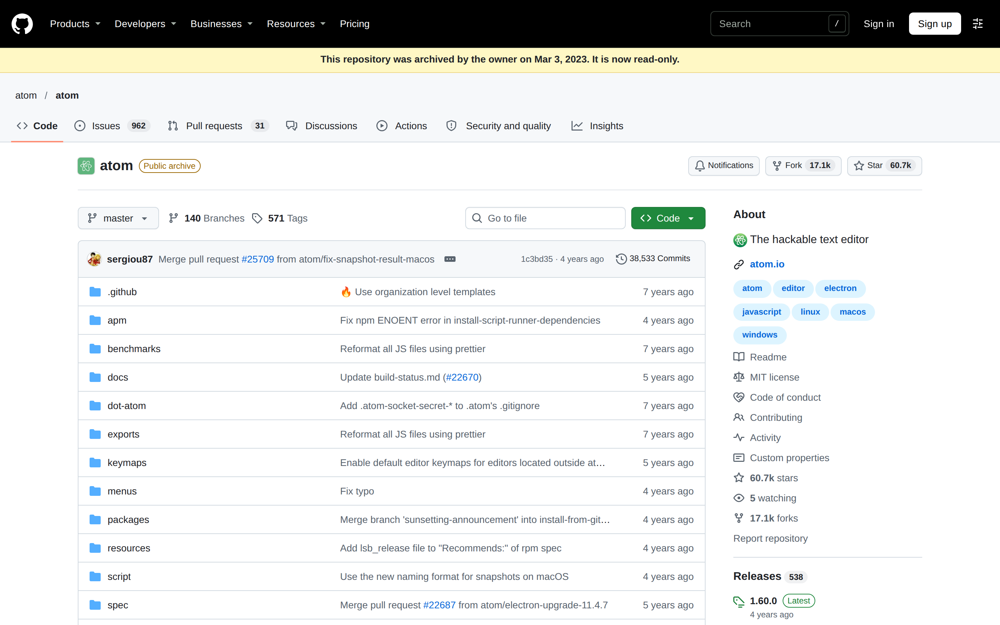
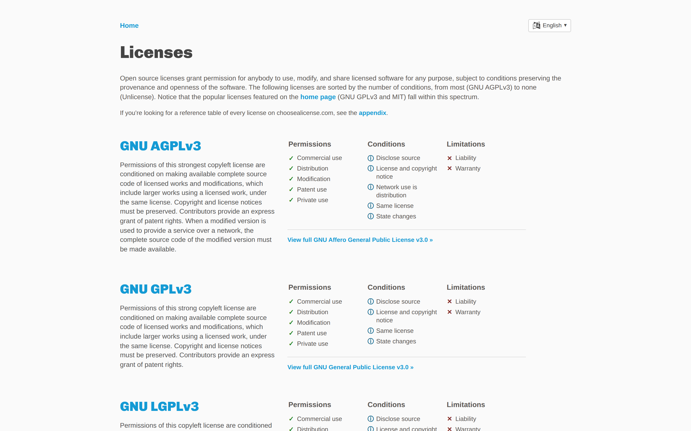

# 4.6 怎么判断一个开源项目靠不靠谱

> 学习目标：掌握一套「3 分钟 5 项体检清单」（活跃度、社区响应、真实热度防刷星、文档与发布完整度、开源协议商用边界），拿到陌生 GitHub 仓库链接时能快速筛掉停更坑、空壳项目和商用合规雷。
>
> 演示环境：[github.com](https://github.com/) 与 GitHub 官方维护的 [choosealicense.com](https://choosealicense.com/licenses/) 实景页面与公开仓库元数据（均采集于 2026 年 11 月 24 日）。

---

## 1. 看到一个「6 万多 Star」的开源神器，就能直接搬进公司用吗？

4.5 课我们认全了单个 GitHub 仓库的每个角落。接下来你会遇到一个极其真实的职场考验：同事在群里转来一个爆火工具的 GitHub 链接，或者小红书刷到一篇「GitHub 6 万星免费平替神器，老板看了狂喜！」

很多新手判断一个项目靠不靠谱，只看一个指标：**Star 数量高不高**。结果兴冲冲下回来折腾一整个下午，要么死活装不上（因为作者 3 年前早就停更不管了），要么用进公司对外产品里才被法务紧急叫停（因为协议禁止拿去二次售卖，甚至压根没写开源协议）。

这一课给你一套照着勾就能用的 **「3 分钟 5 项体检清单」**——以后不管谁甩来一个开源链接，按清单扫 5 眼，靠谱的放心用，踩坑的 30 秒直接淘汰。

---

## 2. 系统位置：把别人开源代码装进你电脑前，必须过的 5 道安检

```
刷到一个 GitHub 仓库链接（朋友推荐 / 趋势榜 / 搜到）
      ↓
3 分钟 5 项体检清单（先看页面，绝不急着下载运行！）      ← 【本课位置】
  ├── 检 ① 活不活：顶部有没有黄色 archived 横幅？最近几周还有提交吗？
  ├── 检 ② 管不管：Issues / Discussions 里维护者回不回话？
  ├── 检 ③ 真不真：Star 数和提交数、代码内容匹不匹配（防空壳/刷星）？
  ├── 检 ④ 全不全：README 写没写清怎么装、依赖什么、有没 Releases？
  └── 检 ⑤ 能不能商用：右侧栏 License 是 MIT/Apache，还是 GPL/AGPL/Other/无协议？
      ↓
5 项全过关 → 安全放进隔离目录试跑 / 评估接入工作流（4.7 课讲怎么协作提需求）
```

---

## 3. 讲清楚：3 分钟 5 项体检清单 + 开源协议商用红绿灯

### 3.1 前 4 项快速体检：看活不活、管不管、真不真、全不全

| 体检项 | 看仓库哪里 | 🟢 健康靠谱信号 | 🔴 警惕 / 直接劝退信号 |
|---|---|---|---|
| **① 活不活（维护状态）** | 页面最顶部横幅 + 文件列表上方最近提交时间 + `Releases` 日期 | 最近几周到几个月仍有提交或发版（例如 `openai/codex`、`astral-sh/uv`、`deepseek-ai/deepseek-harness` 均在 2026 年 11 月持续更新） | 顶部出现**黄色 `archived` 只读横幅**，或者最近一次提交停在 2–3 年前且无人维护 |
| **② 管不管（社区响应）** | `Issues` 或 `Discussions` 标签页（随机点开最新 3 条） | 维护者有回复、有持续关闭解决（`Closed`）的记录；注：部分仓库像 `deepseek-harness` 关了 `Issues` 改用 `Discussions`，要看它实际启用的板块 | 几百条报错帖挂了一年没人回、最新评论全是「作者跑路了吗 / 早就用不了了」 |
| **③ 真不真（防刷星与空壳）** | 对比右上角 `Star` 数 vs `Commits` 提交次数 vs 文件夹实际代码 | Star 数、Commits 次数、Contributors 贡献者人数成比例，代码目录结构像 M3 讲的标准项目 | 几千甚至上万 Star，结果总共只有 2 次 Commit、仓库里只有一篇宣传文档加付费引流二维码，连可跑的代码都没有 |
| **④ 全不全（落地门槛）** | `README.md`、`Releases`、`requirements.txt` / `package.json` | 写清「干嘛用、支持哪些系统、安装步骤、是否需要 API Key」，对非程序员甚至提供了 `Releases` 一键安装包 | `README` 只有三行字、不写依赖清单、或者让你把来历不明的 `curl ... \| sh` 直接贴进终端且不解释来源 |

### 3.2 第 5 项重中之重：一张表看懂开源协议（License）的商用边界

点开仓库右侧栏的协议名称（或在 GitHub 官方维护的 [choosealicense.com](https://choosealicense.com/licenses/) 对照），把常见的 5 种情况按「**公司能不能安心拿来用**」分成四档：

| 级别 | 常见协议 | 真实代表仓库（2026-11-24 核查） | 一句话翻译给白领和老板 |
|---|---|---|---|
| **🟢 绿灯（最省心）** | **MIT** / **Apache-2.0** / **BSD** | `deepseek-ai/deepseek-harness`（MIT）、`openai/codex`（Apache-2.0）、`astral-sh/uv`（Apache-2.0） | 免费用、免费改、允许商用，只需保留原作者的版权和许可声明；Apache-2.0 还额外包含明确的专利授权条款 |
| **🟡 黄灯（分发须开源）** | **GPL-3.0** | 众多传统 Linux 与桌面开源软件 | **公司自己内部装来用通常没问题**；但如果你改了它的代码并打包分发给外部客户，你的整个派生软件也必须按 GPL 开源 |
| **🟠 橙灯（联网服务也须开源）** | **AGPL-3.0** | `grafana/grafana`（78.1k Star，AGPL-3.0） | 比 GPL 更严格——哪怕你不卖安装包，只是**把改过的版本部署在自家服务器上、通过网页给外部用户提供服务**，同样触发开源义务 |
| **🔴 红灯（务必停下来核查！）** | **`Other`（非标准商业限制许可）** 或 **根本没有 `LICENSE` 文件** | `n8n-io/n8n`（212k Star，采用 Sustainable Use License 且含 `.ee.` 企业专有文件） | ① 看到 `Other` / `View license` 必须点开细看，常见条款是「内部自用免费，禁止拿去搭建竞争性 SaaS 卖给外部客户」；② **如果一个公开仓库压根没有 `LICENSE` 文件，法律上默认「保留所有权利」，绝对不是免费随便用！** |

> **监工安全补丁（衔接 1.3 与 3.4 课）**：即便一个项目 5 项体检全部过关，下载后**准备第一次运行陌生脚本前**，仍要坚持两条底线：① 绝不在装满公司机密表和 `.env` 的目录里直接试跑；② 陌生安装脚本先让 AI 帮你快速通读一遍，确认没有偷偷上传本地文件或乱删目录的指令再执行。

**最常见的误解**：以为「既然代码都公开放在 GitHub 上了，大家都能看见，就等于免费开源、怎么商用都行」。**错！** 「公开可见（Public）」只代表你可以浏览源码，不代表作者放弃了版权；决定你能不能复制、修改、商用的唯一依据，是仓库里那份白纸黑字的 **`LICENSE`** 文件。

---

## 4. 现场看：两个真实仓库一眼破除两大盲区

### 现场 ①：60.7k Star 却早已停更归档的 `atom/atom`

打开曾经大名鼎鼎的编辑器仓库 `https://github.com/atom/atom`，第一眼看右边：`Star 60.7k`、`Fork 17.1k`、`MIT license`——单看这仨数字简直完美无瑕。可只要把视线抬高 3 厘米，真相立刻写在脸上了：



盯住图里 3 个立刻劝退的真实信号：
1. 最顶部一整条醒目黄色横幅：**`This repository was archived by the owner on Mar 3, 2023. It is now read-only.`**（仓库已于 2023 年 3 月 3 日归档，现为只读）；
2. 仓库名字 `atom` 右侧挂着圆框标签 **`Public archive`**；
3. 文件列表右侧提交时间清一色写着 `4 years ago`、`5 years ago`，右下角最新 Release `1.60.0` 也是 `4 years ago`。

这就是为什么体检清单把「先看活不活、别先看 Star」排在第一条：高星可能只是它多年前的辉煌历史！

### 现场 ②：用 `choosealicense.com` 10 秒读懂协议的「允许 / 条件 / 限制」

如果不认识某个仓库挂的英文协议名，打开 GitHub 官方维护的 [choosealicense.com/licenses/](https://choosealicense.com/licenses/)，每一条协议都被翻译成了三列一目了然的小图标：



看懂这三列就彻底不怕英文协议：
- **Permissions（绿勾 `✓`）**：你能干什么（如 `Commercial use` 允许商用、`Private use` 允许私有使用）；
- **Conditions（蓝圈 `ⓘ`）**：你必须履行的条件——注意看图里 **GNU AGPLv3** 下面多出的 **`Disclose source`（公开源码）**、**`Network use is distribution`（联网提供服务即视为分发）** 和 **`Same license`（必须沿用同协议）**，一秒就能明白为什么公司对外包装 SaaS 产品时必须对 AGPLv3 亮橙灯！
- **Limitations（红叉 `×`）**：几乎所有开源协议共有的免责条文——`Liability`（作者不承担赔偿责任）与 `Warranty`（不提供担保）。

---

## 5. 你来读：3 个真实选型场景，3 分钟内你怎么给老板拍板？

假设团队准备挑一套开源工具接入日常运营，你在 GitHub 上筛出下面 3 个候选仓库，停 10 秒做出你的监工建议：

1. **候选 A**：`Star 42k`，但顶部挂着黄色横幅 `This repository was archived by the owner... It is now read-only.`，最近一次 Release 是 3 年前。
2. **候选 B**：`Star 212k`，最近今天刚更新，活跃度极高，但右侧栏协议显示 `View license`（点进去写着 `Sustainable Use License`，且禁止直接打包成托管 SaaS 对外售卖）。你们公司准备把它改一改、贴自家品牌按月卖给外部客户。
3. **候选 C**：`Star 1.8k`，不算特别出名，但最近 2 周有 15 次提交、`MIT license`、`Issues` 里作者 24 小时内认真回复了最新 5 个问题，且 `README` 写清了 `.venv` 安装步骤与 `.env.example` 配置项。

**判断思路**：
1. **候选 A：直接淘汰！** 哪怕有 4.2 万星，归档只读意味着不再修复安全漏洞也不再兼容新系统，现在引入纯属给自己埋定时炸弹。
2. **候选 B：亮红灯，立刻请法务或合规审核，绝不擅自拿去对外售卖！** 如果只是公司内部自己跑工作流（不对外提供竞争性托管服务），可以进一步对照协议条款评估；但只要涉及贴牌卖给外部客户，非标准 `Other` 许可极易踩侵权红线。
3. **候选 C：优先试用！** Star 不是越多越靠谱——1,800 星在垂直工具领域已经非常健康，关键在于它「持续维护、响应及时、MIT 商用无忧、文档完整」，是典型的优质实用项目。

---

## 6. 小检查（3 道判断题）

1. 只要一个 GitHub 仓库的 Star 数超过 5 万，就说明它现在依然非常活跃，可以直接放心引入公司新项目。（对 / 错）
2. 看到一个公开 GitHub 仓库里完全没有 `LICENSE` 文件，说明作者把它彻底免费送给大家了，可以随便拿去修改和商用。（对 / 错）
3. `MIT` 和 `Apache-2.0` 属于非常宽松的开源协议，通常允许企业内部使用和商业项目集成（保留版权与许可声明即可）；遇到 `AGPL-3.0` 或自定义 `Other` 协议时，涉及对外商用前应仔细核对开源/限制条款。（对 / 错）

---

## 7. 下一课

学会了挑选靠谱的开源仓库，接下来进入 **M4 的压轴课 4.7《Issue → PR → 审核 → 合并》**：我们直接拿 `openai/codex` 仓库里一条**由 AI Agent 分支发起、26 小时修复线上故障并自动关单的真实案例**，带你看完整条开源协作与 AI 监工审核闭环。

---

## 小检查答案

1. **错**。高 Star 可能是多年前积累的历史数据（例如 `atom/atom` 拥有 60.7k Star 但已于 2023 年归档只读），必须优先核查顶部归档横幅与最近提交时间。
2. **错**。没有 `LICENSE` 文件的公开仓库默认受完整版权保护（保留所有权利），仅允许查看，不代表允许复制、修改或商用。
3. **对**。选型前养成先查 `License` 的习惯，能替团队避开绝大部分后期法务与合规隐患。

---

## 参考与事实边界

- **页面实测截图与实时元数据**（均采集于 2026-11-24 / UTC 2026-11-25）：
  - [atom/atom](https://github.com/atom/atom)：60.7k Stars、17.1k Forks、MIT 协议，已于 Mar 3, 2023 归档只读；
  - 活跃仓库参照：`deepseek-ai/deepseek-harness`（`286.6k` Stars、`MIT`）、`openai/codex`（`136.3k` Stars、`Apache-2.0`）、`astral-sh/uv`（`92.6k` Stars、`Apache-2.0`）、`grafana/grafana`（`78.1k` Stars、`AGPL-3.0`）、`n8n-io/n8n`（`212k` Stars、Sustainable Use License 与 `.ee.` 企业版条款）。
- **官方资料**：
  - GitHub 官方开源协议指南：[Choose an open source license](https://choosealicense.com/licenses/)；
  - GitHub 关于无许可证仓库的法律说明：[Licensing a repository — GitHub Docs](https://docs.github.com/en/repositories/managing-your-repositorys-settings-and-features/customizing-your-repository/licensing-a-repository)。
- **作者说明**：本课协议分级为面向非法律背景职场人的快速风险初筛参考，不构成正式法律意见；涉及商业软件二次分发或对外 SaaS 运营时，请以企业法务审核为准。
