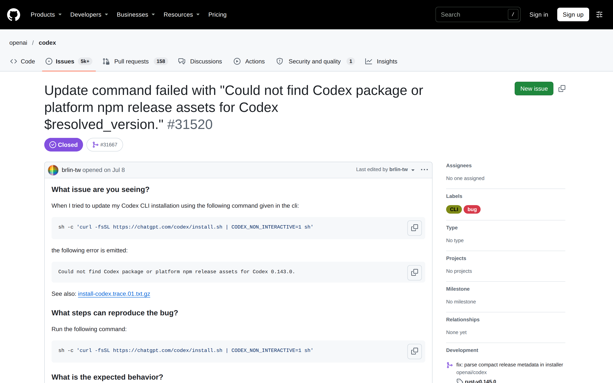
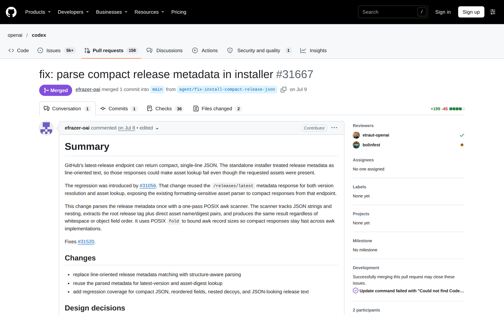
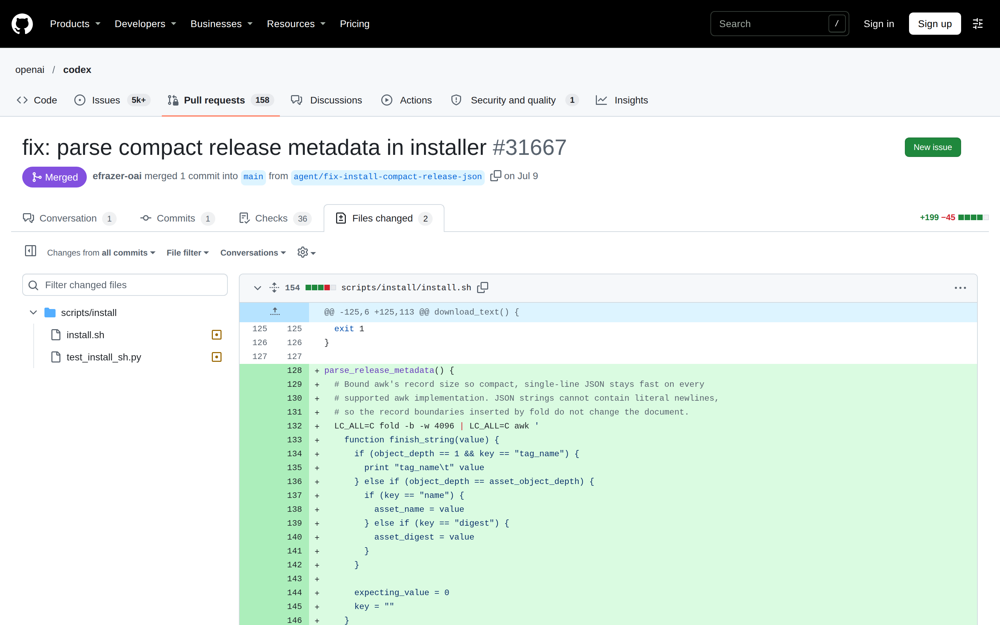

# 4.7 Issue → PR → 审核 → 合并

> 学习目标：看懂 GitHub 上「提需求（Issue）→ 开分支改动 → 提交合并请求（Pull Request / PR）→ 自动检查与人工审 Diff（Review）→ 合并（Merge）」的完整协作闭环，能看懂 PR 页面的 4 个标签页并作为监工审核 AI 或同事提交的 PR。
>
> 演示环境：[github.com/openai/codex](https://github.com/openai/codex) 真实公开 Issue `#31520` 与已合并 PR `#31667`（全部 3 张实景截图均采集于 2026 年 11 月 24 日）。

---

## 1. 微信群里「你发我一版压缩包、我发你一版改完的」为什么一定会乱？

前面 4.1–4.6 课，你已经攒齐了所有零件：本地存档（`commit`）、看差异（`diff`）、平行实验分支（`branch`）和云端仓库（GitHub）。现在把这些零件串成一条真正运转起来的生产线。

回想一下职场里常见的协作噩梦：微信群里有人提了个需求，小王改了一版发 ZIP 过来，小李又改了一版发来，老板根本搞不清「这版改了哪几行、修的到底是昨天群里说的哪条故障、有没有跑通测试」。

在 GitHub 和现代 AI 工程协作里，全世界的团队（包括你和 AI Agent 搭档）都用同一套标准化流水线来解决这个问题：**Issue → PR → 审核（Review）→ 合并（Merge）**。学会看懂这 4 步，以后无论是给开源软件提报错，还是审核 AI 在分支上干完活交上来的作业，你一眼就能抓住重点。

---

## 2. 系统位置：把 M4 全部知识串成一条「从需求到上线」的标准流水线

```
① 提工单（Issue）：写清问题/需求 + 复现步骤
        ↓
② 开分支改代码（4.3 课）：在 agent/xxx 分支修改并 commit
        ↓
③ 提交合并请求（PR）：写明 Summary 与 Fixes #编号
        ↓
④ 监工验货（Checks + Review）：自动检查全绿 + 审 Files changed 红绿 diff  ← 【本课位置】
        ↓
⑤ 正式上线（Merge）：合入 main 主线 + 自动关闭原 Issue
```

一句话把 4 个英文词翻成人话：
- **Issue（工单 / 议题）**：「这里有个 Bug / 我想要个新功能」的正式需求单；
- **PR（Pull Request，拉取请求 / 合并请求）**：「我在实验分支把活干完了，请你审核并允许我并回 `main` 主线」的交卷申请单；
- **Review（审核）**：监工或同事打开 PR 的 `Files changed` 看 `diff`、留言提修改意见或点「批准（Approve）」；
- **Merge（合并）**：审核通过后按下合并按钮，分支改动正式并入 `main`，并自动把关联的 Issue 结案关闭。

---

## 3. 讲清楚：走进一个 PR 页面，你只需要盯住这 4 个标签页

点开 GitHub 上任意一个 Pull Request，顶部永远横排着 4 个固定标签页，监工审作业按「从左到右」看一遍就够了：

| 标签页 | 英文原名 | 里面装什么 | 监工重点查什么 |
|---|---|---|---|
| **① 对话与说明** | `Conversation` | 改动摘要（Summary）、关联的 Issue（`Fixes #编号`）、审稿人的讨论和批准记录 | **先看「为什么要改」**：改动目标和原需求对不对得上？右边 `Reviewers` 有没有绿色对勾 `✓`？ |
| **② 提交记录** | `Commits` | 这条分支上依次打过的每一次 `commit` 存档列表 | 改动步骤清不清楚，有没有把不相关的杂乱提交混进来 |
| **③ 自动体检** | `Checks` | GitHub Actions 自动跑的测试、语法与安全检查结果 | **是不是全绿（Passed）？** 出现红叉 `×` 就先别急着点合并，点进去看哪项测试没过 |
| **④ 改动对比** | `Files changed` | 网页版彩色 `diff`（和 4.2 课一模一样！左侧列出改了哪几个文件，右侧红 `-` 绿 `+`） | **最关键的验收区**：动了几个文件（防越界）、红绿行语义对不对；鼠标移到任意一行左侧点 `+` 号就能直接在代码行上写审核批注！ |

### 监工发审核结论时的 3 个按钮

在 `Files changed` 右上角点 **`Review changes`**，GitHub 会给你 3 个非常清晰的拍板选项：
1. **`Comment`（仅留言）**：先问两个问题，暂不拍板；
2. **`Approve`（批准通过）**：确认改动没问题，亮绿勾放行合并；
3. **`Request changes`（打回修改）**：明确指出哪里改歪了，要求作者（或 AI）按意见修完再审。

**最常见的误解**：以为「只有会写代码的大佬才能提 Issue 或审 PR」。**恰恰相反！**
- 提一份高质量的 **Issue**（写清你干了什么、报错原文是什么、期望结果是什么），**白领和产品经理往往比程序员写得更清楚**；
- 审 AI 交上来的 **PR**，核心是看 `Summary` 有没有偏题、`Checks` 有没有报红、`Files changed` 里有没有动到 `data/` 或写反配置口径——这些正是你 M2–M4 一路练出来的监工本领！

---

## 4. 现场看：真实案例拆解——一条由 `agent/` 分支发起的 PR 如何 26 小时修完故障

下面我们不编假故事，直接打开你在 4.5 课已经见过的 **`openai/codex`** 真实公开仓库，顺着时间线看一遍 **Issue `#31520` → PR `#31667` → 自动关闭** 的全过程：

### 第 1 步：用户提工单（Issue `#31520`）

2026 年 7 月 8 日，一位用户运行 Codex 更新命令时报错失败，于是开了一张非常规范的 Issue `#31520`：



盯住这张图里好 Issue 的 3 个要素：
1. 清楚贴出了自己执行的命令和真实报错原文（呼应 2.8 课「把报错原文完整贴出来」）；
2. 右侧栏打上了 `CLI`、`bug` 分类标签（`Labels`）；
3. 如今它顶部显示紫色 **`Closed`**，旁边挂着修复它的 PR 徽章 **`#31667`**，右下角 `Development` 区域也直接把工单和修复代码双向绑在了一起。

### 第 2 步：在 `agent/` 分支改完提交合并请求（PR `#31667`）

紧接着，团队成员借助独立分支 **`agent/fix-install-compact-release-json`** 提交了修复 PR `#31667`：



仔细看这张信息量极高的真实界面，全都是你已经学过的熟面孔：
- **分支来源**：顶部一行字写得明明白白——`merged 1 commit into main from agent/fix-install-compact-release-json`（从 AI Agent 专用实验分支合入 `main` 主线！）；
- **4 个标签页**：`Conversation 1`、`Commits 1`、`Checks 36`（36 项自动化测试体检）、`Files changed 2`（右端亮着 **`+199 -45`**）；
- **魔法关单句**：正文里写了一句 **`Fixes #31520`**——GitHub 认出这句固定暗号，在右下角 `Development` 自动把 PR 和 Issue `#31520` 绑死；
- **人工审核把关**：右上角 `Reviewers` 里，审稿人 `etraut-openai` 名字旁边挂着一颗**绿色对勾 `✓`**，代表代码审核通过！

### 第 3 步：点开 `Files changed` 逐行验货（网页版 `diff`）

点进第 4 个标签页 **`Files changed 2`**，看到的正是你在 4.2 课练熟的 `diff` 放大镜：



左侧目录树一眼看出只动了 `scripts/install/` 下的 2 个文件（主安装脚本 `install.sh` + 配套测试 `test_install_sh.py`，完全没有越界动其他模块）；右侧清晰标出 `@@ -125,6 +125,113 @@` 与绿色 `+` 增行。

### 第 4 步：按下合并（`Merged`），2 秒后原 Issue 自动结案

2026 年 7 月 9 日 `05:08:00 UTC`，PR `#31667` 正式合入 `main`，状态徽章从绿色 `Open` 变成紫色 **`Merged`**；仅仅 **2 秒之后（`05:08:02 UTC`）**，GitHub 凭正文里的 `Fixes #31520` 自动把原工单 `#31520` 关单结案。从社区报障到修复上线，全程公开留痕，只花了 26 小时。

> **给 AI 监工的启发**：这套机制绝不是大厂专利！等你以后把 `ai-radar` 或公司小工具放进自己的私有 GitHub 仓库，同样可以让 AI 在 `agent/xxx` 分支上干活并提 PR——你喝着咖啡点开网页版 `Files changed` 验收完红绿行、确认检查全绿，点一下 **`Merge pull request`**，既优雅又零失误。

---

## 5. 你来读：AI 给你私有仓库提了一份 PR，这 3 处信号你能看出几个问题？

假设你开了一张 Issue `#12`：「请把 `ai-radar` 的 HN 热点门槛调高到 500 分，顺便把早报标题改成『每日精选 AI 情报』。」10 分钟后，AI 从 `agent/issue-12` 分支交上来一份 PR，你点开一看：

- **Conversation**：写着 `Closes #12`，摘要说已按要求修改。
- **Checks**：显示 `1 failing, 2 successful`（有一项红叉 `×` 报错 `yaml.scanner.ScannerError`）。
- **Files changed（3 个文件，+18 -12）**：左侧文件列表依次是 `practice/config.yaml`、`practice/scripts/daily_briefing.py`、`practice/.env`。

停下来想 10 秒：这份 PR 能不能点 `Merge pull request`？里面藏着哪 **2 个** 必须立刻打回的硬伤？

**判断思路**：
**绝对不能合并，立刻点 `Request changes` 打回！** 里面藏着 2 个致命硬伤：
1. **红线泄密风险：`Files changed` 里竟然出现了 `practice/.env`！**（3.4 课最高红线！）说明本地 `.gitignore` 漏配或被绕过，一旦合并，你的真实 API Key 就会永久写进仓库历史。必须立刻拒绝合并，并在本地核查 `.gitignore` 与密钥安全。
2. **自动检查未通过：`Checks` 里红叉报错 `yaml.scanner.ScannerError`**（3.3 课刚学过，八成是修改 `config.yaml` 时混进了 `Tab` 缩进或格式错误）。必须让 AI 先修好 YAML 语法、等 `Checks` 全绿且彻底移除 `.env` 之后再重新审核。

---

## 6. 小检查（3 道判断题）

1. 在 GitHub 协作流程里，Issue 用来记录问题或需求，Pull Request（PR）用来把分支上的修改提交审核并申请合并进主线。（对 / 错）
2. 在 PR 正文里写上 `Fixes #31520`（或 `Closes #12`）后，当这条 PR 被正式合并进默认分支时，GitHub 会自动把对应编号的 Issue 标记为关闭（`Closed`）。（对 / 错）
3. 审核 PR 时，只要作者（或 AI）在 `Conversation` 里写明了「全部改好了」，就不需要再点开 `Checks` 和 `Files changed` 核对了。（对 / 错）

---

## 7. 下一课

恭喜你！到这里，**M4 Git 与 GitHub** 全部 7 节课（本地存档 4.1–4.3 + GitHub 平台与协作 4.4–4.7）正式圆满通关！从今天起，你已经掌握了软件工程世界里最核心的安全网和通用语言。

接下来进入真正让你效率起飞的 **M5 和 AI 高效协作**。既然我们已经能读懂 Python、看懂项目、用 Git 和 PR 把好关，怎么从一开始就把需求说清楚、让 AI 少走弯路一次做对？下一课就是 **5.1《把需求说清楚：先计划后动手》**。

---

## 小检查答案

1. **对**。Issue 管「要干什么」，PR 管「怎么改的、能不能合进主线」，分工清晰留痕可查。
2. **对**。这是 GitHub 官方内置的关联关键字机制（支持 `Fixes`、`Closes`、`Resolves` 等），省去手动关单还能留下永久溯源链接。
3. **错**。文字摘要只是自述，真正的验货依据永远是 `Checks` 自动检查是否全绿，以及 `Files changed` 里的红绿 `diff` 文件列表与具体代码改动。

---

## 参考与事实边界

- **页面实测截图与数据**（均采集于 2026-11-24）：
  - `openai/codex` Issue `#31520`：[github.com/openai/codex/issues/31520](https://github.com/openai/codex/issues/31520) —— 创建于 2026-07-08T03:00:04Z，16 条评论，于 2026-07-09T05:08:02Z 自动关闭；
  - `openai/codex` PR `#31667`：[github.com/openai/codex/pull/31667](https://github.com/openai/codex/pull/31667) —— 分支 `agent/fix-install-compact-release-json` 合入 `main`，2 个文件 `+199 -45`，`Checks 36`，于 2026-07-09T05:08:00Z 合并。
- **官方资料**：
  - GitHub 协作工作流官方指南：[GitHub flow — GitHub Docs](https://docs.github.com/en/get-started/using-github/github-flow)；
  - 使用关键词自动关联并关闭 Issue：[Linking a pull request to an issue — GitHub Docs](https://docs.github.com/en/issues/tracking-your-work-with-issues/using-issues/linking-a-pull-request-to-an-issue)。
- **作者说明**：第 5 节的「PR 夹带 `.env` 与 YAML 报错」为综合 M3–M4 全部监工验收要点的模拟实战演练。
