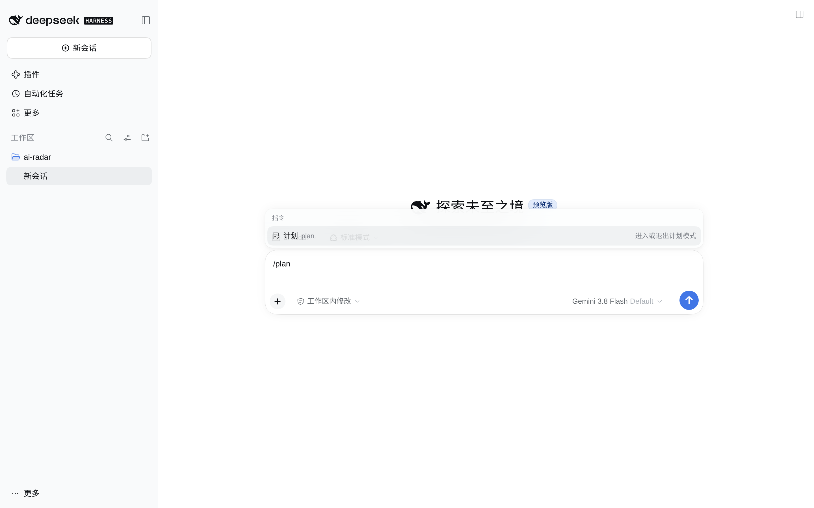
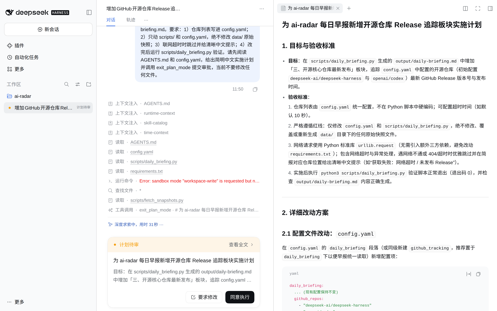

# 5.1 把需求说清楚：先计划后动手

> 学习目标：掌握一套可直接套用的「四要素监工需求单」（目标与产出、输入与改动边界、验收标准、禁止事项），并会在 DeepSeek Harness 中用 `/plan` 计划模式让 AI 先交书面方案、过完「审计划 4 查」再放行动手。
>
> 演示环境：DeepSeek Harness 网页版 `0.2.2-rc.5` + `Gemini 3.8 Flash`（2 张实机中文界面截图均采集于 2026 年 11 月 24 日），基于 `ai-radar` 工作区（含 `AGENTS.md`、`config.yaml` 与 `scripts/daily_briefing.py`）实测 `/plan` 完整计划审批流。

---

## 1. 一句「帮我把早报改得更好用」，为什么经常换来一地鸡毛？

前面 M0–M4，你已经学会了读 Python、理清项目结构、用 Git 存档和看 `diff`。现在进入 **M5 和 AI 高效协作**，你会发现真正拉开普通人和高手差距的，不是事后擦屁股多快，而是「**开口交代任务的第一分钟**」。

看看这两种发任务方式的结局：
- **模糊一句流**：「帮我把 `ai-radar` 早报做得更好看更有用，顺便加点 GitHub 热点。」
  - AI 会自己脑补：装进 3 个多余第三方库、顺手改了你的 `data/` 目录结构、把仓库名硬编码进 Python，甚至把原本好好的表格样式重写得面目全非——等你 `git diff` 看到 300 行改动，返工比重写还累。
- **监工先计划流**：用 **四要素需求单** 把话一次说透，再敲一句 **`/plan`**，逼 AI 先只读项目文件、交出一份结构化书面计划，**你审完点头「同意执行」，它才动第一行代码。**

这一课把「怎么把需求写清楚」和「怎么审 AI 的计划」拆成两张直接照抄的清单。

---

## 2. 系统位置：在 AI 动第一行代码之前，先加一道「书面审批门」

```
你的模糊想法（想给 ai-radar 早报加 GitHub Releases 追踪板块）
      ↓
第 1 步：套用「四要素监工需求单」写清目标、边界、验收与红线      ← 【本课前半】
      ↓
第 2 步：在 DSH 输入 /plan 进入「计划模式」                     ← 【本课后半】
      ↓
AI 只读代码与 AGENTS.md → 提交「计划待审」卡片与右侧完整 Markdown 方案
      ├── 有漏洞 / 范围偏大 / 多装库 ──→ 点「要求修改」（零代码损耗，10 秒改方案！）
      └── 过完「审计划 4 查」全满意   ──→ 点「同意执行」→ 进入修改与 git diff 验收
```

---

## 3. 讲清楚：四要素监工需求单 + 审计划 4 查

### 3.1 「差需求 vs 好需求」：套用 4 要素，30 秒把话说透

假设今天我们要给 `ai-radar` 迭代一个真实功能：**给每日早报加上第 3 个板块，自动追踪关注开源仓库（如 `deepseek-ai/deepseek-harness`、`openai/codex`）的最新 Release 版本。**

不要只写一句「帮我加个 GitHub 版本追踪」，照下面 4 要素填完，AI 的一次成功率立刻翻倍：

| 要素 | 要回答的问题 | 差写法（AI 只能瞎猜） | 好写法（监工四要素需求单） |
|---|---|---|---|
| **① 目标与交付物** | 做成什么样？结果写到哪？ | 「把早报改得更有用，加点 GitHub 动态」 | 「给 `scripts/daily_briefing.py` 生成的 `output/daily-briefing.md` 增加第 3 个板块，追踪关注开源仓库的最新 GitHub Release 版本号与发布时间」 |
| **② 输入与改动边界** | 参数放哪？只允许动哪些文件？ | （不写，任由 AI 乱改） | 「追踪的仓库列表写进 `config.yaml`（先配 `deepseek-ai/deepseek-harness` 和 `openai/codex`）；**只允许改 `config.yaml` 和 `scripts/`**」 |
| **③ 验收与异常口径** | 怎么算跑通？断网报错怎么办？ | （不写，报错就崩） | 「联网超时或仓库无 Release 时优雅跳过并在简报中给出清晰中文提示；改完后运行 `python3 scripts/daily_briefing.py` 验证退出码为 0 且成品正常生成」 |
| **④ 红线禁忌** | 绝对不能干什么？ | （不写） | 「**绝不修改 `data/` 原始快照**；先用 `/plan` 出计划提交审批，审批前不要修改任何文件」 |

### 3.2 什么是 `/plan` 计划模式？怎么审 AI 交上来的方案？

在 DeepSeek Harness `0.2.2-rc.5` 里，在对话框输入 **`/plan`**（或者 `/plan 你的需求内容`）就会开启内置的 **「计划模式（Plan Mode）」**。

进入计划模式后，AI 会先只读你的项目文件（例如 `AGENTS.md`、`config.yaml`、`scripts/daily_briefing.py`），把改法整理成一份带标题和步骤的完整 Markdown 实施计划，并弹出 **「计划待审」** 审批卡片等你拍板：
- 点 **「要求修改」**：直接提反馈（比如「不要新装 `requests` 库，用 Python 自带的 `urllib` 就行」），让 AI 把方案改到你满意；
- 点 **「同意执行」**：退出计划模式，AI 按这份已审定的计划正式开始改代码。

> **来自 DSH 官方文档的重要边界**：`docs/subsystems/plan.zh.md` 明确指出，计划模式本质是「**软性指引**」，真正强制拦住写文件或跑命令的硬开关，仍然是 1.5 课讲的「工作区权限与审批策略」。两者搭配使用最稳。

拿到 AI 交上来的实施计划后，监工 20 秒过一遍 **「审计划 4 查」** 再点「同意执行」：
1. **查改动文件清单**：只动了该动的文件吗？（例如只改 `config.yaml` 和 `scripts/daily_briefing.py`，绝没出现 `data/` 或无关脚本）；
2. **查依赖是否克制**：有没有为了一个小功能非要 `pip install` 一堆沉重第三方库？（能用 Python 标准库 `urllib.request` 搞定就不额外装库）；
3. **查异常与边界**：写没写清断网、超时、404、空数据怎么处理？
4. **查自检步骤**：计划最后有没有写明改完要运行哪条命令验收、核对哪份输出？

**最常见的误解**：觉得「先出计划再动手多绕了一步，浪费时间」。**正好相反！** 改一行文字方案只需要 **10 秒**，等 AI 凭猜测乱改完 5 个文件再排查返工往往要 **半小时**。任何涉及 2 个以上文件、或者新加功能模块的改动，先敲 `/plan` 都是最快、最省 API 额度的捷径。

---

## 4. 现场看：在 DeepSeek Harness 里实跑一遍 `/plan` 审批流

### 第 1 步：在 `ai-radar` 工作区敲下 `/plan`

打开关联了 `ai-radar` 的新会话，在输入框敲下 `/plan`，上方立刻弹出指令提示 **`计划 plan — 进入或退出计划模式`**：



### 第 2 步：发出四要素需求单，审阅 AI 交上来的「计划待审」卡片

我们把 3.1 节写好的四要素需求单接在 `/plan ` 后面发给 `Gemini 3.8 Flash`。不到 30 秒，AI 依次读取了项目文件（没有改动任何一行代码！），并在右侧展开完整方案、在下方弹出黄框 **「计划待审」** 卡片：



盯住这张实机截图里 **4 个让人极度安心的监工信号**：
1. **看中间轨迹第 1 行**：`上下文注入 · AGENTS.md`——DSH 自动把项目说明书塞进了 AI 脑子里（下一课 5.2 专门讲怎么写它！），接着 AI 乖乖只做了 `读取` 动作（`config.yaml`、`daily_briefing.py`、`requirements.txt`），零越界写入；
2. **看右侧方案第 1 节「目标与验收标准」**：AI 主动提出「**网络请求使用 Python 标准库 `urllib.request`（无需引入额外第三方依赖，避免改动 `requirements.txt`）**」，而且写死了「绝不修改 `data/` 下任何原始快照」——这正是四要素需求单 + 审计划 4 查发挥的威力；
3. **看左侧会话标签与底部审批卡片**：会话标题旁边亮起橙色 **`计划待审`**，底部卡片给出明确的 **`要求修改`** 与 **`同意执行`** 两个按钮；
4. **注意**：本课我们只审计划不改 `daily_briefing.py`（保持配套脚本与 M3 实测输出一致）；等到 M6 毕业项目真正开工时，过完「审计划 4 查」再从容点下 **`同意执行`**！

---

## 5. 你来读：AI 交来这份实施计划，你点「同意执行」还是「要求修改」？

假如你给 `ai-radar` 发了同样的「新增 GitHub Release 追踪板块」需求，另一个粗心的 AI 在 `/plan` 里交上来下面这份 4 行计划：

```markdown
# 实施计划
1. 安装 `PyGithub` 和 `pandas` 两个新库来拉取 GitHub 接口与拼表。
2. 把 `deepseek-ai/deepseek-harness` 和 `openai/codex` 写死在 `scripts/daily_briefing.py` 第 20 行。
3. 把拉回来的 JSON 直接覆盖存进 `data/hn-frontpage-2026-11-24.json` 方便一起读取。
4. 改完代码我就直接告诉你完成。
```

停下来想 10 秒：照「审计划 4 查」，这份计划里藏着哪 **4 个** 必须点 **「要求修改」** 打回的硬伤？

**判断思路**：
**绝对不能点「同意执行」，必须点「要求修改」把下面 4 条一次性纠偏：**
1. **无必要堆重依赖**：只是调一个免 Key 的公开 JSON 接口，完全没必要新装 `PyGithub` 和几百兆的 `pandas`，要求改用 Python 标准库 `urllib.request`。
2. **参数硬编码违背约定**：仓库列表应该放进 `config.yaml`，否则以后想增删关注仓库还得改 Python 代码。
3. **触碰最高数据红线**：竟然要把新数据覆盖写进只读原料仓 `data/hn-frontpage-2026-11-24.json`！立刻严禁改动 `data/` 现有快照。
4. **缺少异常兜底与自检验收**：既没说明断网超时怎么优雅跳过，也没安排改完后运行 `python3 scripts/daily_briefing.py` 自检退出码和产出文件。

---

## 6. 小检查（3 道判断题）

1. 给 AI 派跨文件新功能任务时，先用 `/plan` 让它给出书面实施计划、过完「审计划 4 查」再点「同意执行」，能大幅减少大面积返工。（对 / 错）
2. 一份好懂好执行的监工需求单，通常只需把「目标与产出、输入与改动边界、验收与异常处理、红线禁忌」4 要素写清楚，不需要自己懂怎么写 Python 代码。（对 / 错）
3. 只要开启了 DeepSeek Harness 的 `/plan` 计划模式，系统底层就会绝对锁死硬盘，不需要再关心工作区权限和命令审批。（对 / 错）

---

## 7. 下一课

刚才在 5.1 的实机截图里，你已经亲眼看到了轨迹顶部那一行神奇的 **`上下文注入 · AGENTS.md`**——我们甚至不用每次新开对话都把目录分工、自检命令和红线重新念一遍，AI 一进工作区就自动全背下来了。下一课 **5.2《`AGENTS.md`：给 AI 的项目说明书》**，带你亲手写出一份能跨 DeepSeek Harness 和 OpenAI Codex 通用的项目说明书。

---

## 小检查答案

1. **对**。在文字方案阶段花 20 秒改掉方向错误，比改完一堆代码再返工省时省钱得多。
2. **对**。监工负责定清业务目标、边界、验收口径和红线，具体怎么写代码交给 AI 即可。
3. **错**。据 DSH 官方文档，计划模式属于软性协作指引，真正的硬性文件与命令边界仍由工作区沙箱和审批策略负责。

---

## 参考与事实边界

- **实际操作结果**：本课 2 张实机截图均于 2026-11-24 在 DeepSeek Harness 网页版 `0.2.2-rc.5` + `Gemini 3.8 Flash`（`ai-radar` 独立工作区副本）实测采集，验证了 `/plan` 指令提示、`上下文注入 · AGENTS.md`、`exit_plan_mode` 触发的「计划待审」卡片及「要求修改 / 同意执行」按钮。
- **官方资料**：DeepSeek Harness 计划模式架构文档：`docs/subsystems/plan.zh.md`（明确说明 `/plan [off|message]`、`exit_plan_mode` 评审流，以及「计划模式是软性指引，沙箱模式与审批策略分别强制限制」）。
- **作者说明**：第 3.1 节「四要素监工需求单」与第 3.2 节「审计划 4 查」为面向零基础职场人的通用需求沟通框架；第 5 节为对应反面计划排雷练习。
