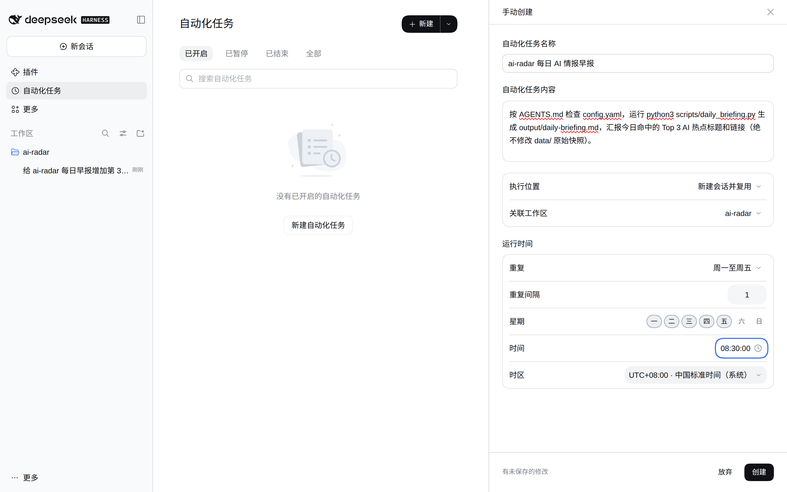
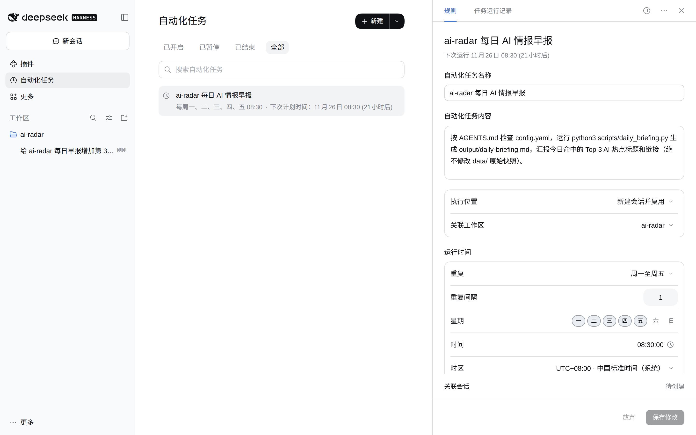

# 5.3 让 AI 自动按时干活

> 学习目标：会用 DeepSeek Harness 内置「自动化任务」给 `ai-radar` 配出工作日定时早报，理解本机宿主定时与模型消耗的两条真实边界，并能对照「三方案选型表」在 DSH 定时、本机零 Token 系统定时和 GitHub Actions 云端定时之间做正确选择。
>
> 演示环境：DeepSeek Harness 网页版 `0.2.2-rc.5`（含 2 张实机中文界面截图，采集于 2026 年 11 月 24 日），结合官方 `Schedule 提醒` 文档与 `ai-radar` 工作区实测。

---

## 1. 脚本写好了，可每天早上还得自己打开终端敲一遍？

到 5.2 课为止，你的 `ai-radar` 已经是一座规规矩矩的自动化小工厂：有目录分区、有 `config.yaml` 参数面板、有 `AGENTS.md` 给 AI 立规矩。但还有一个小尾巴没解决：

每天早上 8:30 到工位，你还得手动打开终端或对话框，提醒 AI：「帮我跑一下今天的 AI 情报早报。」忙起来忘了两天，这套好不容易搭起来的工具就闲置吃灰了。

如果能给 AI 设一个**「定时闹钟」**——每个工作日早上 8:30 准时唤醒，按 `AGENTS.md` 自动跑完脚本、把今日 Top 3 热点整理好等你端着咖啡来看——这才算真正把重复劳动交了出去。这一课带你用 2 分钟配好它，同时把「定时任务最容易踩的两个大坑」一次说透。

---

## 2. 系统位置：给 `ai-radar` 装上「时间触发器」，从手动唤起变成按点交付

```
M0–M4：手工触发（你随时发指令 → AI 读/改/跑 → 你验收）
                    ↓
M5.3：定时触发（闹钟到点自动唤醒！）                          ← 【本课位置】
  ├── 路径 A（本课主线）：DeepSeek Harness「自动化任务」（会动脑总结，需电脑开着）
  ├── 路径 B（零 Token）：Mac crontab/launchd · Windows 任务计划程序（纯跑 Python）
  └── 路径 C（关机也跑）：GitHub Actions 云端 schedule（24 小时云端跑，不依赖本机）
```

---

## 3. 讲清楚：DeepSeek Harness「自动化任务」怎么配 + 三种定时方案怎么选

### 3.1 DSH 里的 2 种建法与 5 个核心字段

在 DeepSeek Harness 网页版 `0.2.2-rc.5` 左侧栏点 **「自动化任务」**，有两种创建方式：
- **方式一（对话创建）**：直接在新会话里打字告诉 AI「每个工作日早上 8:30（Asia/Shanghai 时区）帮我跑 `ai-radar` 早报」，支持提醒工具的模型预设（如默认的 `standard`）会自动调用 `schedule_create` 建好任务；
- **方式二（手动创建，推荐新手先用）**：点页面里的 **「新建自动化任务」**（或右上角「+ 新建」旁的下拉箭头选 **「手动创建」**），像定手机闹钟一样填完表单，**建任务本身不消耗任何模型额度**。

表单里只有 5 项需要你看清：

| 表单字段 | 填什么 / 怎么选 | 监工避坑提示 |
|---|---|---|
| **自动化任务名称** | 一句话起名，例如 `ai-radar 每日 AI 情报早报` | 以后会在会话列表和任务列表里显示，起名要能一眼认出用途 |
| **自动化任务内容** | 每次到点发给 AI 的固定指令（写清跑哪个脚本、输出什么、不能碰什么） | 把 5.1 课的「具体目标 + 禁止项」塞进 2–3 句话，例如明确写明「绝不修改 `data/` 原始快照」 |
| **执行位置** | **「新建会话并复用」** vs **「每次新建对话」** | 复用 = 每天接在同一条对话里（方便回翻历史，但跑一两周后对话会变长、耗 Token 变多）；每次新建 = 每次开独立干净对话（日报类最清爽、耗额度更稳） |
| **关联工作区** | 选定 `ai-radar` | **务必选对工作区！** 选了 `ai-radar`，定时触发时才会自动读到 `practice/AGENTS.md` 和 `config.yaml` |
| **运行时间 & 时区** | 频率支持「仅一次 / 每 N 分钟 / 每 N 小时 / 每天 / 每周 / **周一至周五** / 每月 / 自定义」，时间选 `08:30:00`，时区确认 **`UTC+08:00 · 中国标准时间`** | **千万别手滑把频率设成「每 1 分钟」**——一晚忘关能把 API 额度刷干！ |

### 3.2 必须提前知道的 2 条真实边界（据 DSH 官方文档）

1. **关电脑或关闭 DSH 进程后，定时不会在云端继续跑**：DSH 是跑在你自己电脑上的本地宿主服务（1.4 课讲过「黑框终端就是发动机」）。官方 `Schedule 提醒` 文档明确说明：**关闭宿主后，调度即停止，直到宿主再次启动**（重启后会把每条重复任务最近错过的一次补投递出来）。
2. **每次唤醒 AI 都在真花模型 API 费用，且要守住安全底线**：定时任务每次触发都会把指令发给大模型执行。因此：**绝不要在无人值守的定时任务里安排「自动删除文件」「自动给客户群发消息」等高危动作**；而且如果只是纯跑固定 Python 脚本、完全不需要 AI 动脑总结，根本没必要花大模型额度！

### 3.3 一张表选对你的定时方案（DSH vs 本机系统 vs GitHub Actions）

职场里做自动化，没有「哪一种万能」，按你手头的任务特征照下表直接对号入座：

| 维度 | 方案 A：DSH「自动化任务」（本课主线） | 方案 B：本机系统定时（Mac `launchd`/`crontab` · Windows「任务计划程序」） | 方案 C：GitHub Actions 云端 `schedule` |
|---|---|---|---|
| **要不要 AI 动脑** | **会动脑**（能总结热点、按语境挑重点、灵活排错） | 纯跑固定脚本（如 `daily_briefing.py`），不调用大模型 | 默认纯跑固定脚本（也可按需配密钥调用 API） |
| **关电脑后还能跑吗** | **不能**（电脑和 DSH 需保持运行） | **不能**（电脑休眠或关机即暂停） | **可以！24 小时云端准点运行** |
| **费用成本** | 每次触发消耗模型 API Token | **完全免费（\$0 Token）** | 公开仓库免费；私有仓库每月自带免费分钟数 |
| **上手门槛** | **最低**（中文图形表单，1 分钟配完） | 中等（可让 AI 帮你生成配置命令） | 中偏高（需在仓库建 `.github/workflows/*.yml`） |
| **最适合什么场景** | 白天电脑常开、希望 AI 每天总结汇报的个人情报/复盘助手 | 只需固定跑 Python 导表、想省掉全部模型费用的本机任务 | 哪怕周末出差关机，也必须准点更新数据或自动发简报的团队流程 |

顺手认一眼方案 C（GitHub Actions 云端定时）在仓库 `.github/workflows/daily-briefing.yml` 里最核心的那 4 行长什么样，以后在开源仓库里看见一眼就懂：

```yaml
on:
  schedule:
    # 注意：GitHub Actions 的 cron 一律按 UTC 时区计算！
    # UTC 00:30 = 北京时间（UTC+8）早上 08:30，1-5 表示周一至周五
    - cron: "30 0 * * 1-5"
```

记住这个高频踩坑点：**GitHub Actions 的 `cron` 永远是 UTC 世界标准时间，不是北京时间**——想让它北京时间早上 `8:30` 跑，小时数要减 8，写成 `"30 0 * * 1-5"`（而在 DSH「自动化任务」里已经贴心内置了 `UTC+08:00 · 中国标准时间`，直接填 `08:30:00` 就行！）。

**最常见的误解**：以为「配好了 DSH 自动化任务，把笔记本合盖装包里，明天早上 7 点它也会自己跑完发消息到我手机上」。**不对！** ① DSH 是本机应用，合盖休眠后宿主会暂停；② DSH 官方文档也明确说明，它的「任务运行记录」只记录指令投递进本地会话收件箱，本身不是微信/飞书等外部推送渠道。如果真需要「合盖也跑 + 推送到手机/飞书」，就要用方案 C（GitHub Actions + 飞书/企微 Webhook，或 M6 毕业项目按需扩展）。

---

## 4. 现场看：2 分钟在 DeepSeek Harness 里建好 `ai-radar` 工作日早报

### 第 1 步：打开「自动化任务 → 手动创建」，填好 5 项参数

切到左侧栏 **「自动化任务」**，点中间的 **「新建自动化任务」**，右侧滑出 **「手动创建」** 面板。照下面这张实机截图依次填好名称、内容、选好 **「关联工作区」为 `ai-radar`**、重复选 **「周一至周五」**、时间拨到 **`08:30:00`**、核对时区为 **`UTC+08:00 · 中国标准时间（系统）`**：



### 第 2 步：点右下角「创建」，检查下次计划时间与「立即执行」入口

点完黑色 **「创建」** 按钮，任务立刻进入「已开启」状态，中间列表和右侧详情页清清楚楚展示全部状态：



盯住监工必查的 3 个确认信号：
1. **核对摘要行**：中间卡片明明白白写着 **`每周一、二、三、四、五 08:30 · 下次计划时间：11月26日 08:30`**——确认星期、小时和时区完全没错；
2. **用「立即执行」先试跑一次**：不用干等到明天早上 8:30 才知道指令写得对不对！点右上角 **`...`（自动化任务操作）→「立即执行」**，马上触发一次现场验收，确认模型乖乖按 `AGENTS.md` 跑完 `daily_briefing.py` 再放心收工；
3. **随时可暂停或查记录**：放长假不想白耗额度时，点右上角 **`暂停` 图标（‖）** 即可一键停用；以后想回看哪天跑过，切到顶部 **「任务运行记录」** 标签页就能逐条追溯。

---

## 5. 你来读：3 个真实定时需求，分别选哪种方案、拦住哪个坑？

先停 10 秒看清每个需求，再核对参考判断：

1. **需求 A**：你白天电脑一直开着，想让 AI 每个周五下午 5 点读一下你本周记在 `notes/` 里的零散工作记录，自动帮你归纳出一份 300 字中文周报草稿。
2. **需求 B**：你的 `ai-radar` 脚本（`fetch_snapshots.py` + `daily_briefing.py`）完全固定、不需要大模型动脑，而且你希望周末电脑关机在家也能每天早上 8:30 自动更新并存回 GitHub。
3. **需求 C**：同事在 DSH 里建了一个自动化任务，频率选成了「每 5 分钟」，指令写着「检查并自动清理桌面所有旧文件，顺便把最新客户表总结一下」。

**判断思路**：
1. **需求 A 选方案 A（DSH「自动化任务」）**：需要大模型阅读归纳文字，且发生在周五工作时间电脑开机状态，用 DSH 表单 1 分钟配完最省事，执行位置建议选「每次新建对话」保持周报之间干净独立。
2. **需求 B 选方案 C（GitHub Actions `schedule`）**：纯 Python 固定脚本零 Token 成本，且硬要求「关电脑也能 24 小时运行」，DSH 本机定时做不到，GitHub Actions 配一条 `cron: "30 0 * * 1-5"`（或每天 `"30 0 * * *"`）最合适。
3. **需求 C 立刻叫停，连踩 3 条红线！** ① 频率「每 5 分钟」一天要触发 288 次，会迅速烧光 API 额度；② 无人值守定时任务绝不能赋予「自动清理删除桌面文件」的破坏性指令；③ 客户表属于 3.4 课的红/黄灯敏感数据，绝不能定时裸奔喂给云端大模型！

---

## 6. 小检查（3 道判断题）

1. 在 DeepSeek Harness 里建好「周一至周五 08:30」的自动化任务后，即便把电脑彻底关机或关闭 DSH 终端进程，任务也会在云端继续按时执行。（对 / 错）
2. 建好 DSH 自动化任务后，不必傻等到明天早上才能验证效果，可以通过右上角菜单里的「立即执行」当场试跑一次验收。（对 / 错）
3. 如果一个任务只需要定时运行固定的 Python 脚本（无需 AI 动脑总结）且要求关电脑也能跑，使用 GitHub Actions 的 `schedule`（注意采用 UTC 时区）往往比定时唤醒大模型更省钱、更稳定。（对 / 错）

---

## 7. 下一课

恭喜你！到这里，**M5 和 AI 高效协作** 全部 3 节课——先计划后动手（5.1）、项目说明书 `AGENTS.md`（5.2）、让 AI 自动按时干活（5.3）——正式圆满通关！

一路从 M0 走到 M5，你已经掌握了看路径、判危险命令、读 Python、理清项目与安全红线、用 Git 和 GitHub 留痕协作，以及写清需求、立好规矩、设好定时的全部监工本领。下一课进入激动人心的 **M6 毕业项目 · 6.1《解决你工作中一个真实的重复劳动》**——把前面 28 课学到的全部招式，从头到尾落地成一件真正替你省时间的职场趁手工具！

---

## 小检查答案

1. **错**。DSH 自动化任务由本机宿主进程调度，关闭电脑或宿主后调度会暂停（重启后会补投递最近错过的一次）；需要关机也跑应选用 GitHub Actions 等云端定时方案。
2. **对**。创建完定时任务后马上「立即执行」试跑验收一遍，能提前排掉路径、权限或指令表述不清的隐患。
3. **对**。不需要推理总结的固定脚本交给云端定时或系统定时，既能实现关机照跑，又完全不花大模型 API 费用。

---

## 参考与事实边界

- **实际操作结果**：本课 2 张实机截图（手动创建表单与创建完成详情页）均于 2026-11-24 在 DeepSeek Harness 网页版 `0.2.2-rc.5`（本地关联 `ai-radar` 工作区，中国标准时间 `UTC+08:00`）实测采集。
- **官方资料**：
  - DeepSeek Harness 官方定时任务说明：`docs/user/guide/schedule.zh.md`（明确说明「关闭宿主后调度停止」「重启补投递机制」「执行位置两选项」「任务运行记录并非外部推送渠道」等事实边界）；
  - GitHub Actions 定时触发文档：[Events that trigger workflows — schedule — GitHub Docs](https://docs.github.com/en/actions/writing-workflows/choosing-when-your-workflow-runs/events-that-trigger-workflows#schedule) —— 明确标注 `schedule` 使用 POSIX cron 语法且固定采用 UTC 时区。
- **作者说明**：第 3.3 节的三方案选型矩阵与第 5 节的 3 个职场判定题为结合职场真实自动化需求总结的监工决策框架。
