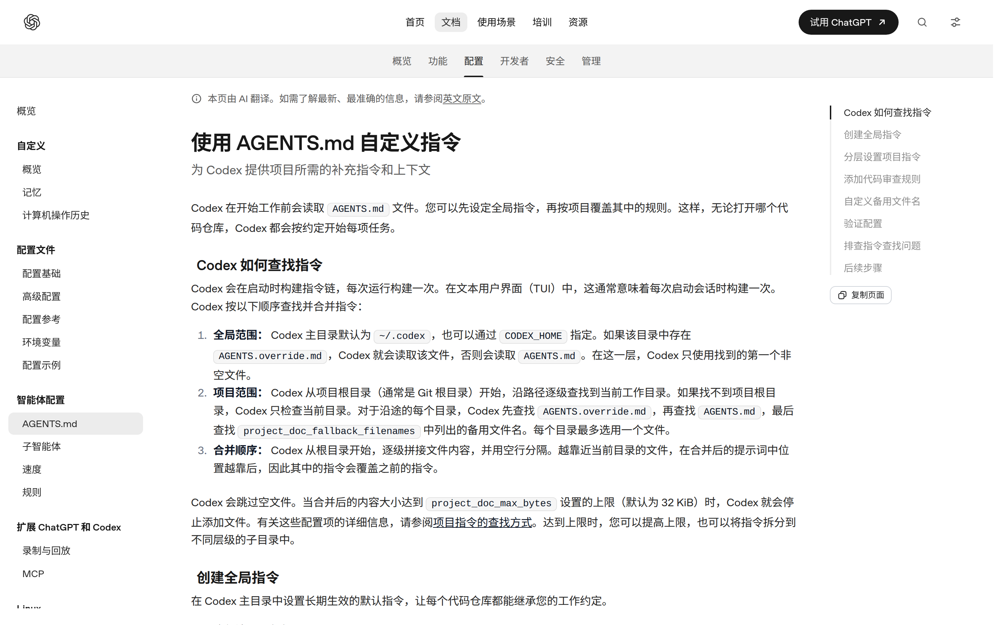
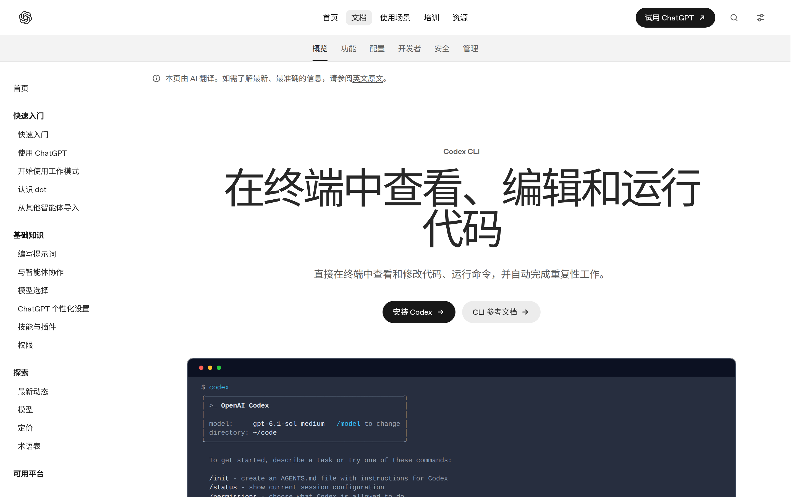

# 7.1 同一个任务，在 Codex 上重做一遍

> 学习目标：把前面用 DeepSeek Harness 跑通的 `ai-radar` 任务和原封不动的 `practice/AGENTS.md` 迁移到 OpenAI Codex 上，亲眼验证「工作区、权限、计划、说明书、diff 验收」这套监工核心概念 100% 跨工具通用。
>
> 演示环境：OpenAI 官方中文文档（[learn.chatgpt.com/docs](https://learn.chatgpt.com/docs)，2 张实景截图均采集于 2026 年 11 月 24 日）与配套仓库 `practice/AGENTS.md`、`practice/release-radar.yaml`。

---

## 1. 「我花了 30 节课学的本领，半年后换个新工具会不会全作废？」

这是很多职场学员学 AI 工具时最担心的事：今年大家用 DeepSeek Harness，明年公司换成 OpenAI Codex 或 Claude Code，界面长得不一样、按钮位置全变了，难道又要从零重学一遍？

这一课进入 **M7 换个工具也会用：迁移到 Codex**。我们直接拿 OpenAI 官方的 **Codex** 做一次对照迁移，用同一套 `ai-radar` 文件夹、同一份一字不改的 `practice/AGENTS.md` 重跑一遍任务，帮你彻底打消「换工具就白学」的焦虑。

---

## 2. 系统位置：工具只是外壳，下面这套「监工底座」永远不变

把 DeepSeek Harness 和 OpenAI Codex 上下叠在一起看，你会发现变的只有菜单名字，底下 6 层逻辑一模一样：

```
上层外壳（不同公司做的客户端：DSH 网页/桌面端  ⇄  Codex 桌面 App / CLI / IDE 扩展）
═════════════════════════════════════════════════════════════════════════════
下层通用底座（你前 30 课已经练熟的全部核心功力！）：                 ← 【本课位置】
  ① 项目文件夹骨架（data/ scripts/ output/ config.yaml）        → 完全不变
  ② 给 AI 的项目说明书（AGENTS.md）                            → 原封不动复用！
  ③ 三档权限与沙箱（只读 / 工作区内修改 / 完全访问）            → 换个英文标签继续用
  ④ 四要素需求 + 先出计划再动手                                → 说话方式一模一样
  ⑤ 本地 Git 存档 + git diff 验收 + 私有 GitHub 归档           → 命令一个字母都不用改
```

---

## 3. 讲清楚：DeepSeek Harness ⇄ OpenAI Codex 概念一一对照表

OpenAI Codex 目前提供 **ChatGPT 桌面应用（内置 Codex 图形界面）**、**Codex CLI（终端版）**、**IDE 扩展** 与 **Codex Cloud（云端后台）** 多种入口。不管选图形界面还是终端，拿你学熟的 DSH 概念往上一套，3 分钟就能上手：

| 监工核心概念 | DeepSeek Harness（0.2.2-rc.5） | OpenAI Codex（2026-11 官方中文文档） | 迁移要不要重学？ |
|---|---|---|---|
| **安装 / 打开方式** | `npx @deepseek-ai/dsh web` 或桌面端 | ChatGPT 桌面端直接进 Codex，或终端安装 `codex`（官网提供一键脚本与 npm/brew） | 看一眼官网即可 |
| **登录与额度** | 填 Gemini / DeepSeek 等 API Key（按量计费） | 直接登录 ChatGPT 账号（含免费/Go/Plus/Pro 套餐用量），也可改填 `OPENAI_API_KEY` 按量计费 | 7.2 课专门算账 |
| **项目说明书** | 全局 `~/.dsh/AGENTS.md` + 项目根 `AGENTS.md` | 全局 `~/.codex/AGENTS.md`（可配 `CODEX_HOME`）+ 项目根 `AGENTS.md`（支持 `AGENTS.override.md`） | **原样 100% 复用！** |
| **权限与沙箱边界** | 「只读」/「工作区内修改」/「完全访问」（1.5 课） | 在 CLI 敲 `/permissions` 或桌面端选三档沙箱：`read-only`（只读）/ `workspace-write`（工作区内可写）/ `danger-full-access`（高危全放开） | **三档边界完全对应！** |
| **切换模型** | 聊天框右下角点模型名称 | 桌面端下拉选，或 CLI 敲 `/model`（如 `gpt-6.1-sol`、`gpt-6-luna`） | 换个命令名而已 |
| **验收与回退** | 看右侧「代码差异」或终端 `git diff` / `git restore` | 桌面端内置 Diff 视图，或终端照旧敲 `git diff` / `git restore` | **一模一样！** |

> **顺手提醒一句**：如果以后团队用的是 Anthropic 的 Claude Code，除了项目说明书叫 `CLAUDE.md`（5.2 课讲过可一行指向 `AGENTS.md`）之外，上述 6 项核心概念同样 100% 通用！

**最常见的误解**：以为「换了一个 AI 编程工具，以前给项目配的 `.venv`、`config.yaml`、`AGENTS.md` 和 Git 仓库全都得推倒重做」。**完全不用！** 它们全都是独立于任何一家 AI 厂商的开放标准——真正被锁死的从来不是你的项目，而是只靠点网页聊天框复制粘贴的工作方式。

---

## 4. 现场看：核对 Codex 官方中文文档，看 `practice/AGENTS.md` 如何零改动生效

### 现场 ①：Codex 官方文档里的 `AGENTS.md` 两层加载规则

打开 OpenAI 官方中文文档 `learn.chatgpt.com/docs/agent-configuration/agents-md`，读完下面这一屏你会会心一笑——它和你在 5.2 课刚学完的 DSH 机制几乎是双胞胎：



盯住官方页里写得明明白白的 3 个关键事实：
1. **全局范围**：主目录默认是 **`~/.codex`**（对应 DSH 的 `~/.dsh`），读取里面的 `AGENTS.md` 或 `AGENTS.override.md`；
2. **项目范围**：自动从 Git 项目根目录开始查找 **`AGENTS.md`**——也就是说，你 5.2 课写好的那份 46 行 `practice/AGENTS.md`，**一个字不用改**，只要在 `ai-radar` 文件夹里打开 Codex，它开工前就会自动读进去！
3. **同样有体积上限**：默认 `project_doc_max_bytes` 为 **`32 KiB`**，再次印证 5.2 课讲的「说明书宁短勿长、精炼写重点」。

### 现场 ②：Codex CLI 入口与你早已熟门熟路的斜杠命令

再看一眼官方 `Codex CLI` 中文引导页：



哪怕你是第一次见这个黑框，扫一眼里面的命令就全认识：
- **`/init`**：如果打开的是个还没写说明书的空白项目，敲它能自动帮你起草一份 `AGENTS.md`；
- **`/permissions`**：直接切换只读 / 工作区内修改权限（就是 1.5 课的权限开关！）；
- **`/model`**：切换模型档位；
- **`/status`**：查看当前工作目录、模型和会话状态。

### 现场 ③：用 Codex 重跑 6.1 同款任务的 4 步监工口令

现在把 `ai-radar` 文件夹直接丢给 Codex（无论是在 ChatGPT 桌面端选中 `ai-radar` 目录，还是在终端 `cd ai-radar` 后输入 `codex`），全流程跟 DSH 毫无二致：

1. **确认工作区与权限**：确认当前目录是 `ai-radar`，权限锁在「工作区内修改（`workspace-write`）」，绝不选全放开；
2. **发出同一份四要素需求单**：
   > 「请先阅读项目里的 `AGENTS.md` 和 `release-radar.yaml`。给 `release-radar.yaml` 增加追踪 `psf/requests`，先给出计划等我确认，不要修改 `data/` 原始快照；确认后运行 `python3 scripts/release_radar.py` 汇报退出码与 `git diff --stat`。」
3. **审计划 + 看 `git diff`**：确认它只改了 `release-radar.yaml` 里的 1 行列表，零越界；
4. **验收提交**：终端看到 `成功 4/4`、`output/release-radar.md` 生成正常，照旧 `git add` + `git commit` 打存档！

> `[可选补拍：作者在本机登录 ChatGPT 桌面端或 Codex CLI 打开 ai-radar 目录、执行上述同一任务并弹出权限/Diff 界面的实机录屏或截图]`

---

## 5. 你来读：刚切到 Codex 时遇到这 3 个状况，你一眼怎么处理？

停下来想 10 秒，用你学过的通用底座知识给出判断：

1. 你在 `ai-radar` 里启动 Codex 后，发现它居然完全没遵守你在 `~/.dsh/AGENTS.md` 里写的「默认用简体中文汇报」，但遵守了项目里「不改 `data/`」的规矩。为什么？怎么修？
2. 同事为了省事，在启动 Codex CLI 时顺手加了最高权限放行参数（对应 `danger-full-access`），准备让它处理桌面上一堆业务文件。你该怎么劝他？
3. 在 Codex 里让 AI 改完 `scripts/release_radar.py` 后，你想检查它到底改了哪几行，一时找不到界面里的 Diff 按钮，最快怎么办？

**判断思路**：
1. **全局目录路径不同！** 项目根里的 `ai-radar/AGENTS.md` 两边共用所以自动生效了；但全局习惯文件在 DSH 里放 `~/.dsh/AGENTS.md`，在 Codex 里默认读 **`~/.codex/AGENTS.md`**。把你的几条通用个人习惯复制到 `~/.codex/AGENTS.md` 即可。
2. **立刻拦停！** 照 1.3 和 1.5 课的铁律，永远先把任务放进独立工作区文件夹，把权限锁在 `workspace-write`（工作区内修改），绝不对着整个桌面开最高权限放行！
3. **直接打开终端敲 `git diff --stat` 和 `git diff`！** 4.2 课学的本地 Git 命令完全不依赖任何 AI 工具界面，换到全世界任何一款 AI 客户端都 100% 通用。

---

## 6. 小检查（3 道判断题）

1. 在 DeepSeek Harness 项目根目录写好的 `AGENTS.md`，迁移到 OpenAI Codex 后不需要重写，Codex 启动会话时会自动读取它。（对 / 错）
2. 换用 OpenAI Codex 之后，之前在项目里建好的 `.venv`、`requirements.txt`、`config.yaml` 和 Git 仓库全部失效，必须全部删掉重做。（对 / 错）
3. 无论是 DeepSeek Harness 还是 Codex，都把「只读 / 工作区内修改 / 高危全放开」划分了权限边界，日常干活应默认锁在「工作区内修改」并配合 `git diff` 验收。（对 / 错）

---

## 7. 下一课

亲眼确认「换工具不换脑子」之后，接下来就是正课的最后一讲——**7.2《DSH vs Codex：怎么选、怎么搭配》**。我们把这两大工具的网络门槛、计费账单（订阅包月 vs API 按量）、开源透明度与多模型生态摊开对比，帮你按自己的预算和场景选出最舒服的主力组合。

---

## 小检查答案

1. **对**。`AGENTS.md` 是双方共同支持的开放约定，项目根目录的那一份直接零改动复用（只需按需同步各自的全局 `~/.dsh/AGENTS.md` 和 `~/.codex/AGENTS.md`）。
2. **错**。标准工程目录、虚拟环境、YAML 配置和 Git 历史完全独立于任何 AI 工具，100% 保留无缝衔接。
3. **对**。换壳不换底线，最小权限工作区 + 事后 `git diff` 验货是跨工具永恒有效的监工护身符。

---

## 参考与事实边界

- **官方资料与实景截图**（均采集于 2026-11-24）：
  - Codex `AGENTS.md` 官方中文文档：[使用 AGENTS.md 自定义指令 — ChatGPT Learn](https://learn.chatgpt.com/docs/agent-configuration/agents-md) —— 明确说明 `~/.codex/AGENTS.md`、项目根逐级查找与默认 `32 KiB` 上限；
  - Codex CLI 官方中文文档：[Codex CLI — ChatGPT Learn](https://learn.chatgpt.com/docs/codex/cli)；
  - Codex 开源仓库：[github.com/openai/codex](https://github.com/openai/codex)。
- **作者说明**：按课程制作约定（`docs/decisions.md`），本课采用官方文档实景截图 + 完整概念对照演练，未消费额外 OpenAI 付费订阅；作者本机录播时可按 `[可选补拍]` 提示补充登录态演示画面。
