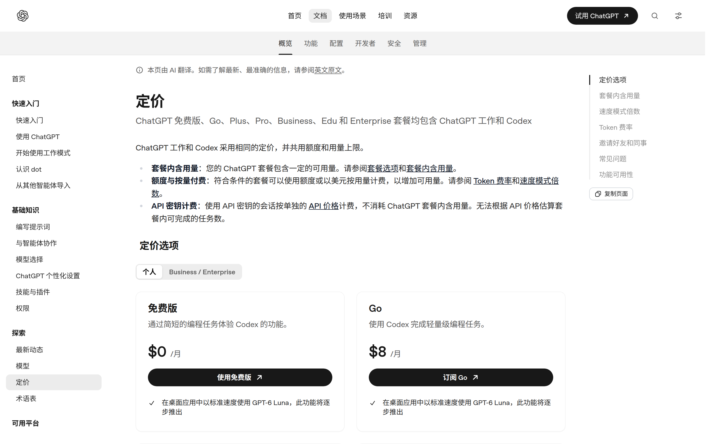

# 7.2 DSH vs Codex：怎么选、怎么搭配

> 学习目标：从网络门槛、计费模式（API 按量 vs ChatGPT 订阅）、多模型自由度、权限与开源透明度 5 个维度对比 DeepSeek Harness 与 OpenAI Codex，为自己和团队选出最省钱、最顺手的主力搭配方案。
>
> 演示环境：对照 DeepSeek Harness `0.2.2-rc.5`（MIT 开源）与 OpenAI Codex 官方中文定价页（[learn.chatgpt.com/docs/pricing](https://learn.chatgpt.com/docs/pricing)，实景截图采集于 2026 年 11 月 24 日）。

---

## 1. 「两个都会用了，日常到底该把哪一个当主力？」

7.1 课我们验证了「换工具不换脑子」——同一份 `practice/AGENTS.md` 和 `ai-radar` 文件夹，在 DeepSeek Harness（简称 DSH）和 OpenAI Codex 里都能丝滑跑通。

接下来你一定会问一个最现实的问题：**「既然两边概念都一样，我平时工作到底该主用 DSH、主用 Codex，还是两个搭着用？怎么花钱最划算？」**

这最后一节正课不吹不黑，把两套工具的**真实账单、网络门槛、权限透明度与适用场景**摆在一张表里，给你一套 30 秒就能拍板的选型决策法。

---

## 2. 系统位置：先看清你的「网络、预算、场景」，再选工具外壳

```
你的实际约束条件（网络能不能直连海外 / 习惯按量还是包月 / 要不要换多家模型）
                    ↓
          工具选型决策路由器                                ← 【本课位置】
      ├── 国内直连优先 + 想自由挑 DeepSeek/Gemini/Kimi 低价模型 + 开源透明 → 主用 DeepSeek Harness
      ├── 已有 ChatGPT 订阅 + 重度工程任务 + 爱用桌面端/云端一体化体验   → 主用 OpenAI Codex
      └── 进阶混搭：DSH 跑日常高性价比批量与定时 + Codex 啃高难度重构    → 双刀流（共享同一份 AGENTS.md！）
```

---

## 3. 讲清楚：DeepSeek Harness vs OpenAI Codex 五维硬核对比

| 对比维度 | DeepSeek Harness（`0.2.2-rc.5`） | OpenAI Codex（桌面端 / CLI / 云端） | 监工怎么看差异 |
|---|---|---|---|
| **① 开源与透明度** | **完全开源（MIT）**，架构文档与安全边界全公开，可自由装第三方/自研插件 | Codex CLI 核心开源（Apache-2.0），ChatGPT 桌面端与 Codex Cloud 为官方托管服务 | 对安全审计或内网定制敏感的团队，DSH 的透明度和插件自由度占优 |
| **② 模型自由度** | **多模型通吃**：内置 DeepSeek、Google Gemini、OpenAI、Anthropic、Kimi、Qwen、OpenRouter 等数十家提供商，随时按性价比切换 | **深度绑定 OpenAI 生态**（如 GPT-6 / GPT-6.1 / GPT-6 Luna 系列），针对自家模型做了极深调优 | 想货比三家省钱选 DSH；只求 OpenAI 顶配模型省心体验选 Codex |
| **③ 计费方式** | **纯 API 按量付费**（用多少付多少，配合 DeepSeek 或 Gemini Flash 低价模型，日常轻度办公每月几元到几十元人民币） | **支持订阅包月 + API 按量双轨**：ChatGPT 免费版（0 美元/月）、Go（8 美元/月）、Plus / Pro / Business / Enterprise 均含 Codex 套餐额度；也可单独用 API Key 按量计费 | **轻度/中度使用者按量付费最省钱；每天高频重度写代码买套餐更划算** |
| **④ 国内网络门槛** | 接 **DeepSeek 官方 API** 可国内直连无障碍；接 Gemini 等海外模型需自备合规网络 | 注册、登录与日常调用均需稳定的海外网络环境与境外支付方式 | 国内零基础新手起步，DSH + DeepSeek API 的零折腾优势明显 |
| **⑤ 界面与特色能力** | 网页版 / 桌面端统一界面，内置「显示代码工作视图（轨迹 + 代码差异）」、`/plan` 计划审批卡片和「自动化任务」本地定时 | 提供 ChatGPT 桌面端多智能体工作台、轻快终端 CLI、IDE 扩展与 **Codex Cloud 云端沙箱**（合盖关机也能在云端跑任务并直接提 GitHub PR） | 需要云端后台异步提 PR 选 Codex Cloud；本地轻快定时 + 图形表单选 DSH |

> **顺手补充一句话**：如果团队重度偏好 Anthropic 模型，**Claude Code** 同样是极强的海外主力选择——而且正如 5.2 和 7.1 课讲的，只需在项目里放一行 `CLAUDE.md` 指向 `AGENTS.md`，你学过的全套监工习惯依然原样生效。

**最常见的误解**：以为「包月订阅一定比 API 按量划算，或者 API 按量一定比包月便宜」。**完全看你的使用频率！**
- 如果你每周只让 AI 帮你跑 2–3 次表格脚本或微调一下 `ai-radar` 配置，按量调用低价模型（如 DeepSeek 或 Gemini Flash）一个月可能花不到 **10 元人民币**，此时花几十美元买高档订阅纯属浪费；
- 反过来，如果你每天盯着 AI 连续干 4 小时复杂项目开发，单靠按量计费调用顶配大模型可能几天就刷掉几十美元，此时用 **ChatGPT Plus / Go 等套餐内含额度** 反而稳赚不赔。

---

## 4. 现场看：核对 Codex 官方中文定价页 + 3 套真实搭配组合

### 现场 ①：看清 Codex 的「套餐内含用量 vs API 密钥计费」双轨规则

打开 OpenAI 官方中文定价文档 `learn.chatgpt.com/docs/pricing`，页面顶部把两种计费路径写得非常清楚：



盯住官方说明里的 2 个省钱要点：
1. **零门槛尝鲜**：ChatGPT 免费版（0 美元/月）和入门 `Go` 套餐（8 美元/月）就已经包含轻量级 Codex 体验，不用一上来就买高价 Pro；
2. **两本账分开算**：使用 ChatGPT 账号登录消耗**套餐内含用量**；改用 `OPENAI_API_KEY` 则走**单独的 API 价格按量计费**，两者互不扣减——记得依然遵守 3.4 课铁律：给 API 后台设硬消费上限！

### 现场 ②：按你的画像直接抄这 3 套主力搭配方案

| 你的画像 | 推荐组合 | 具体怎么用（直接照抄） |
|---|---|---|
| **画像 A：国内职场白领 / 预算敏感新手** | **DSH + DeepSeek 官方 API（主力）** + 免费 GitHub 私有库 | 国内直连零门槛，充 10–50 元够用很久；不想碰终端可顺手翻看附录 A.1（豆包工作）或 A.2（TRAE） |
| **画像 B：已有海外网络与 ChatGPT 订阅** | **OpenAI Codex（主力）** + GitHub PR 审核流 | 直接白嫖/吃满已有套餐额度，复杂改造丢给 Codex 桌面端或 Codex Cloud 在分支上跑完提 PR，你审完 `Files changed` 合并 |
| **画像 C：高阶效率控 / 小老板** | **「双刀流」：DSH + Codex 共享同一套仓库与 `AGENTS.md`** | 日常早报、轻量脚本和定时总结用 DSH 接低价 Flash/DeepSeek 省钱；遇到疑难杂症或大重构切到 Codex 顶配模型攻坚——因为共用一份 `AGENTS.md` 和 Git 仓库，切换成本为零！ |

---

## 5. 你来读：帮这 3 位学员 10 秒选出最适合的工具组合

先停 10 秒做判断，再核对参考建议：

1. **小陈（国内电商运营）**：没有海外信用卡，公司电脑不能挂代理，每周只需让 AI 帮洗 2 次脱敏后的销售表格、偶尔改改 `config.yaml`。
2. **老林（出海独立创业者）**：平时一直在用海外网络，已经续费了 ChatGPT 套餐，希望出差合盖关机时也能让云端 Agent 在 GitHub 仓库里帮自己修小 Bug 并提 PR。
3. **王姐（小团队负责人）**：团队里 3 个人有人习惯用 DSH、有人习惯用 Codex，还有人想试 Claude Code，她担心「各用各的工具，代码规范和目录会不会全乱套？」

**判断思路**：
1. **小陈选「DSH + DeepSeek 官方 API」（或参考附录 A.1 / A.2 国产备选）**：国内直连零门槛，每周 2 次轻度任务走按量付费几乎零成本。
2. **老林选「OpenAI Codex（含 Codex Cloud）」**：直接吃满已有 ChatGPT 订阅额度，且 Codex Cloud 天生契合「关机异步跑任务 + 提 PR 审核」的出海协作场景。
3. **王姐完全不用强迫大家统一客户端，只需在仓库根目录固化一份 `AGENTS.md`（加一行 `CLAUDE.md` 指向它）+ GitHub PR 审核规范！** 只要大家守住同一份项目说明书、同一套 `config.yaml` 和同样的 `git diff` 验收标准，前端用什么 AI 客户端都能无缝协作。

---

## 6. 小检查（3 道判断题）

1. 如果你每周只偶尔跑 2–3 次简单脚本任务，用 DSH 接低价按量 API（如 DeepSeek 或 Gemini Flash）通常比买高档包月订阅更省钱。（对 / 错）
2. 在 OpenAI Codex 里，使用 ChatGPT 账号登录消耗套餐内含用量，使用 API 密钥则按单独的 API 价格计费，两者计费方式不同。（对 / 错）
3. 同一个项目团队里如果有人用 DSH、有人用 Codex，就必须维护两套完全不同的项目目录和两套代码仓库，无法一起协作。（对 / 错）

---

## 7. 下一课（全套正课圆满结业！）

恭喜你！到这里，**《给 AI 当监工》全部 32 节正课（M0–M7）正式圆满结业！**

回头看看一路走来的变化：你不再是被黑框终端、英文报错和 GitHub 页面吓退的「纯聊天用户」，而是真正能看懂路径、拦住危险命令、读懂 Python 口径、守住密钥与数据底线、用 `AGENTS.md` + `/plan` + `git diff` + 定时任务稳稳指挥任何一款 AI 编程工具的**合格 AI 监工**。

如果你希望彻底不碰终端（公司全员用飞书），或者想在可视化代码编辑器里直观看到文件树和红绿差异，欢迎继续翻看后面的两篇国产备选附录：**附录 A.1《豆包工作版》** 与 **附录 A.2《TRAE 版》**。

---

## 小检查答案

1. **对**。按量计费对低频轻度任务极其友好，搭配预算硬上限可精准控费。
2. **对**。据 OpenAI 官方中文定价文档，套餐内含用量与 API 密钥计费分开核算。
3. **错**。标准工程目录、Git 仓库和根目录 `AGENTS.md` 跨工具完全通用，团队成员可以自由选用趁手的客户端协作开发同一份项目。

---

## 参考与事实边界

- **官方资料与实景截图**（均采集于 2026-11-24）：
  - OpenAI Codex 官方中文定价页：[定价 — ChatGPT Learn](https://learn.chatgpt.com/docs/pricing) —— 明确列出免费版（0 美元/月）、Go（8 美元/月）等套餐均含 Codex，及套餐用量与 API 计费区别；
  - DeepSeek Harness 仓库与协议：[github.com/deepseek-ai/deepseek-harness](https://github.com/deepseek-ai/deepseek-harness)（MIT 开源，内置多提供商模型目录）。
- **作者说明**：各平台套餐价格与可用模型会随官方策略调整，实际开通前请以对应官网最新计费页为准；第 4.2 节的 3 套搭配方案与第 5 节为作者面向不同职场画像的选型建议。
