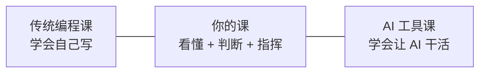
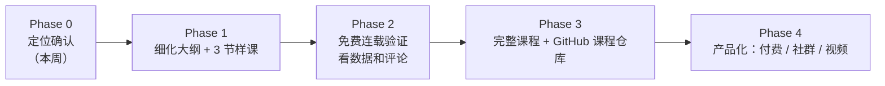

# 零基础「AI 时代代码常识课」调研报告 v0.1

> 调研日期：2026-11-19 ｜ 状态：初稿，等你确认方向后进入大纲细化

---

## 一、一句话结论

**这个想法有市场，但"教工具"和"教 Python"这两个方向都已经很挤了。真正的空白是：教零基础的人"看懂 AI 在做什么、判断它做得对不对"，而不是教他们自己写代码。**

建议定位：**不是编程课，是"给 AI 当监工"的代码常识课**——学完以后，用户能看懂 Codex / Claude Code 要执行的命令、改动的 diff、报错信息和 GitHub 项目页面，并能做出"同意 / 拒绝 / 让它重来"的判断。

---

## 二、市场现状：已有的课在教什么

### 2.1 竞品三大类

| 类型 | 代表 | 教什么 | 缺什么 |
|---|---|---|---|
| **A. AI 工具上手课** | [小白AI编程 7天计划](https://www.aicodeasy.com/course/7-day-ai-coding)（免费，2.5 万+学员）、[雷蒙 24h Claude Code 迷你课](https://lifehacker.tw/courses/24hr-claude-code-tutorial)（NT\$1,599，6,000+学员，5.0 分）、[CC for Everyone](https://ccforeveryone.com/)（英文免费）、B 站大量"Claude Code 从入门到精通" | 装工具 → 让 AI 做出第一个网页 / 搭 AI 助理 / Skills / 部署上线 | 只教"怎么让 AI 干活"，**不教"怎么看懂 AI 干了什么"**；GitHub 通常只占 1 节课 |
| **B. 传统编程入门** | 廖雪峰 Python、菜鸟教程、B 站 Python 零基础、CS50P | 系统学"自己写代码" | 为"写代码"设计，太长、太细；对只想用 AI 的人来说 80% 内容用不上 |
| **C. Git/GitHub 课** | [GitHub Skills 官方](https://learn.github.com/skills)、Microsoft Learn、Coursera Google 课 | 面向开发者的版本控制 | 默认你会写代码、会用终端；英文为主 |

### 2.2 值得借鉴的做法

- **雷蒙**：课程内容放在私有 GitHub Repo 里，"课是买给你的 AI 学的"——学员把教材丢给 AI，AI 引导学员。顺带把 GitHub 也教了。
- **CC for Everyone**：课在 Claude Code 内部进行，输入 `/start-1-1` 由 AI 逐课带练。
- **小白AI编程**：每天一个明确任务 + 真实截图 + Windows/Mac 双版本，最后一定有"能打开的作品"。

### 2.3 用户真实痛点（来自评论区、Reddit、行业报告）

1. **"做出来了，但不知道做了什么"**——东西能跑，一出问题就完全无法排查（Reddit r/vibecoding 高频抱怨）。
2. **看不懂 AI 的权限请求**——AI 问"是否允许执行 `rm -rf` / `git push --force`"时只能盲点同意。
3. **环境与报错**——Windows 路径、依赖安装、Traceback 报错是新手流失的第一大坑（雷蒙课评论区多条 Windows 提问）。
4. **安全**——GitLab 2025 调查：73% 的受访者遇到过 vibe coding 代码带来的问题；多份报告指出 AI 生成代码的安全漏洞率显著更高。零基础用户把 API Key 推到公开仓库是常见事故。
5. **工具更新太快怕白学**——学员普遍担心"今天学 Claude Code，明天换工具"。

---

## 三、差异化定位建议

| 维度 | 建议 |
|---|---|
| **核心能力** | "读"大于"写"：读命令、读 diff、读报错、读 GitHub 页面、读项目结构 |
| **Python 的角色** | 不追求会写，只学"读懂 AI 写的 Python 所需的最小子集"（约 10 个概念） |
| **工具中立** | 概念课通用，Codex / Claude Code 只在操作附录里分别演示 → 解决"怕白学" |
| **你的优势** | 你已经有一整套 Codex 实战系列文章 + 内容 Pipeline，可直接作为真实案例和分发渠道 |

**备选课名**：《看懂 AI 写的代码》《给 AI 当监工：零基础代码常识》《AI 时代的代码常识课》

---

## 四、初版课程大纲（v0.1）

> 设计原则：每个模块都回答"这能帮我在用 AI 时少踩什么坑"。

### M0 心智模型（1 课）
- AI 编程工具在你电脑上到底做了什么：**读文件 → 改文件 → 跑命令 → 看结果 → 再改** 的循环
- 为什么你需要懂一点：你是"产品经理 + 验收人"

### M1 电脑基本功（3–4 课）
- 文件、文件夹、路径、扩展名、隐藏文件（`.env`、`.git`）
- 终端是什么；10 个必会命令：`pwd` `ls` `cd` `mkdir` `cat` `cp` `mv` `rm` `which` `clear`
- **危险命令识别表**：`rm -rf`、`sudo`、`git push --force`、`curl ... | sh` —— AI 请求权限时怎么判断

### M2 读懂 Python（6–8 课）
| 概念 | 对应场景 |
|---|---|
| 变量、字符串、数字 | 看懂 AI 改了哪个"设置值" |
| 列表、字典 | 看懂数据长什么样（JSON 的近亲） |
| `if` 判断 | 看懂"什么情况下会做什么" |
| `for` 循环 | 看懂"批量处理" |
| 函数 | 看懂代码被拆成了哪些"功能块" |
| `import` 与第三方库 | 看懂为什么要 `pip install` |
| 读写文件 | 最常见的自动化场景 |
| **读报错（Traceback）** | 从最后一行往上读；把报错正确交给 AI |

每课练习固定为：**让 AI 写一段 → 你逐行解释 → 你手动改一处 → 运行验证**。

### M3 一个项目长什么样（3 课）
- 项目结构、`README.md`、`requirements.txt` / `package.json`
- 依赖、虚拟环境（`venv`）——"为什么在我电脑上跑不起来"
- 配置文件三件套：Markdown / JSON / YAML；`.env` 与密钥安全

### M4 Git 与 GitHub（6–7 课）
- **Git 概念**（用"游戏存档"类比）：commit、diff、branch、merge、回滚
- **GitHub 页面逐个讲**：

| 页面/按钮 | 一句话解释 |
|---|---|
| Code | 项目文件本体 |
| Issues | 待办 / 问题 / 需求清单 |
| Pull requests | "我改好了，请审核后合并" |
| Actions | 自动执行的机器人（测试、定时任务、部署） |
| Projects | 看板式项目管理 |
| Releases | 打包好的正式版本 |
| Security | 依赖漏洞、泄露密钥提醒 |
| Insights | 项目活跃度数据 |
| Settings | 权限、公开/私有、分支保护 |
| Star / Fork / Watch | 收藏 / 复制一份自己的 / 订阅更新 |
| README / License / `.gitignore` | 说明书 / 使用授权 / 不上传清单 |

- **实用技能**：如何判断一个开源项目靠不靠谱（Star、最近提交、Issues 活跃度、License）；把 GitHub 项目交给 AI 帮你跑起来

### M5 和 AI 协作（4 课）
- 如何描述需求；先让 AI 出计划再动手
- 让 AI 解释代码 / 解释它的改动；**审 diff** 的方法
- `AGENTS.md` / `CLAUDE.md`：给 AI 的项目说明书
- 安全红线清单：密钥、删除、生产数据、付费 API

### M6 毕业项目（1–2 课）
- 用 Python 做一个自己的小工具（批量重命名 / 整理表格 / 抓取 RSS 等）
- 推到 GitHub → 开 Issue → 让 AI 提 PR → 你审核合并 → 可选用 Actions 定时运行
- **整个 GitHub 工作流在一个真实项目里走一遍**

> 合计约 25–30 课，每课 15–30 分钟。

---

## 五、单课模板（建议）

1. **场景钩子**：一个真实的 AI 协作截图（"Codex 问我要不要执行这条命令…"）
2. **概念**：一个生活类比 + 最少术语
3. **现场看**：AI 实际操作的录屏 / 截图
4. **你来读**：给一段代码/命令/页面，让学员解释
5. **小检查**：3 道判断题（"这个命令该不该同意？"）
6. **带走一张卡**：速查卡片（适合小红书单独分发）

---

## 六、交付形式建议

| 形式 | 优点 | 建议 |
|---|---|---|
| **图文（公众号 / 知乎 / 小红书）** | 与你现有 Pipeline 完全匹配，成本最低 | ✅ 第一阶段主力 |
| **GitHub 仓库作为课程载体** | 学课的过程本身就是学 GitHub；可加 `AGENTS.md` 让学员在 Codex 里说"开始第 1 课" | ✅ 核心差异点 |
| 视频 | 获客强，但制作成本高 | 第二阶段再考虑 |
| 互动网页 | 体验最好 | 后期产品化 |

---

## 七、分步推进计划

| 阶段 | 产出 | 验证指标 |
|---|---|---|
| P0 | 定位、目标人群、主工具、形式 | 你拍板 |
| P1 | 完整大纲 + 3 节样课（建议 M0、M1-危险命令、M4-GitHub 页面导览） | 找 3–5 个零基础朋友试读，记录卡点 |
| P2 | 连载 6–8 篇 | 收藏率、评论里的"看懂了/没看懂"、新增关注 |
| P3 | 全部 25–30 课 + 课程仓库 | 完课率、毕业项目提交数 |
| P4 | 定价与交付 | 转化率 |

---

## 八、风险

> [!WARNING]
> - **工具迭代快**：界面截图半年就过时 → 概念与操作分离，操作部分集中在可替换的附录。
> - **国内网络与账号门槛**：Claude / OpenAI 注册对零基础用户是第一道坎 → 需决定是否纳入国产工具（如 Trae、Qoder 等）作为备选。
> - **Windows 环境**：大量新手卡在 Windows → 至少需要 Mac / Windows 双版本截图。
> - **竞品已有用户心智**：小白AI编程、雷蒙已占据"上手"位置 → 必须守住"看懂 + 判断"这一差异，不要滑向"又一门 Claude Code 教程"。
